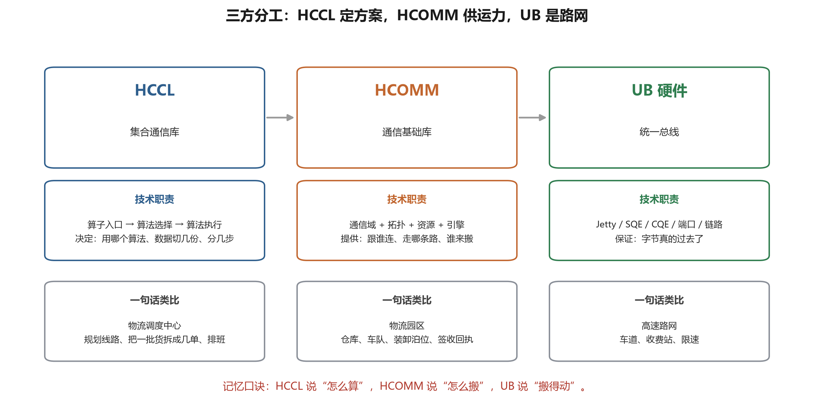
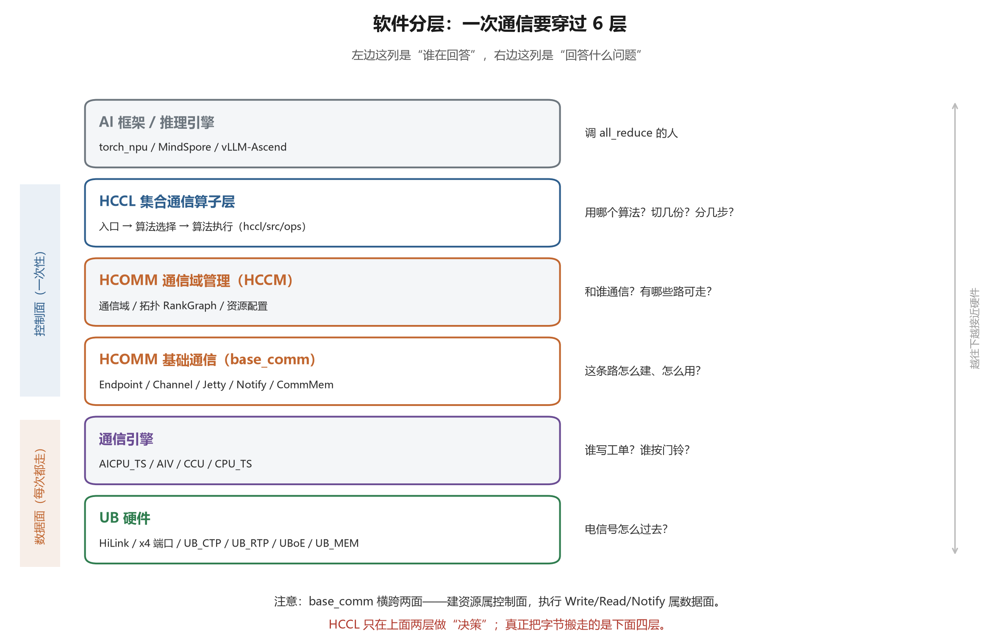
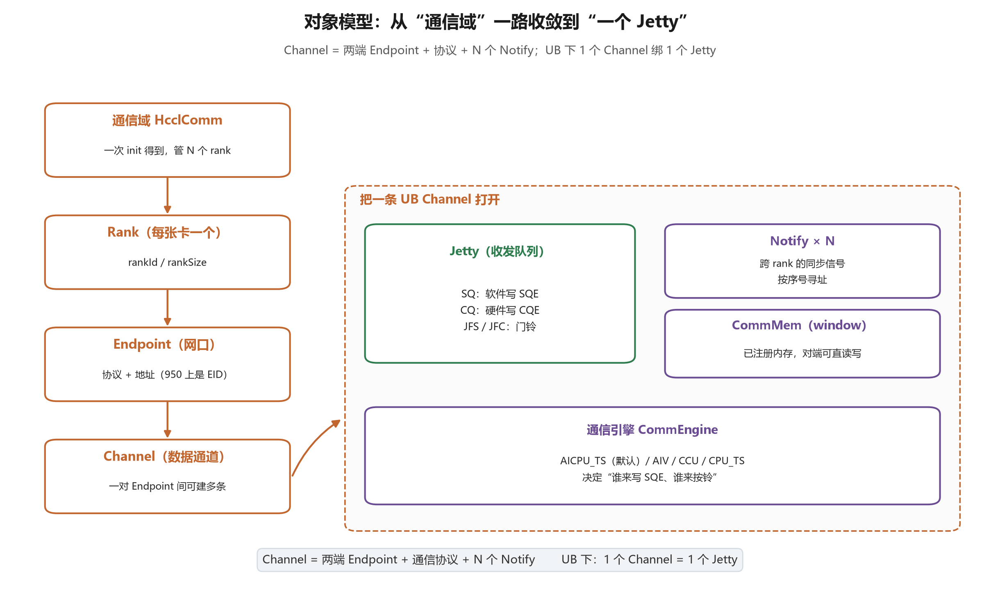
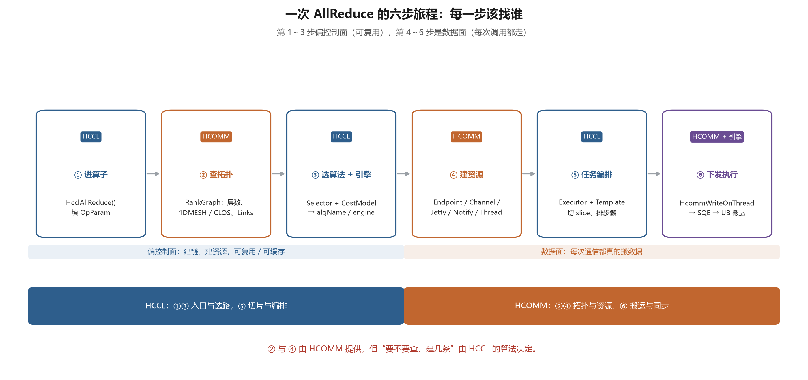
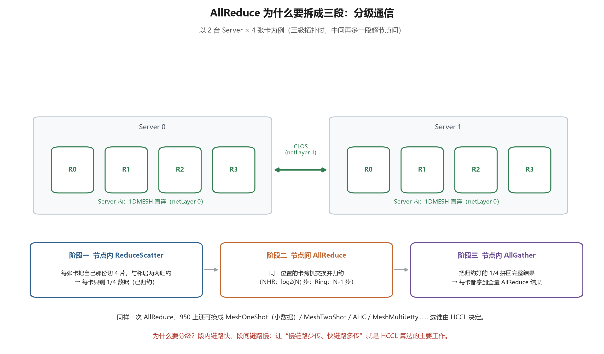
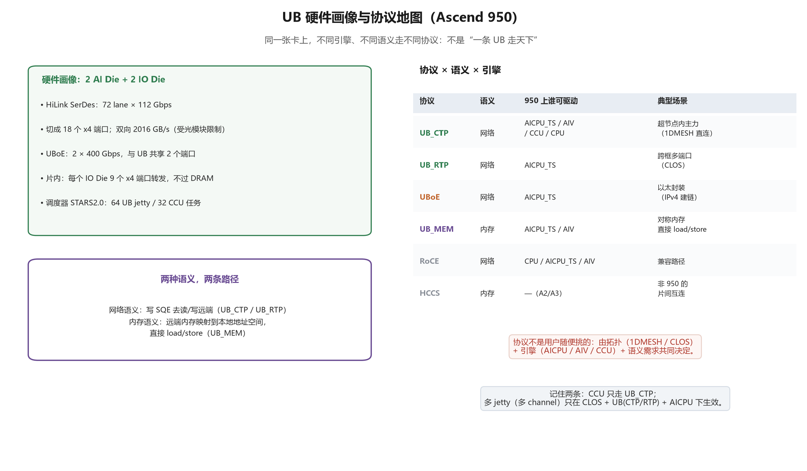
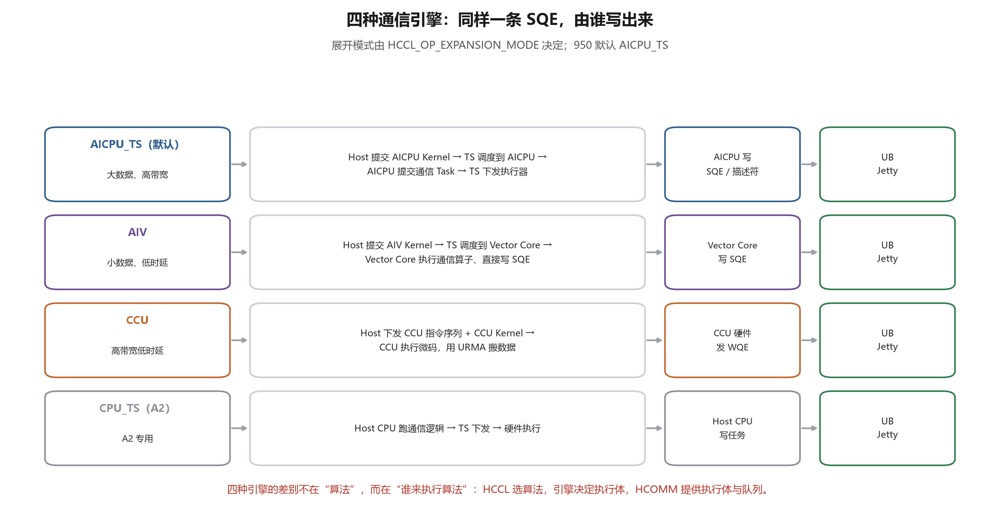
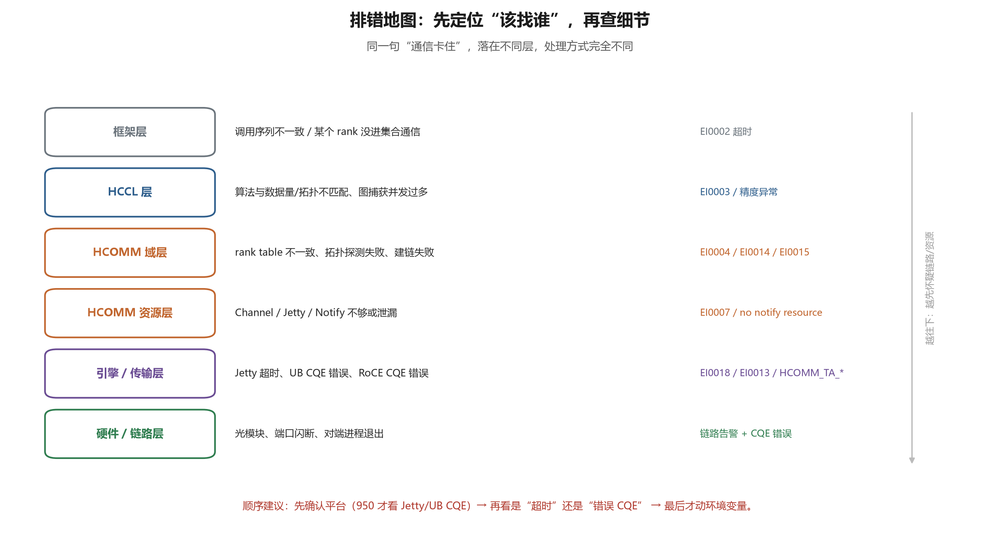

# HCCL 与 HCOMM 在通信流程中的分工：从一次 AllReduce 说起（UB 篇）

> **怎么读**：开篇的"三句话结论"与第 1～2 节建立整体直觉（谁管什么、分成几层）；第 3～4 节按"控制面 / 数据面"把一次 AllReduce 拆成六步，逐步看每一层做了什么；第 5 节专门讲 UB（统一总线）上的硬件、协议、引擎与 Jetty；第 6～8 节是代码链路、排错地图与常见误解；第 9～10 节是术语表与证据来源。
>
> **平台边界**：本文的 UB 细节以 **Ascend 950PR / 950DT（A5）** 为准。在 Atlas A2 / A3 上，这套流程的骨架仍然成立（HCCL 选算法、HCOMM 管域和资源），但传输对象是 **SDMA / RoCE QP / HCCS 对称内存**，没有 Jetty、没有 UB_CTP/RTP、也没有 CCU。
>
> **和另一篇的关系**：Jetty 的内部结构（SQ/CQ/SQE/门铃）见 [Jetty.md](Jetty.md)。本文讲的是"**谁决定要建 Jetty、谁去建、谁往里写工单**"，Jetty 只作为流程里的一个零件出现。

---

## 目录

- [一句话结论：三件事，三个人](#一句话结论三件事三个人)
- [1. 直觉：调度中心、物流园、高速路网](#1-直觉调度中心物流园高速路网)
- [2. 分层：一次通信要穿过 6 层](#2-分层一次通信要穿过-6-层)
  - [2.1 每层回答什么问题](#21-每层回答什么问题)
  - [2.2 三条硬约束（新手最该先记住）](#22-三条硬约束新手最该先记住)
- [3. 控制面：先把"路"修好](#3-控制面先把路修好)
  - [3.1 通信域初始化的四个阶段](#31-通信域初始化的四个阶段)
  - [3.2 拓扑建模：RankGraph 的六个概念](#32-拓扑建模rankgraph-的六个概念)
  - [3.3 建资源：Endpoint → Channel → Jetty / Notify](#33-建资源endpoint--channel--jetty--notify)
  - [3.4 950 的特殊之处：拓扑文件与 EID](#34-950-的特殊之处拓扑文件与-eid)
- [4. 数据面：一次 AllReduce 的六步旅程](#4-数据面一次-allreduce-的六步旅程)
  - [为什么 AllReduce 要拆成三段](#为什么-allreduce-要拆成三段)
- [5. UB 专项：硬件、协议、引擎、Jetty](#5-ub-专项硬件协议引擎jetty)
  - [5.1 硬件画像](#51-硬件画像)
  - [5.2 协议地图：网络语义 vs 内存语义](#52-协议地图网络语义-vs-内存语义)
  - [5.3 四种引擎：同样一条 SQE，由谁写出来](#53-四种引擎同样一条-sqe由谁写出来)
  - [5.4 Jetty 在流程中的四个出现位置](#54-jetty-在流程中的四个出现位置)
  - [5.5 对称内存：为什么 UB 上要"免地址交换"](#55-对称内存为什么-ub-上要免地址交换)
- [6. 代码视角：一条 AllReduce 调用链](#6-代码视角一条-allreduce-调用链)
- [7. 分工边界：出问题该找谁](#7-分工边界出问题该找谁)
- [8. 新手最容易误解的 8 件事](#8-新手最容易误解的-8-件事)
- [9. 术语表](#9-术语表)
- [10. 证据来源与等级](#10-证据来源与等级)

---

## 一句话结论：三件事，三个人

一次集合通信，本质上是回答三个问题：

| 问题 | 谁回答 | 关键词 |
|---|---|---|
| **算什么、怎么切、分几步？** | **HCCL** | 集合语义、算法、选择器、执行器、模板 |
| **跟谁连、走哪条路、谁来搬？** | **HCOMM** | 通信域、拓扑 RankGraph、Endpoint/Channel/Jetty、引擎、原语 |
| **电信号怎么过去？** | **UB 硬件** | HiLink、x4 端口、UB_CTP/UB_RTP/UBoE/UB_MEM |

把这三句话记住，后面所有细节都只是它们的展开。

再补一句最容易混淆的：**HCOMM 不是"HCCL 的下半身"，而是 HCCL 与 HCOMM 两仓通过 `dlsym` 动态解耦**（[D1] 第 3 章"软件架构约束"）。所以你在日志里看到两个仓各自的目录、各自的版本号，是正常的。

---

## 1. 直觉：调度中心、物流园、高速路网



> **图 1** 左中右分别是 HCCL、HCOMM、UB。上排是角色，中排是技术职责，下排是生活类比。

用寄一批货来理解：

- **HCCL = 物流调度中心**。它不碰卡车，也不修路。它做的事是：这批货要发给谁、拆成几单、每单走哪条线路、先发哪单后发哪单。换成通信语言就是：**用哪个算法、数据切几片、分几步走、每步读写哪一段**。
- **HCOMM = 物流园区**。它提供仓库（CommMem）、车队和司机（通信引擎）、装卸泊位（Jetty/Channel）、签收回执（Notify/CQE）。它不关心你这批货是梯度还是 KV cache，只负责"你把货交给我，我按单子搬过去"。
- **UB = 高速路网**。车道多少、限速多少、哪里是收费站，决定了"最快能多快"。它不认识 AllReduce，只认识"从 A 地址搬到 B 地址，搬 N 字节"。

这个分工不是拍脑袋，而是工程上的必然：**算法要跟着模型和并行策略变，搬运要跟着硬件换代变**。把两者拆开，HCCL 换算法时不用动 HCOMM，UB 换代时（A2/A3 的 SDMA/RoCE → 950 的 Jetty）也不用重写所有集合通信算子。这正是文档里"控制面/数据面分离、HCCL 与 HCOMM 解耦"这两条约束的由来（[D1] 第 3 章）。

---

## 2. 分层：一次通信要穿过 6 层



> **图 2** 自下而上看：UB 硬件提供链路；通信引擎负责"谁来执行"；HCOMM 两层分别管"域与拓扑"和"资源与原语"；最上面是 HCCL 的算子层和 AI 框架。

### 2.1 每层回答什么问题

| 层 | 你可以把它理解成 | 它回答的问题 | 代码仓 |
|---|---|---|---|
| AI 框架 / 推理引擎 | 下单的客户 | 我要一次 AllReduce | PyTorch + torch_npu、MindSpore、vLLM-Ascend |
| **HCCL 集合通信算子** | 调度中心 | 用哪个算法？切几份？分几步？ | `hccl`（`src/ops/`） |
| **HCOMM 通信域管理（HCCM）** | 物流园管理处 | 和谁通信？有哪些路？有哪些资源？ | `hcomm/src/coll_communicator_mgr/` |
| **HCOMM 基础通信（base_comm）** | 仓库 + 车队 + 泊位 | 这条路怎么建、怎么用？ | `hcomm/src/base_comm/` |
| 通信引擎 | 司机 | 谁写工单？谁按门铃？ | AICPU_TS / AIV / CCU / CPU_TS |
| UB 硬件 | 高速路网 | 电信号怎么过去？ | HiLink / x4 端口 / UB 协议 |

这张表来自 [D1] 第 3.1 节和 [D2] 第 3.1 节（两份文档同源）。**注意第三、四层都是 HCOMM**：HCCM 管"域、拓扑、资源配置"，base_comm 管"原语和资源实体"。新手常把 HCOMM 当成一个整体，其实它内部还有一条清晰的分界：**HCCM 做"规划"，base_comm 做"执行"**（[D2] 第 1 章、第 3 章）。

### 2.2 三条硬约束（新手最该先记住）

1. **依赖方向单向**：`base_comm` 不能反向依赖 `coll_communicator_mgr`；这两层都不能反向依赖 HCCL 的算子层（[D1] "软件架构约束"）。
2. **控制面 / 数据面分离**：资源管理、拓扑查询属于控制面；数据搬运（Write/Read/Reduce）与同步（Notify）属于数据面。两层接口独立演进（[D1] 同节；[D19] 也有同样的表述）。
3. **两仓用 `dlsym` 解耦**：HCCL 不 `#include` HCOMM 私有头，而是通过符号表动态加载 HCOMM 接口（[D1] 同节；源码见 [C8] `src/common/hcomm_dlsym/`）。

> **新手提示**：这三条约束解释了你在实际工程里看到的很多"怪现象"——比如为什么 HCCL 报错信息里会出现 HCOMM 的符号名，为什么升级 HCOMM 不用重编 HCCL，为什么"建资源"和"搬数据"的接口风格完全不同。

---

## 3. 控制面：先把"路"修好

控制面是**一次性**的：通信域初始化、拓扑发现、建链、注册内存，通常只在进程启动或通信域创建时做一遍。做完之后，数据面每次通信只需"填单、按铃"。

### 3.1 通信域初始化的四个阶段

通信域（`HcclComm`）是"一次集合通信的上下文"，它管理参与通信的 rank 和所有资源。初始化分四段（[D13]）：

| 阶段 | 做什么 | 典型失败码 |
|---|---|---|
| ① 环境变量初始化 | 解析并校验 HCCL 环境变量 | EI0001 |
| ② 资源初始化 | 建通信所需的本地资源 | — |
| ③ 获取整个通信域的集群信息 | **两条路**：读 rank table 文件，或基于 root 节点做集群协商（Host 网卡建 socket 汇聚信息） | EI0004 / EI0014 / EI0015 / EI0019 |
| ④ 集群信息校验 | 查 IP 是否重复、IPv4/IPv6 是否混用、TLS 配置是否一致 | EI0001 / EI0016 |

两个容易踩的点：

- **rank table 的一致性校验不在初始化阶段**。文档明确说：HCCL 会在**后续算子的参数面建链过程**中做 rank 间 rank table 一致性校验，不一致就终止业务（[D13]）。
- **初始化成功 ≠ 链路已建好**。初始化只拿到"集群信息和资源"；文档把真正的建链称为**参数面建链**，它发生在后续算子执行、按算法需求申请 Channel 的时候（[D13]）。

### 3.2 拓扑建模：RankGraph 的六个概念

HCCM 把"谁和谁怎么连"建模成一张带层级的图，叫 **RankGraph**（[D1] 2.2 节、[D6]）：

| 概念 | 一句话 | 类比 |
|---|---|---|
| **Node** | 图节点，分通信实体与 Fabric（交换/路由抽象） | 带网口的 NPU / 交换机组 |
| **Endpoint** | Node 的逻辑端口，一个 Node 可有多个 | NPU 上的网口 |
| **Edge** | Node 间的连接关系（对应 NCCL 的 Link） | 网线 |
| **Link** | 从 Edge 提取的"可建链信息"（两端 Endpoint + 协议） | 建链路径描述 |
| **netLayer** | 拓扑层级，层级越外通信质量越差 | Server 内是 Layer0，跨机经交换机是 Layer1 |
| **TopoInstance** | 每层内的拓扑实例 | 8 卡组成一个 1DMesh 实例 |

记忆链条：**Edge 说"谁和谁连" → Link 说"怎么建链" → Channel 说"怎么通信" → Jetty 说"用哪套队列"**。

为什么 HCCL 一定要先查拓扑？文档给的理由很实在：**建 Channel 需要知道"不同 rank 是否互连、通过哪些 Endpoint 互连"**；而算法性能与拓扑强相关，不感知拓扑就没法适配不同集群形态（[D6] 开篇）。

### 3.3 建资源：Endpoint → Channel → Jetty / Notify



> **图 3** 左边是从通信域到 Channel 的收敛路径；右边把一条 UB Channel 打开：里面是 Jetty、N 个 Notify、注册内存，以及"谁来驱动它们"的通信引擎。

组合公式（[D1] 2.3 节、[D3]）：

```text
Channel = 两端 Endpoint + 通信协议 + N 个 Notify
```

逐项说明（[D3]）：

- **Endpoint（通信设备）**：网络通信的逻辑接口，包含协议与地址；一个 Endpoint 可能包含多个物理口（Bonding），一个物理口也可被多个 Endpoint 共享。
- **Channel（通信通道）**：真正可用的数据通道。**一对 Endpoint 之间可以建多条 Channel**。建 Channel 时本端与远端要同步调用，并交换各自注册的内存信息。
- **CommMem（通信内存）**：注册给通信域、允许对端访问的内存段。SQE 里写的目标地址必须落在这种已注册内存（window）里。
- **Notify**：同步信号的抽象，按序号寻址。**它在不同引擎下的实现不同**：AICPU/CPU_TS 下是 NPU 的 Notify 寄存器，AIV 下是 Device 内存里的软同步标记（每个标记约 32 Byte），CCU 下是同步寄存器（[D3]、[D5]、[D20]）。

在 UB 协议下，**1 条 Channel 绑定 1 个 Jetty**（[D1] 2.3 节；[D11] 也明确"每个 channel 底层对应一个独立 jetty"）。换成 RoCE，同一个 Channel 概念底下就是 1 到 N 个 QP。

> **新手提示**：建 Channel 是"双向配合"的动作——数据面可以单边（对端全程不参与搬运），但**建链阶段双方必须握手**。这一点在排障时很关键：单边通信卡住，先查对端有没有一起建链。

### 3.4 950 的特殊之处：拓扑文件与 EID

A5 的 rank table 和 A2/A3 长得不一样，有三点必须知道（[D12]）：

1. **必须配合拓扑文件**。950 的 rank table 必须配 `/usr/local/Ascend/driver/topo/` 下的拓扑文件才能初始化通信域；该文件出厂自动配置，用户不手改（物理拓扑 + 路由）。
2. **两层结构**：`net_layer 0` 是 Server 内，`PEER2PEER` + `topo_type: "1DMESH"`（Device 间直连、全互联）；`net_layer 1` 是 Server 间，`PEER2NET` + `topo_type: "CLOS"`（经交换机），示例里一条链路列了 6 个端口（Die0 的 4~7 号口 + Die1 的 5~6 号口）。
3. **地址是 EID，不是 IP**。950 的 UB 设备地址由 HCCN TOOL 查询得到；rank table 的 `addr_type` 可选 EID（Device 侧）或 IPv4/IPv6（仅 Host 网卡）。协议枚举里同时列了 `UB_CTP / UB_RTP / ROCE / HCCS / TCP / UB_MEM / UBOE`，但示例中 Server 内与 Server 间**都填 `UB_CTP`**。

还有一个数字值得记住：拓扑文件里 `peer_count` 取值 `[1, 65]`，即单个 AI Server 最多 65 个 NPU——这就是"超节点"量级的由来（[D12]）。

---

## 4. 数据面：一次 AllReduce 的六步旅程



> **图 4** 六步里，①③⑤ 是 HCCL 的决策，②④⑥ 是 HCOMM 的能力。注意 ② 和 ④ 虽然由 HCOMM 提供接口，但"要不要查、建几条"是 HCCL 的算法决定的。

这六步不是我编的，它对应 HCOMM 文档给算子开发者的标准流程：**定义算子接口 → 查询拓扑 → 算法选择 → 创建资源 → 任务编排 → 算子下发**（[D7]）。HCCL 的内置算子，本质上就是把这六步写死在 C++ 里。

### 第①步 进算子：HCCL 的门口

```c
HcclResult HcclAllReduce(void *sendBuf, void *recvBuf, uint64_t count,
                         HcclDataType dataType, HcclReduceOp op,
                         HcclComm comm, aclrtStream stream);
```

一次调用进来，HCCL 先做三件事：校验参数、把 `sendBuf/recvBuf/count/dataType/op` 填进统一的 `OpParam`、判断该走哪条路径（单卡？图模式？CCU 快速下发？AIV cache 回放？）。**这一步是纯 HCCL 的**，HCOMM 完全不参与（[C1]）。

### 第②步 查拓扑：向 HCOMM 要地图

HCCL 通过 `HcclRankGraphGetLayers` / `HcclRankGraphGetLinks` 这类接口，向 HCOMM 要"这个通信域有几层、每层什么拓扑、我和某个 rank 之间有哪些 Link"（[C10]、[D6]）。

拿到之后，HCCL 会把它压缩成算法好用的视图：`TopoInfoWithNetLayerDetails`（层数、每层实例数、每层实例内 rank 数）+ 物理层拓扑类型（[C2]、[C10]）。

> **新手提示**：拓扑查询返回的内存由库内管理，**调用者严禁释放**；重复调用可能让上一次的结果失效。这是 HCOMM 资源接口的通用约定（[D6] 对应接口页）。

### 第③步 选算法 + 选引擎：HCCL 的大脑

这是 HCCL 最核心的一步，也是 HCOMM 完全不碰的一步。

**输入**：算子类型、数据类型、数据量、reduce 类型、拓扑（层数/拓扑类型/每层卡数）、产品形态、运行模式（[D9]、[C3]）。

**过程**：HCCL 维护一张"算法注册表 + 属性表（`AlgAttrs`）"，选择器按优先级遍历候选算法，用 **CostModel** 估代价，取最小代价者（[C3]）。代价模型的理论基础是 α–β 模型（Hockney）：单步耗时 `D = α + nβ + nγ`，其中 α 是固定时延、β 是每字节传输耗时、γ 是每字节归约耗时（[D8] "耗时评估"）。

**输出**：一个算法名字符串 `algName`，以及**引擎**（`param.engine`）。文档明确："同一集合通信域默认只用一种引擎；**算子开发者通过算法选择器自动选择引擎**"（[D1] 2.4 节）。所以"选算法"和"选引擎"是同一次决策的两个产物。

**HCCL_ALGO 能强制吗？** 在 950 上，**只能给优先级，不能硬绑定**（[D9] "配置生效语义"）：

- 正向指定的算法优先生效；多个正向配置并存时，在指定集合内**按通信代价**选最优。
- 配置写错**不阻断通信**：格式错、组合未命中、与场景硬约束不匹配、否定配置排除了全部候选——都会打警告并**回退自适应选择**。

950 上可配的算法族比 A2/A3 丰富得多（[D9]），新手可以先把它们分成三类理解：

| 类别 | 代表算法 | 一句话 |
|---|---|---|
| 基础拓扑算法 | `mesh`、`nhr` | Mesh 一步直连、时延最优；NHR 走 log2(N) 步减半/倍增 |
| Mesh 变体 | `meshoneshot`、`meshtwoshot`、`meshchunk`、`mesh2die`、`meshconcur` | 按数据量/Die 分布/链路类型换不同的切法 |
| 多端口变体 | `meshmultilink`、`nhrmultilink`、`meshmultijetty`、`nhrmultijetty` | 按 port 数或 jetty 数把数据切片并行发 |

执行器（Executor）也有六种：`Sole`（默认，单算法）、`Sequence`（顺序执行 2~3 级算法）、`Parallel`（两维度并行）、`PipeLine`、`Concur`、`StrictOrdered`（[D9]）。**"执行器"这个词很关键**：它决定了"分几级、哪几级串行、哪几级并行"。

### 第④步 建资源：HCOMM 的仓库

算法定了，HCCL 就知道自己要什么资源：要跟哪几个 rank 建 Channel、每条 Channel 要几个 Notify、要几个 Thread、要多大 scratch。于是它向 HCOMM 下"资源订单"：

| 订单 | HCOMM 接口（示意） | 说明 |
|---|---|---|
| 建链 | `HcclChannelAcquire` / `HcommChannelCreate` | 传入 `HcclChannelDesc`（远端 rank、协议、要交换的内存句柄、Notify 数） |
| 申请线程 | `HcclThreadAcquire` / `HcclThreadAcquireWithStream` | 通信任务的执行上下文；AIV 不用 Thread |
| 注册内存 | `HcclCommMemReg` / `HcommMemReg` | 把 buffer 注册进通信域，供对端直接读写 |
| 引擎上下文 | `HcclEngineCtxCreate/Get` | 存放资源句柄，创建一次可反复取用 |

几条容易忽略的约束（[D23]、[D20]、[D22]）：

- **Channel 复用判据**是 `commId + engine + remoteRank + channelProtocol`；同一通信域内**不支持并发调用**建链接口，必须串行。
- **Notify 数量**在 `channelDesc.notifyNum` 里指定，范围 0~64；CCU 引擎默认分配 4 个。
- **共享 Jetty**：设置 `IS_SHARED_QUEUE=true` 并给相同 tag，多条 Channel 可复用同一个底层 Jetty，用于"频繁建链/销毁"的场景；但**只支持 AIV 引擎、只支持 UB 网络语义（UB_CTP/UB_RTP）**，且共享同一 Jetty 的 Channel **不能并发使用**（[D22]）。

### 第⑤步 任务编排：把算法变成"第几步搬哪一段"

这是 HCCL 里最"算法"的一步，也是新手看源码最容易迷路的地方。

- **Executor** 负责"编排"：算出每轮能处理多少数据（受 HCCL Buffer 预算限制）、要循环几轮，然后把每轮的参数交给模板（[C4]、[C5]）。
- **Template** 负责"展开"：比如 NHR 模板会把一次 AllReduce 展开成"ReduceScatter 相位 + AllGather 相位"的步骤表，每一步算出"跟谁、读哪段、写哪段、发不发通知"（[C6]）。
- **Planner** 只算"谁和谁交换哪四组 slice"，**不执行通信、不管理资源**；真正执行 Read/Write/Reduce/Notify 的是模板（[D17]）。

一个典型模板的 `KernelRun` 骨架是四段（[D17]）：

```text
PreCopy → RunAlgorithm（规划） → SendAll / ReduceAll（搬运） → PostCopy
```

> **新手提示**：源码里**没有** `Task` / `WriteTask` 这种"任务对象"（这是很多人从 NCCL 带来的直觉）。HCCL v2 用 `DataSlice` / `SlicesList` / `SendRecvReduceInfo` 这类结构描述"要搬什么"，到下发时才翻译成 HCOMM 原语（[C7]）。所以"任务编排"是**数据结构的编排**，不是对象树的编排。

### 第⑥步 下发执行：从函数调用到一条 SQE

这是 HCCL 与 HCOMM 真正"交接"的地方。HCCL 的下发封装（wrapper）把每个 slice 翻译成 HCOMM 数据面调用，例如：

```cpp
/* HCCL 侧：把"第 k 步、写给 rank r 的这段数据"翻译成一次 HCOMM 写 */
CHK_RET(static_cast<HcclResult>(
    HcommWriteOnThread(thread, sendChannel.handle, dst, src, srcSlice.size_)));
```

（[C7]；`HcommWriteOnThread` 这一族原语的语义见 HCOMM 数据面接口。）

再往上，HCOMM 把这次调用交给**通信引擎**：

- **AICPU_TS**（950 默认）：Host 提 AICPU Kernel → TS 调度到 AICPU → AICPU 提交通信 Task → TS 下发执行器（[D4]）。
- **AIV**：Host 提 AIV Kernel → Vector Core 直接执行通信算子、直接写 SQE（[D4]）。
- **CCU**：Host 下发 CCU 指令序列 → CCU 执行微码，用 URMA 搬数据；`CCU_SCHED` 模式下 CCU 直接向 UB 引擎调度 UB WQE（[D4]、[D10]）。

到硬件这一层，就是我们熟悉的那套：**软件写 SQE、推进 PI、敲 doorbell；硬件搬数据、写 CQE；软件轮询 CQE**（详见 [Jetty.md](Jetty.md) 第 5 节）。

**完成不等于"函数返回"**。HCCL 的 `HcclAllReduce` 在 AICPU_TS 下返回时，只代表"任务已经提交"，不代表"数据已经到对端"。要判断完成，要么等 Stream 同步，要么靠 Notify/CQE。这就是为什么"通信 hang"往往发生在下一步而不是调用当场。

### 为什么 AllReduce 要拆成三段



> **图 5** 2 台 Server × 4 卡：先在节点内 ReduceScatter，再跨节点 AllReduce，最后节点内 AllGather。

因为集群天然分层，**层内链路快、层间链路慢**。HCCL 的做法是"分级通信"：慢链路只传必须传的部分，快链路负责扇出（[D8] "分级通信原理"；[D24] 给了逐算子的分级流程示例）。

以 A2 的单算子模式为例，AllReduce = 节点内 ReduceScatter → 节点间 AllReduce → 节点内 AllGather（[D8] 表）。到 950 上，骨架不变，但每级可选算法更多：RFC 给出的两层组合是"Server 内 Mesh + 跨 Server NHR"，三层再叠加"跨超节点 NHR"（[D17]）；落到 `HCCL_ALGO` 上，节点内多是 `mesh` / `mesh2die` / `meshchunk` 一族，节点间多是 `nhr` / `nhrmultijetty` 一族，还可以用 `sequence{mesh,nhr}` 或 `parallel{mesh,nhr}` 指定串行/并行执行器（[D9]）。**950 上 `level0/level1` 与"Server 内/间"的显式对应，文档没有像 A2/A3 那样写死，实际映射以拓扑和日志为准。**

**这就是"算法"存在的意义**：不是把数据从 A 搬到 B 那么简单，而是在给定拓扑和带宽比的前提下，决定"传多少、传几轮、走哪条链路"。

---

## 5. UB 专项：硬件、协议、引擎、Jetty



> **图 6** 左上是 950 的 UB 硬件画像；左下是两种语义；右边是"协议 × 语义 × 引擎"的对应关系。

### 5.1 硬件画像

按 950 架构白皮书口径（[D16]）：

| 项目 | 数值 |
|---|---|
| UB 版本 | UB 2.0 |
| SerDes | 72 lane HiLink，每 lane 最高 112 Gbps |
| 端口 | 划分为 **18 个 x4 端口**；双向 **2016 GB/s**（受光模块限制） |
| UBoE | 2 × 400 Gbps，与 UB **共享 2 个端口** |
| 片内交换 | 每个 IO Die **9 个 x4 端口**转发，**不过 DRAM** |
| 调度器 | STARS2.0：**64 UB jetty**、32 CCU 任务、2048 任务流、16 AI-CPU + 64 Host-CPU |

两个"原来如此"：

- **为什么 950 上要有 Jetty**：因为 UB 的传输对象就是 Jetty（SQE/CQE 那套）。A2/A3 没有 UB，自然没有 Jetty，只有 SDMA task 和 RoCE QP。
- **为什么 CCU 目前只做单机**：CCU 在 IO Die 上，受片上资源和 Die 归属限制；现有 CCU 展开配置也都限定在单机场景（[D10]），跨机请按 AICPU 路径理解。

### 5.2 协议地图：网络语义 vs 内存语义

UB 上有两条完全不同的编程路径（[D1] 2.3.1 节、[D3]）：

| | 网络语义 | 内存语义 |
|---|---|---|
| 核心对象 | Channel + Jetty + Notify | 通信设备 + **映射内存** |
| 操作方式 | Write / Read / Notify / Atomic | 本地 load/store、原子操作 |
| 通信模型 | 单边或双边 | 单边（只需一端发起） |
| 适用协议 | **UB_CTP、UB_RTP**、RoCE | **UB_MEM**、HCCS |

新手最容易混的地方：看到"单边"就以为两者一样。区别在于**谁在指挥搬运**——网络语义由 SQE 指挥，内存语义由访存指令指挥。

协议枚举与引擎的对应关系（950，[D14]）：

| 协议 | 枚举值 | 语义 | 950 上可驱动的引擎 |
|---|---|---|---|
| `UB_CTP`（别名 `UBC_CTP`） | 4 | 网络 | CPU / AICPU_TS / AIV / **CCU** |
| `UB_RTP`（别名 `UBG`） | 9 | 网络 | AICPU_TS |
| `UBoE` | 7 | 网络 | AICPU_TS |
| `UB_MEM` | 6 | 内存 | AICPU_TS / AIV |
| `RoCE` | 1 | 网络 | CPU / AICPU_TS / AIV |
| `HCCS` | 0 | 内存 | 仅 A2/A3 |

> **注意**：不同接口页的"引擎 × 协议"矩阵有细微出入（例如 `HcclChannelAcquire` 页与 `CommProtocol` 页对 AICPU_TS 是否支持 `UB_MEM` 的写法不完全一致）。写代码或排查时，**以你实际调用的那个接口页为准**；本文表格用于建立直觉，不作为契约。

### 5.3 四种引擎：同样一条 SQE，由谁写出来



> **图 7** 四种引擎的差别不在"算法"，而在"谁来执行算法"。

| 引擎 | 谁执行 | 怎么下发 | 代价 | 适合 |
|---|---|---|---|---|
| **AICPU_TS**（950 默认） | AI CPU 跑 Kernel，TS 调度 | AICPU 提交通信 Task 描述符 | 不占计算核，静态开销大 | 大数据、高带宽 |
| **AIV** | Vector Core | Vector Core 直接写 SQE | 占 Vector 核，与计算抢核 | 小数据、低时延 |
| **CCU** | IO Die 上的协处理器 | CCU 指令序列，URMA 搬运 | 省核省带宽，但片上资源有限、支持的通信域少 | 高带宽低时延（单机） |
| **CPU_TS** | Host CPU | Host 提交任务，TS 下发 | 下发开销随任务数线性增加 | A2 专用 |

选择它们的环境变量是 `HCCL_OP_EXPANSION_MODE`（[D10]）：

- 950 上默认 `AICPU_TS`；`AI_CPU` 是旧名，将废弃。
- `AIV` 仅支持**对称组网 + 推理特性**，且不支持多通信域同时配成 AIV。
- `CCU_MS` 用 CcuBuffer 中转，**950PR 不支持**；`CCU_SCHED` 不用 CcuBuffer、直接在两个 rank 间搬片上内存，且**CCU 作为调度器向 UB 引擎下发 UB WQE**。
- 两者都有兜底：**CCU 资源不足时自动切回 AI_CPU 模式**。

> **新手提示**：看到"自动切换"要意识到——**你以为跑在 CCU 上，实际可能已经回落到 AICPU**。做性能对比时必须先确认实际生效的引擎（profiling 或日志）。

### 5.4 Jetty 在流程中的四个出现位置

把本文和 Jetty 那篇接起来，Jetty 在通信流程里其实只出现在四个位置：

1. **选算法时**：多 jetty 变体（`meshmultijetty` / `nhrmultijetty`）把"每个对端建几条 Channel、每条一个 Jetty"写进算法（[D9]）。
2. **建资源时**：Channel 创建 → 底层创建 Jetty；`HCCL_UB_MULTI_CHANNEL_NUM` 控制同一 eid 对之间的 Channel 数，范围 `[1,16]`、默认 1（[D11]）。
3. **下发时**：引擎把 SQE 写进 Jetty 的 SQ，敲门铃；硬件执行后写 CQE。
4. **排障时**：Jetty 超时、UB CQE 错误，对应 `HCOMM_TA_CTP_UB_TIMEOUT` 等环境变量（[D21]）。

`HCCL_UB_MULTI_CHANNEL_NUM` 有三个"生效条件"必须一起满足，缺一不生效（[D11]）：

```text
CLOS 拓扑  +  UB 协议（CTP 或 RTP）  +  算法跑在 AICPU 引擎
```

而且文档说得很直白：**只有在单个 Jetty 就是带宽瓶颈时，加 Channel 才有收益**；单 Jetty 已打满链路带宽，多 Jetty 毫无增益，还会挤占同设备其他通信域的 Jetty 资源。

### 5.5 对称内存：为什么 UB 上要"免地址交换"

对称内存（Symmetric Memory）是 UB/URMA 时代的关键能力：**各 rank 以"全局可见但无需显式地址交换"的方式访问彼此内存**（[D15]）。它的直接收益是：HCCL 可以直接对业务传入的内存做操作，**不用先拷进 HCCL Buffer**，省一次拷贝。

950 上有三种落地方式（[D15]）：

| 场景 | 做法 | 注意 |
|---|---|---|
| AIV + URMA | 注册已申请 Device 内存，配合 `HcclTeamCreate` | 需交换内存句柄 |
| AICPU + URMA | `HcclCommSymWinRegister` 只做本端登记，跨 rank 注册与句柄交换在通道创建时完成 | 不要求对称组网，但各 rank `size` 必须一致 |
| AIV + UB Memory | 预留相同大小、相同布局的虚拟地址实现"对称" | 要求同一通信域内所有 LSA WorldTeam 成员同时调用 |

取远端地址也分两路：URMA 用 `HcclSymWinGetRemoteAddr`，UB Memory 用 `HcclSymWinGetPeerPointer`（后者在 URMA 场景**不支持**）。

> **新手提示**：对称内存不是 950 独有（A3 的 HCCS 也有），但 **950 独有的是"UB Memory 对称内存"场景**——靠预留虚拟地址实现，不需要真的交换地址。

---

## 6. 代码视角：一条 AllReduce 调用链

下面这条链路来自 `cann/hccl` 仓 master 分支的源码阅读（[C1]~[C10]），用于把前面的"六步"落到具体符号上。选择器/执行器为什么要拆成现在这样，可以对照 [D18] 的历史背景一起看。**不同版本会有差异，接口名以你本地的头文件为准**。

```text
HcclAllReduce()                              // [C1] src/ops/all_reduce/all_reduce.cc
  └─ AllReduceOutPlaceCommon()
       ├─ Selector(comm, param, topoInfo, algName)      // [C2] 选算法 + 选引擎
       │    ├─ HcclCalcTopoInfo(...)                     // 把 RankGraph 压成算法视图
       │    └─ SelectorEngine::Run / ExecuteSelector::Run // [C3] CostModel + 候选遍历
       └─ HcclExecOp(comm, param, topoInfo, algName, resPack)
            ├─ GetAlgExec(opType, algName)               // 取执行器
            ├─ executor->CalcRes(...)                    // [C4] 算 Thread/Notify/Channel 需求
            ├─ HcclGetChannel / HcclGetThread            // [C10] 向 HCOMM 要资源（dlsym）
            └─ executor->Orchestrate(...)                // [C5] 编排
                 └─ template->KernelRun(...)             // [C6] 展开成步骤表
                      └─ SendWrite(...)                  // [C7] 翻译成 HCOMM 原语
                           └─ HcommWriteOnThread(...)    // [C8] dlsym 进入 HCOMM
```

三个"看懂这条链"的关键点：

1. **选择器只返回名字**。`Selector` 的产物是 `algName` 字符串和 `param.engine`，它不建资源、不搬数据（[C2]、[C3]）。这就是"决策"与"执行"的分离。
2. **边界是两族弱符号**。控制面是 `HcclChannelQuery` / `HcclThreadAcquireWithConfig` / `HcclChannelGetRemoteMems`；数据面是 `HcommWriteOnThread` / `HcommWriteReduceWithNotifyOnThread` / `HcommChannelNotifyRecordOnThread`（[C8]）。**这一行之上全是 HCCL 的算法语义，这一行之下是 HCOMM 的"把这段字节搬到那个 Channel 的对端"**。
3. **HCOMM 侧不参与算法**。HCOMM 仓里没有 selector、没有 Mesh/NHR 这些算法概念；它只有 Thread 实体（`thread.cc`、`aicpu_ts_thread.cc`、`aiv_thread.cc` 等）和 Endpoint/Channel/内存注册（[C9]）。

> **版本提示**：文档里还在讲 RFC 0003 的 `recursive_executor` 重构（`Selector → HcclExecOp → GetAlgExec → CalcAlgHierarchyInfoV2/CalcRes → Orchestrate`），它属于 experimental 目录、受运行期开关保护，默认关闭（[D17]）。**读源码时以实际被调用的那条路径为准，不要把 experimental 当唯一真相。**

---

## 7. 分工边界：出问题该找谁



> **图 8** 同一句"通信卡住"，落在不同层，处理方式完全不同。

| 现象 / 关键字 | 大概率在哪层 | 先做什么 |
|---|---|---|
| `EI0002` 通信超时 | 框架层 / 通信域 | 对齐各 rank 的调用序列，确认没有 rank 漏进集合通信 |
| 结果不对但通信成功 | HCCL 层 | 查算法与数据类型/数据量是否匹配、是否开了确定性 |
| `EI0004` / `EI0014` / `EI0015` / `EI0019` | HCOMM 域层 | 查 rank table 一致性、拓扑文件、socket 端口 |
| `EI0007` / `no notify resource` | HCOMM 资源层 | 查 Channel/Notify/Jetty 是否泄漏（create/destroy 是否成对） |
| `EI0018` / UB CQE 错误 | 引擎 / 传输层 | 查 UB 链路与对端状态；确认平台是 950 才看 Jetty |
| `EI0013` / RoCE CQE 错误 | 引擎 / 传输层 | A2/A3 场景；查网口闪断、对端进程 |
| `HCOMM_TA_*_UB_TIMEOUT` 相关 | Jetty 传输层 | 看超时档位是否太小（512ms/4s/8s/32s 四档） |
| 性能不达预期 | HCCL 算法 / 引擎 | 先确认实际生效的引擎与算法，再谈环境变量 |

一个实用的排错顺序：

1. **先确认平台**：950 才看 Jetty / UB CQE；A2/A3 看 SDMA / RoCE CQE。别在错误的层上找。
2. **再看是"超时"还是"错误 CQE"**：超时多半是"对端没参与/没回应"；错误 CQE 多半是链路或对端进程挂了。
3. **查资源是否泄漏**：Jetty、Notify、Event 都是有限资源（单芯片 64 个 UB jetty），create 不 destroy 迟早报资源不足。
4. **最后才动环境变量**：调大超时只能掩盖症状，不能解决链路问题。

---

## 8. 新手最容易误解的 8 件事

**1. "HCOMM 是 HCCL 的一部分。"**
不是从属关系，是两个仓、通过 `dlsym` 动态解耦、可独立编译独立版本演进（[D1]）。HCCL 里甚至不 `#include` HCOMM 的私有头。

**2. "HCCL 负责把数据搬过去。"**
HCCL 负责**决定怎么搬**，真正搬数据的是 HCOMM 的原语 + 引擎 + UB 硬件。HCCL 侧代码到 `HcommWriteOnThread` 这一行就交棒了。

**3. "一个 Channel 一定对应一个 Jetty。"**
默认是，但三种情况会打破：多 jetty 算法（N:N）、共享 Jetty 模式（N:1）、CCU 引擎（多 Channel 共享一个 Jetty）。另外共享 Jetty **不能并发使用**（[D22]）。

**4. "HCCL_ALGO 设了就一定生效。"**
在 950 上它只提供**优先级**，最终仍按通信代价在候选集合里选；配错还会回退自适应，只打警告不报错（[D9]）。

**5. "选了 AIV 就一定跑在 AIV 上。"**
AIV 只支持对称组网 + 推理特性，不支持多通信域并行；数据量超阈值、开确定性、或资源不足时都可能回落（[D10]）。

**6. "CCU 就是更快的 AICPU。"**
CCU 是 IO Die 上的专用协处理器，跑微码、用 URMA 搬数，**只支持 UB_CTP、只支持单机**；`CCU_MS` 在 950PR 上还不支持（[D14]、[D10]）。

**7. "多 Jetty 一定更快。"**
只有单 Jetty 是带宽瓶颈时才有收益；单 Jetty 打满链路后加 Jetty 纯属浪费，还会挤占其他通信域（[D11]）。

**8. "建链是数据面的一部分。"**
建链（Channel/Jetty/Notify）是控制面，一次性、可复用；数据面只做 Write/Read/Reduce/Notify。两者接口独立演进，混在一起理解会让你在排障时找错层（[D1]）。

---

## 附：读完自测 5 问

1. 一次 AllReduce 里，谁决定"分几步"？谁决定"走哪条链路"？谁真正把字节搬走？
2. 为什么说 HCOMM 内部还分两层？HCCM 与 base_comm 分别管什么？
3. 950 上 1 条 Channel 对应几个 Jetty？什么情况下不是 1:1？
4. `HCCL_ALGO` 设成 `nhr`，为什么实际还可能跑 `mesh`？
5. 通信卡住时，为什么"先确认平台"比"先调大超时"更重要？

<details>
<summary>参考答案</summary>

1. HCCL 决定分几步（算法 + 执行器 + 模板）；HCCL 也决定走哪条链路（选算法时按拓扑与代价）；真正搬字节的是 HCOMM 的原语 + 通信引擎 + UB 硬件。
2. HCCM 管通信域、拓扑（RankGraph）、资源配置；base_comm 管 Endpoint/Channel/CommMem/Thread 等资源实体与 Write/Read/Reduce/Notify 原语。
3. 默认 1:1。打破 1:1 的三种情况：多 Jetty 算法（N:N）、共享 Jetty 模式（N:1）、CCU 引擎（多 Channel 共享一个 Jetty）。
4. 因为 950 上 `HCCL_ALGO` 只提供**优先级**，最终仍在候选集合里按通信代价选；配置与场景硬约束不匹配时会回退自适应，只打警告。
5. 因为 Jetty / UB CQE 只在 950 存在，A2/A3 上是 SDMA / RoCE CQE；在错误的层上找，既浪费时间又容易误判。调大超时只能掩盖症状。

</details>

---

## 9. 术语表

| 术语 | 解释 |
|---|---|
| HCCL | 昇腾集合通信库，负责集合语义、算法选择与执行编排 |
| HCOMM | 通信基础库，提供通信域、拓扑、资源、原语与引擎 |
| HCCM | HCOMM 的集合通信域管理模块（`coll_communicator_mgr`） |
| RankGraph | 描述 rank 间连接关系的拓扑图（Node/Endpoint/Edge/Link/netLayer） |
| Endpoint | 通信设备的逻辑端口（协议 + 地址），950 上是 EID |
| Channel | 两端 Endpoint 之间的数据通道，`Channel = 两端 Endpoint + 协议 + N Notify` |
| CommMem | 注册到通信域、可被对端访问的内存段（window） |
| Notify | 同步信号抽象；AICPU/CPU_TS 下是 Notify 寄存器，AIV 下是 Device 内存标记，CCU 下是同步寄存器 |
| CommEngine | 通信引擎：AICPU_TS / AIV / CCU / CPU_TS |
| Jetty | UB 上的收发队列对象（SQ + CQ + 门铃），1 Channel 绑 1 Jetty |
| URMA | Unified Remote Memory Access，统一远端内存访问 |
| CCU | Collective Communication Unit，IO Die 上的集合通信加速单元 |
| netLayer | 拓扑层级，层级越外通信质量越差 |
| 展开模式 | 算子在哪个引擎上展开执行，由 `HCCL_OP_EXPANSION_MODE` 控制 |

---

## 10. 证据来源与等级

### 文档来源（相对 `cannbot-knowledge/cann-docs-raw/`）

| 编号 | 路径 |
|---|---|
| [D1] | `hccl/docs/zh/architecture/architecture-brief.md` |
| [D2] | `hcomm/docs/zh/architecture/architecture-brief.md` |
| [D3] | `hcomm/docs/zh/comm_op_dev_guide/prog_models_concepts/comm_model.md` |
| [D4] | `hcomm/docs/zh/comm_op_dev_guide/prog_models_concepts/comm_engine.md` |
| [D5] | `hcomm/docs/zh/comm_op_dev_guide/prog_models_concepts/concurrency_model.md` |
| [D6] | `hcomm/docs/zh/comm_op_dev_guide/prog_models_concepts/topology_model.md` |
| [D7] | `hcomm/docs/zh/comm_op_dev_guide/aiv_comm_op_dev/overall_flow.md` |
| [D8] | `hccl/docs/zh/user_guide/coll_algo_intro/algo_intro.md` |
| [D9] | `hccl/docs/zh/user_guide/hccl_env/HCCL_ALGO.md` |
| [D10] | `hccl/docs/zh/user_guide/hccl_env/HCCL_OP_EXPANSION_MODE.md` |
| [D11] | `hccl/docs/zh/user_guide/hccl_env/HCCL_UB_MULTI_CHANNEL_NUM.md` |
| [D12] | `hccl/docs/zh/user_guide/cluster_info_config/rank_table_config_a5.md` |
| [D13] | `hccl/docs/zh/user_guide/fault_diagnosis/comm_domain_init_flow.md` |
| [D14] | `hcomm/docs/zh/api_ref/comm_opdev/datatype_definition/CommProtocol.md` |
| [D15] | `hcomm/docs/zh/api_ref/comm_mgr_c/HcclCommSymWinRegister.md` |
| [D16] | `knowledge/common/platforms/concepts/ascend950_scheduler_interconnect.md` |
| [D17] | `hccl/docs/zh/rfcs/0003-executor-template-refactor.md` |
| [D18] | `hccl/docs/zh/rfcs/0002-HCCL-ALGO-Plugin.md` |
| [D19] | `hccl/docs/zh/user_guide/hccl_intro.md` |
| [D20] | `hcomm/docs/zh/comm_op_dev_guide/aiv_comm_op_dev/create_res.md` |
| [D21] | `hccl/docs/zh/user_guide/hccl_env/HCOMM_TA_CTP_UB_TIMEOUT.md`（及 `_RTP_`、`_RTP_UBOE_` 两份） |
| [D22] | `hcomm/docs/zh/api_ref/comm_opdev/control_plane_api/basic_resource_mgmt/HcommChannelCreateWithConfig.md` |
| [D23] | `hcomm/docs/zh/api_ref/comm_opdev/control_plane_api/comms_domain_resource_mgmt/HcclChannelAcquire.md` |
| [D24] | `hccl/docs/zh/user_guide/coll_algo_intro/hierarchical_comm_principle.md` |

### 源码来源（GitCode `cann/hccl`、`cann/hcomm`，master 分支）

| 编号 | 路径 |
|---|---|
| [C1] | `hccl:src/ops/all_reduce/all_reduce.cc` |
| [C2] | `hccl:src/ops/op_common/op_common.cc`（`Selector`） |
| [C3] | `hccl:src/ops/op_common/selector/selector_engine.cc`、`execute_selector.cc`、`cost_model.cc` |
| [C4] | `hccl:src/ops/op_common/algorithm/executor/executor_v2_base.h` |
| [C5] | `hccl:src/ops/all_reduce/algorithm/executor/ins_v2_all_reduce_sole_executor.cc` |
| [C6] | `hccl:src/ops/all_reduce/algorithm/template/aicpu/ins_temp_all_reduce_nhr.{h,cc}` |
| [C7] | `hccl:src/ops/op_common/algorithm/template/wrapper/alg_data_trans_wrapper.cc` |
| [C8] | `hccl:src/common/hcomm_dlsym/hcomm_primitives_dl.h`、`hccl_res_dl.cc` |
| [C9] | `hcomm:src/base_comm/resources/comm_engine_res/threads/` |
| [C10] | `hccl:src/ops/op_common/algorithm/executor/channel/channel.cc` |

### 证据等级说明

- **文档明确记载**：六层分工与 API 分层、`Channel = 两端 Endpoint + 协议 + N Notify`、四种引擎的调度方式、950 默认 AICPU_TS、协议 × 引擎矩阵、`HCCL_ALGO` 在 950 上只提供优先级、`HCCL_UB_MULTI_CHANNEL_NUM` 的三重生效条件与 `[1,16]` 范围、A5 rank table 的两层拓扑与 EID、对称内存三场景 —— 均可在上表文档中直接查到。
- **源码观察**：`Selector → HcclExecOp → Orchestrate → KernelRun → SendWrite → HcommWriteOnThread` 的具体符号与调用顺序、`InsTempAllReduceNHR` 的步骤表展开、wrapper 层翻译逻辑 —— 来自 master 分支源码阅读；接口名与内部结构可能随版本变化，**不作为稳定 ABI**。
- **工程推断**：把"HCCL 比作调度中心、HCOMM 比作物流园"的类比、排错顺序的优先级建议、"先确认引擎再谈性能"的经验 —— 便于理解，不是规范条文。
- **已知缺口**：文档没有给出 UB 数据面的端到端时延数字、CLOS 收敛比、每 rank 的 Jetty 上限（只有芯片级 64 个）；950 的 `HCCL_ALGO` 也没有像 A2/A3 那样把 `level0/level1` 明写映射到 Server 内/间。文中凡涉及这些的地方都做了标注或未展开。

---

*本文配图由 `assets/hccl_hcomm/make_figures.py` 生成（matplotlib + 微软雅黑），可修改脚本重新出图。*
