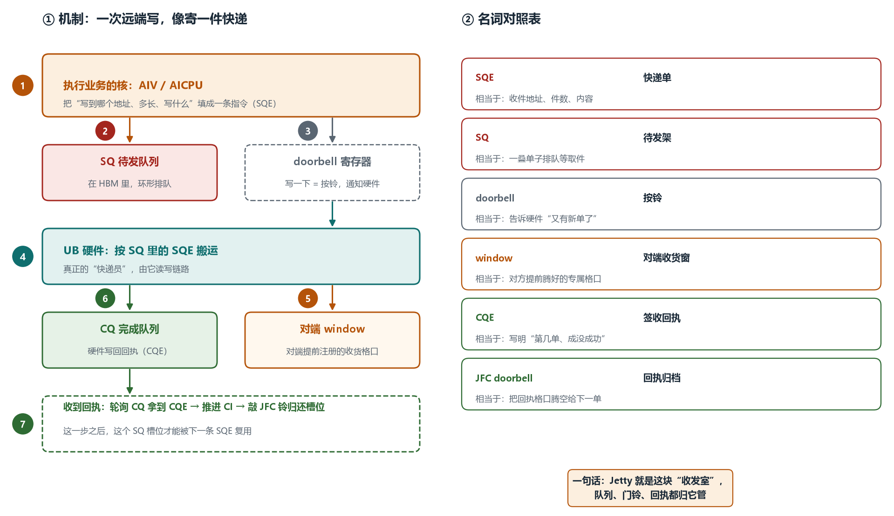
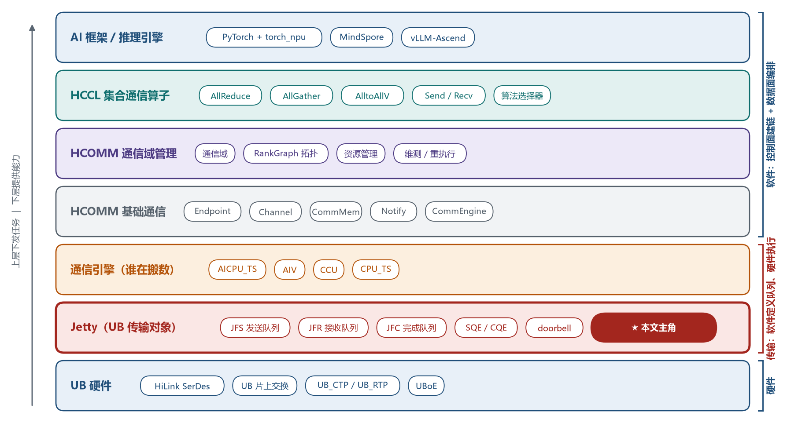
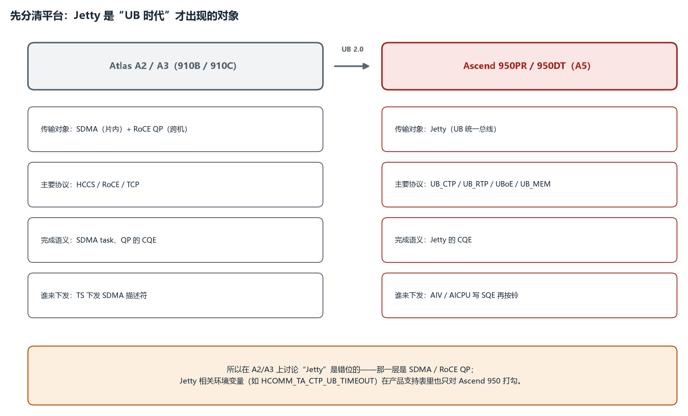
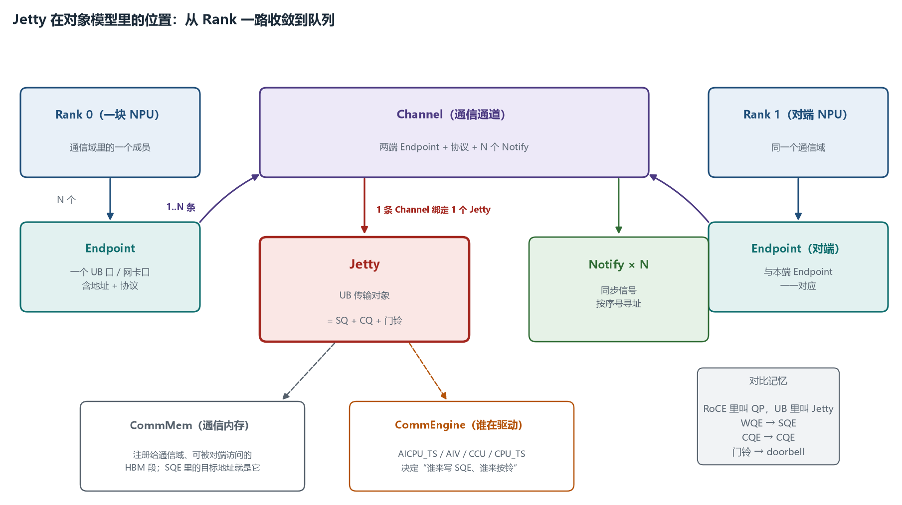
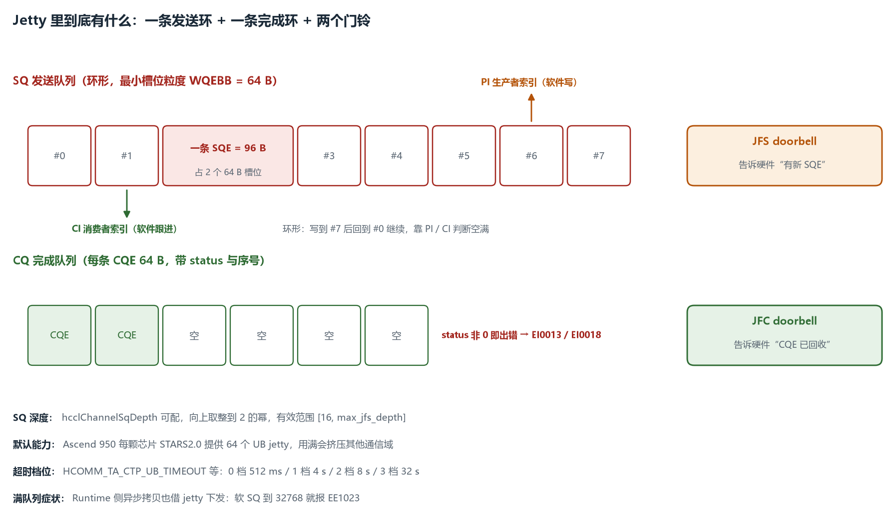
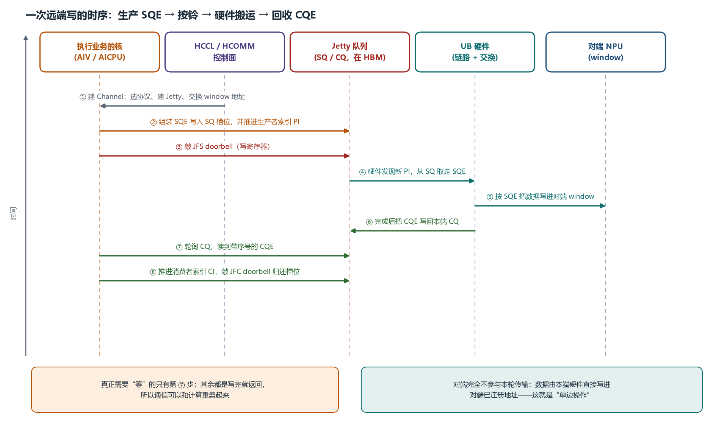
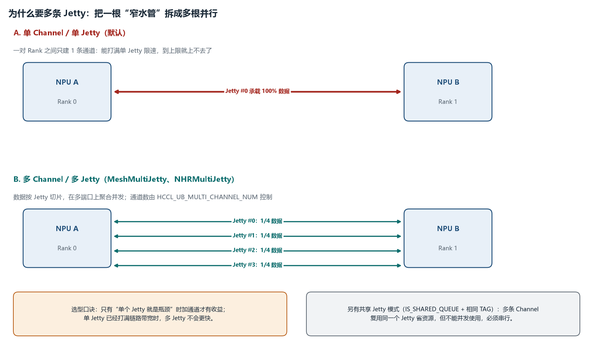

# 昇腾 Jetty 通信架构：从零开始理解

> **怎么读**：第 1～5 节建立直觉与机制（Jetty 是什么、卡在哪一层、内部长什么样、一次通信怎么走）；第 6～7 节看真实工程落点；第 8～9 节看排错与常见坑。
>
> **平台边界**：本文描述的是 **UB（统一总线）时代的 Jetty**，典型平台是 Ascend 950PR / 950DT（A5）。在 Atlas A2 / A3（910B / 910C）上，这一层对应的是 **SDMA + RoCE QP**，没有 Jetty 这个东西。

---

## 目录

- [昇腾 Jetty 通信架构：从零开始理解](#昇腾-jetty-通信架构从零开始理解)
  - [目录](#目录)
  - [一句话直觉：Jetty 是"收发室"](#一句话直觉jetty-是收发室)
  - [它在软件栈的哪一层](#它在软件栈的哪一层)
    - [为什么 A2/A3 上没有 Jetty](#为什么-a2a3-上没有-jetty)
  - [对象模型：Endpoint、Channel、Jetty、Notify](#对象模型endpointchanneljettynotify)
  - [拆开 Jetty：SQ、CQ、SQE、doorbell](#拆开-jettysqcqsqedoorbell)
    - [四个部件](#四个部件)
    - [SQE 长什么样](#sqe-长什么样)
    - [PI / CI：怎么判断队列空满](#pi--ci怎么判断队列空满)
    - [队列不是无限深的](#队列不是无限深的)
  - [一次远端写的完整流程](#一次远端写的完整流程)
    - [谁来写 SQE：四种引擎的差别](#谁来写-sqe四种引擎的差别)
    - [网络语义 vs 内存语义](#网络语义-vs-内存语义)
  - [真实落点：MoE 通信里的 Jetty](#真实落点moe-通信里的-jetty)
  - [多条 Jetty 与拓扑：为什么要拆通道](#多条-jetty-与拓扑为什么要拆通道)
    - [底层还依赖拓扑](#底层还依赖拓扑)
  - [超时、报错与排错地图](#超时报错与排错地图)
    - [Jetty 超时的四档机制](#jetty-超时的四档机制)
    - [一个实用的排错顺序](#一个实用的排错顺序)
  - [新手最容易错的 8 个理解](#新手最容易错的-8-个理解)
  - [术语表与延伸阅读](#术语表与延伸阅读)
    - [术语表](#术语表)
    - [延伸阅读](#延伸阅读)
    - [证据等级说明](#证据等级说明)

---

## 一句话直觉：Jetty 是"收发室"

昇腾 NPU 之间传数据，硬件不认识"张量"、也不认识 AllReduce。它只认识一种东西：**一张写着"从哪搬到哪、搬多长"的指令**。这条指令要放在一个队列里排队，由硬件取走执行，执行完再把结果回执写到另一个队列里。

**Jetty 就是"队列 + 门铃 + 回执"这一整套收发设施的集合体**，是 UB 网络上一个方向上的通信端点对象。

如果你熟悉 RDMA / NCCL，可以这样对照——这是理解 Jetty 最快的路径：

| RDMA 世界 | 昇腾 UB 世界 | 它管什么 |
|---|---|---|
| QP（Queue Pair） | **Jetty** | 一个通信端点，收发队列的载体 |
| WQE（Work Queue Element） | **SQE**（Send Queue Element） | 一条"搬运工单" |
| CQE（Completion Queue Element） | **CQE** | 一条"完成回执" |
| Doorbell | **doorbell**（JFS / JFC） | "有新工单了 / 我收完回执了"的敲门信号 |
| Send Queue / Completion Queue | **SQ / CQ** | 工单队列 / 回执队列 |
| MR（Memory Region） | **CommMem / window** | 已注册、允许对端直接读写的内存 |



> **图 1** 左边是真实机制，右边是生活类比。新手先记住这个"寄快递"的画面：填单（SQE）→ 放上待发架（SQ）→ 按铃（doorbell）→ 快递员搬运（UB 硬件）→ 对方收货窗（window）→ 回执进箱（CQE）。

为什么要用"队列 + 门铃"这种别扭的设计？因为**它让发送方不用等**。写完工单、按个铃，CPU/核就可以去干别的活；真正搬数据的是硬件。这就是"通信与计算重叠"的物理基础——后面第 6 节会看到，昇腾的 MoE 算子正是靠这个把通信藏进计算里。

---

## 它在软件栈的哪一层

很多人第一次看到 Jetty 是在环境变量或报错日志里（比如 `HCOMM_TA_CTP_UB_TIMEOUT`、`stream_jetty_context.cc`），于是误以为它是驱动里的黑盒。其实它在软件栈里有明确的位置：



> **图 2** 自下而上看这张图：UB 硬件提供链路；Jetty 是软件在硬件之上定义的传输对象；通信引擎（AICPU_TS / AIV / CCU）负责"谁来写 SQE、谁来按铃"；再往上是 HCOMM 的基础通信原语、通信域管理，最上面才是 HCCL 算子和 AI 框架。

各层职责，用一张表说清楚：

| 层次 | 你可以把它理解成 | 典型代码位置 |
|---|---|---|
| AI 框架 / 推理引擎 | 调 `all_reduce` 的人 | PyTorch + torch_npu、MindSpore、vLLM-Ascend |
| HCCL 集合通信算子 | 把 AllReduce 拆成"跟谁、传几轮、传哪块" | `hccl/src/ops/` |
| HCOMM 通信域管理 | 管通信域、拓扑（RankGraph）、资源 | `hcomm/src/coll_communicator_mgr/` |
| HCOMM 基础通信 | Endpoint / Channel / CommMem / Notify 这些原语 | `hcomm/src/base_comm/` |
| 通信引擎 | 真正跑通信 kernel、下发任务的执行体 | AICPU_TS / AIV / CCU / CPU_TS |
| **Jetty** | **UB 上的收发队列对象（SQ + CQ + 门铃）** | 由 HCOMM 资源层创建、由引擎驱动 |
| UB 硬件 | HiLink SerDes、UB 片上交换、CTP/RTP 协议 | 芯片 |

注意图 2 右侧的分组：**上面四层是软件（控制面建链 + 数据面编排），中间两层是"软件定义队列、硬件执行"，最下面是硬件。** Jetty 正好卡在软硬交界处——它是软件能配、硬件能认的最后一种对象。

### 为什么 A2/A3 上没有 Jetty

这不是"版本新不新"的问题，而是**互连换代**导致的抽象换代：



> **图 3** Atlas A2/A3 的传输对象是 SDMA（片内）和 RoCE QP（跨机）；Ascend 950 引入 UB 2.0 后，传输对象统一成 Jetty，协议变成 UB_CTP / UB_RTP / UBoE / UB_MEM。

旁证很直接：`HCOMM_TA_CTP_UB_TIMEOUT` 这类"配置 Jetty 超时"的环境变量，在产品支持表里只对 Ascend 950PR&950DT 打勾，A2/A3 明确写"不支持"。所以：

- 在 950 上讨论"Jetty 怎么工作" —— 对。
- 在 A2/A3 上找 Jetty —— 找错层了，那是 SDMA task 和 QP 的地盘。

---

## 对象模型：Endpoint、Channel、Jetty、Notify

理解了"Jetty 是队列对象"，下一个问题是：**它归谁管？怎么被创建出来？**



> **图 4** 从 Rank 一路收敛到队列：Rank 有若干 Endpoint（网口），两个 Endpoint 之间可以建多条 Channel，Channel 在 UB 协议下绑定 1 个 Jetty，同时带 N 个 Notify 用于同步。

HCCL 文档给过一个很精确的组合公式，值得背下来：

```text
Channel = 两端 Endpoint + 通信协议 + N 个 Notify
```

逐项解释：

- **Endpoint（通信设备）**：网络通信的逻辑接口，含地址与协议。一个 Rank 可以有多个 Endpoint（多网口）；一个物理口在 Bonding 场景下可被多个 Endpoint 共享，这一点软件不感知。
- **Channel（通信通道）**：真正可用的数据通道。**一对 Endpoint 之间可以建多条 Channel**，这是后面"多 Jetty"的前提。
- **Jetty**：Channel 在 UB 协议下的底层实现载体——**1 条 Channel 绑定 1 个 Jetty**。换成 RoCE 协议，同一个 Channel 概念底下就是 1 到 N 个 QP。
- **Notify**：同步信号的抽象。Channel 建好时指定要几个 Notify；本端可以按"序号"给对端的某个 Notify 发信号，也可以等某个 Notify 的信号。跨机同步靠它，不靠 Jetty。
- **CommMem**：注册给通信域、可被对端访问的内存段。SQE 里写的目标地址，必须落在这种已注册内存（window）里，否则硬件不会认。
- **CommEngine**：执行通信任务的模块。它决定"谁写 SQE、谁按铃"——这是下一节的重点。

两条容易忽略的规则：

1. **建 Channel 是双向配合的动作。** 本端与远端要同步调用创建接口，期间双方交换各自注册的内存信息。所以"单边操作"指的是**数据面**单边，建链阶段仍然是双方握手。
2. **Channel 与 Jetty 的数量关系不是恒定的。** 默认 1:1；开了多通道算法就变成 N:N；开了共享 Jetty 模式又变成 N:1（见第 7 节）。

---

## 拆开 Jetty：SQ、CQ、SQE、doorbell

现在把 Jetty 这个盒子打开。



> **图 5** 一条发送环（SQ）、一条完成环（CQ）、两个门铃（JFS / JFC），以及推进队列的两个索引（PI / CI）。

### 四个部件

| 部件 | 全称 / 含义 | 谁写 | 谁读 |
|---|---|---|---|
| **SQ** | Send Queue，发送队列，环形 | 软件（写 SQE） | 硬件（取 SQE 执行） |
| **CQ** | Completion Queue，完成队列，环形 | 硬件（写 CQE） | 软件（轮询读 CQE） |
| **JFS doorbell** | 发送侧门铃寄存器 | 软件 | 硬件 |
| **JFC doorbell** | 完成侧门铃寄存器 | 软件 | 硬件 |

### SQE 长什么样

一条 SQE 就是一张工单，核心字段是：**操作类型（写/读/带通知的写/原子）+ 源地址 + 目标地址 + 长度 + 完成属性**。

尺寸上有个细节新手容易困惑：SQ 的最小槽位粒度是 **WQEBB = 64 B**，但一条真正的 SQE 可能比 64 B 大。例如 HCCL 的 MoE 算子里用的 **Write-with-Notify SQE 是 96 B，占 2 个槽位**；带通知信息后更长的情况也存在，源码里要显式处理"跨 WQEBB 回绕"。

所以别把"槽位"和"指令"混为一谈：槽位是停车场车位，SQE 是车，一辆车可能占两个车位。

### PI / CI：怎么判断队列空满

环形队列没有"尾巴"，靠两个索引描述进度：

- **PI（Producer Index，生产者索引）**：软件写完 SQE 后推进，表示"我已经提交到这儿了"。
- **CI（Consumer Index，消费者索引）**：硬件消费后推进（软件读取硬件进度并更新），表示"已经处理到这儿了"。

队列满 = PI 追上 CI；队列空 = CI 追上 PI。这个模型和网卡的 SQ/CQ 完全一致，学过 RDMA 的同学可以无缝迁移。

### 队列不是无限深的

这是实践中最容易踩的坑，有三个不同的"上限"要分清：

| 限制 | 数值 / 来源 | 超了会怎样 |
|---|---|---|
| 单 Jetty 的 SQ 深度 | `hcclChannelSqDepth` 可配，向上取整到 2 的幂，有效范围 `[16, 设备的 max_jfs_depth]`（仅 A5、AIV 展开、UB_CTP/UB_RTP 生效） | 配置被夹到合法区间 |
| 单芯片的 Jetty 数量 | Ascend 950 的 STARS2.0 调度器提供 **64 个 UB jetty** | 建链失败 / 挤压其他通信域 |
| Runtime 异步拷贝的软 SQ | 深度上限 **32768**（`stream_jetty_handler` 里 `max_depth=32768`） | 报 `EE1023`，`no stream resource` |

第三条要特别说明：**Runtime 也用 jetty**。`aclrtMemcpyAsync` / `aclrtMemcpy2dAsync` 这类异步拷贝，在 A5 上会被转换成 WQE 追加到"该 stream 对应的 jetty"的软件 SQ 里（源码里是 `stream_jetty_context.cc` / `stream_jetty_handler.cc`）。所以你在 plog 里看到 `stream_jetty`，说的不是 HCCL 的通信 Jetty，而是 Runtime 自己的拷贝队列——但两者受同一套硬件资源约束。

---

## 一次远端写的完整流程

把前面的零件串起来，就是一次完整通信。这张图建议反复看，它是全文的核心：



> **图 6** 八步完成一次远端写。注意第 7 步是唯一需要"等"的地方。

分三个阶段理解：

**阶段一：建链（控制面，一次性的）**

1. 上层决定"我要和 rank 1 通信"，HCCL/HCOMM 选择合适的协议（UB_CTP / UB_RTP / UB_MEM …），在本端创建 Jetty；
2. 双方交换各自注册的内存信息（window 地址、大小）；
3. 建链完成后，业务侧拿到的是 Channel 句柄，Jetty 隐藏在 Channel 背后。

**阶段二：下发（数据面，每次都做）**

4. 执行业务的核（AIV 或 AICPU）组装 SQE，写进 SQ 的槽位；
5. 推进 PI；
6. 敲 JFS doorbell —— 这一步是"告诉硬件有新工单"，**不按铃硬件可能不知道**（部分实现靠轮询 PI，但门铃是标准做法）。

**阶段三：完成（异步回收）**

7. 硬件按 SQE 把数据直接写进对端已注册的 window（对端全程不参与，这就是"单边"）；
8. 硬件把 CQE 写回本端 CQ；
9. 软件轮询 CQ 拿到 CQE（**唯一需要等待的地方**），推进 CI，敲 JFC doorbell 归还槽位。

> **为什么要归还槽位？** CQ 也是环形的。不按 JFC 铃，硬件不知道该槽位已空，后面就没地方写新回执了——这就是"回执箱满了，快递员没法再投"。

### 谁来写 SQE：四种引擎的差别

同样是"发一条 SQE"，不同通信引擎的做法完全不同，这直接影响性能特征：

| 通信引擎 | Thread 抽象 | 怎么干活 | 特点 | 适用 |
|---|---|---|---|---|
| **AICPU_TS** | NPU Stream | AICPU 跑通信 Kernel，下发 Task 描述符，TS 调度 | 不占计算核，适合大数据 | 大数据量通信 |
| **AIV** | AICore Block | Vector Core 直接执行通信算子、直接写 SQE 按铃 | 低延迟，但占 Vector 核 | 小数据低延迟 |
| **CCU** | Mission | IO Die 上的硬化协处理器，跑微码，用 URMA 搬数 | 高带宽低时延，少占核；但片上资源有限、支持的通信域数量有限 | 950 专用加速 |
| **CPU_TS** | NPU Stream | Host CPU 跑通信逻辑，TS 下发 | 不占计算核，下发开销大 | A2 专用 |

一个容易被忽略的点：**CCU 引擎下多条 Channel 共享一个 Jetty**，所以 `HCCL_UB_MULTI_CHANNEL_NUM`（多通道）在 CCU 引擎上不生效——这也是文档里明确写了的约束。

### 网络语义 vs 内存语义

Jetty 属于**网络语义**：你要显式写 SQE 去"读/写远端内存"。

昇腾还有另一条路——**内存语义**：把远端内存映射到本地地址空间，然后像访问本地内存一样 `load/store`。这条路走的是 UB_MEM / HCCS 协议，核心对象是"通信设备 + 映射内存"，而不是 Channel + Jetty。

| | 网络语义（Jetty 这一路） | 内存语义（UB_MEM 这一路） |
|---|---|---|
| 核心对象 | Channel / Jetty / SQE | 通信设备 + 映射内存 |
| 操作方式 | Write / Read / Notify | 本地 load/store、原子操作 |
| 通信模型 | 单边或双边 | 单边 |
| 适用协议 | RoCE、UB | UB_MEM、HCCS |

新手最常混的地方：看到"单边"就以为两者一样。区别在于**谁在指挥搬运**——网络语义由 SQE 指挥，内存语义由访存指令指挥。

---

## 真实落点：MoE 通信里的 Jetty

抽象讲完，看一个真实工程例子：昇腾 950 上的 MoE dispatch/combine 算子（`aclnnMoeDistributeDispatchSetup` 一族）。这是当前大模型推理里最吃通信的场景之一。

它的一次调用大致是这样：

```text
TokenScatter      -> 排序 token，写本地输出
AlltoAllDispatch  -> 按专家把 token 搬到目标位置
SetStatus         -> 每个专家写 32 B 状态记录
SyncAll<true>     -> 全核屏障（把"生产 SQE"和"发布 PI"分开）
Communication     -> 组 token SQE / status SQE，写进 HBM 的 SQ
                  -> 敲 JFS doorbell
                  -> 立即返回，不等本轮通信完成
```

对应到 Jetty 的视角，这套实现里有几个非常"教科书"的细节：

1. **SQ/CQ/门铃的地址不由算子自己申请**，而是从 HCCL 运行时给的上下文里取（`GetHcclContext` 拿到 `windowsIn/windowsOut`、SQ/CQ 地址、门铃地址）。算子只负责"填单、放架、按铃"。
2. **SQ 和 CQ 的元数据放在片上 UB**，但队列本体在 HBM——源码里 `HcclAiRMAWQ`（约 80 B）、`HcclAiRMACQ`（约 48 B）描述队列信息，`cqeBuf` 直接开 8 KB。
3. **一次 doorbell 之前必须先把 PI 更新完**：先用 `SyncAll` 把"所有 AIV 写完 SQE"和"少数 AIV 按铃"分成两个阶段，否则硬件可能看到某个目的 rank 的 SQE 还没写全就去搬运，直接取到脏数据。
4. **status 是数据的提交标志**：配套的 Teardown 算子不轮询 URMA 的 CQ，而是轮询对端 window 里的 32 B 状态记录（第 0 个 int32 的位模式是 `0x3f800000`，按 float 解释就是 2.0）。这体现了一条重要工程约定——**跨 rank 的可见性要有明确的"提交点"**，不能依赖"指令发出去了应该就到了"。

这套设计能成立，前提正是第 5 节讲的异步语义：**Setup 提交完就返回，通信在后台跑，Teardown 才去等结果**。于是通信窗口被计算填满，这也是 MoE 推理里 dispatch/combine 能被"掩盖"的原因。

> 提醒：上面这些尺寸和字段来自开源算子源码，属于**实现细节**，不是公开 API 契约。做算子移植时可以参考，但不要把它当稳定 ABI。

---

## 多条 Jetty 与拓扑：为什么要拆通道

单个 Jetty 的带宽是有限的。当一对 Rank 之间需要更大带宽，标准解法是**多建几条 Channel，每条绑定一个独立 Jetty，把数据切片并行发**：



> **图 7** 上图是默认的单通道；下图是多通道，数据按 Jetty 切片，在多端口上聚合并发。

HCCL 里对应的算法就叫 **MeshMultiJetty / NHRMultiJetty**：对每个对端建多条 Channel（每个 Channel 一个 Jetty），数据按 Jetty 切片，在多端口上聚合并发。控制它的环境变量是 `HCCL_UB_MULTI_CHANNEL_NUM`（默认 1，即不使能），文档里明确说这和 "RoCE 多 QP 机制类似"。

但有三个约束必须知道：

**① 不是越多越好。** 官方提示很直白：只有当"单个 Jetty 就是带宽瓶颈"时，加通道才有收益；如果单 Jetty 已经打满链路带宽，多 Jetty 毫无增益。同时每个 Channel 都占 Jetty 等硬件资源，配太多会挤压同一个 Device 上的其他通信域。

**② 生效条件很窄。** `HCCL_UB_MULTI_CHANNEL_NUM` 只在使用纯 CLOS 拓扑 + UB（CTP）协议 + 算法跑在 AICPU 引擎时才生效；mesh 拓扑、UBMEM 协议、PCIe 链路上都不生效。

**③ 还有"反向"的共享模式。** 如果目标是省资源而不是提带宽，可以开**共享 Jetty**：设置 `IS_SHARED_QUEUE=true` 并给出相同的 `SHARED_QUEUE_TAG`，多条 Channel 会复用同一个底层 Jetty。

```c
/* 共享 Jetty 模式的关键两步（示意） */
HcclChannelConfig config;
HcclChannelConfigCreate(&config);
HcclChannelConfigSetInt(config, HCCL_CHANNEL_CONFIG_TYPE_IS_SHARED_QUEUE, 1);
HcclChannelConfigSetStr(config, HCCL_CHANNEL_CONFIG_TYPE_SHARED_QUEUE_TAG, "my_tag");
HcclChannelAcquireWithConfig(comm, engine, &channelDesc, 1, &channel, config);
```

共享 Jetty 的代价写在文档里，很明确：**共享同一个 Jetty 的多条 Channel 不支持并发使用，必须由调用方串行调用**；而且被复用的 Jetty 只能关联一个 endpoint。这就像"几个人共用一个快递窗口"——省了窗口，但得排队。

### 底层还依赖拓扑

Jetty 建在 Endpoint 之间，而 Endpoint 挂在拓扑图上。HCCL 的 RankGraph 用这样一套概念描述"谁和谁怎么连"：

| 概念 | 一句话 | 类比 |
|---|---|---|
| Node | 图节点，分通信实体与 Fabric | 带网口的 NPU / 交换机组 |
| Endpoint | 节点的通信设备，映射物理端口 | NPU 上的网口 |
| Edge | 节点间连接关系（对应 NCCL 的 Link） | 网线 |
| Link | 从 Edge 提取的"可建链信息"（两端 Endpoint + 协议，对应 NCCL 的 Path） | 建链路径描述 |
| Channel | 基于 Link 实例化的数据通道 | 真正能跑数据的管道 |
| netLayer | 拓扑层级，通信质量随层级递减 | 机内 HCCS 是 Layer0，跨机经交换机是 Layer1 |

记忆链条：**Edge 说"谁和谁连" → Link 说"怎么建链" → Channel 说"怎么通信" → Jetty 说"用哪套队列"**。

---

## 超时、报错与排错地图

Jetty 出问题时，报错往往不在 Jetty 本身，而在一层层往上报。先记住这张"现象 → 层"的地图：

| 现象 / 关键字 | 大概率所在层 | 含义与下一步 |
|---|---|---|
| `jetty timeout`、`HCOMM_TA_*_UB_TIMEOUT` 相关 | Jetty 传输层 | 对端长时间没回应或链路异常，先看超时档位是否太小 |
| `EI0013` / `Error ROCE CQE` | RoCE（A2/A3 场景） | RoCE 报文重传超时，必伴随集群卡死；查网口闪断、对端进程是否退出 |
| `EI0018` / `UB CQE` | UB（950 场景） | UB 侧 CQE 错误，查链路与对端状态 |
| `EI0002` 通信超时 | 通信域 | 常见于"部分 rank 没进集合通信"，先对齐各 rank 的调用序列 |
| `EE1023` + `stream_jetty_*` | Runtime | Runtime 的异步拷贝软 SQ 满了，减少 `numBatches` / `height` |
| `no notify resource` / `no event resource` | 硬件资源 | 资源泄漏，检查 create/destroy 是否成对 |

### Jetty 超时的四档机制

UB 协议下的 Jetty 超时不是随便填的毫秒数，而是**四档**：

| 档位 | 计算方式 | 实际超时 |
|---|---|---|
| 0 档 | `timeout / 8 = 0` | 512 ms |
| 1 档 | `timeout / 8 = 1` | 4 s |
| 2 档 | `timeout / 8 = 2` | 8 s |
| 3 档 | `timeout / 8 = 3` | 32 s |

三个环境变量分别对应三种协议：`HCOMM_TA_CTP_UB_TIMEOUT`（UB_CTP）、`HCOMM_TA_RTP_UB_TIMEOUT`（UB_RTP）、`HCOMM_TA_RTP_UBOE_TIMEOUT`（UBoE）。

有个细节很有意思：**创建 Jetty 前，软件会先查 TP 的总超时配置，做一次"升档拦截"**。

- UB_CTP：直接用你配的值，不与 TP 总超时比较；
- UB_RTP / UBoE：如果你配的值 ≤ TP 总超时，Jetty 超时会被**自动升到"大于 TP 总超时的最小档"**。

为什么要升档？因为如果 Jetty 先超时、TP 还没超时，底层会先报一个"假故障"，而上层还在正常等待——诊断信息就乱了。让"内层超时 ≥ 外层超时"，故障才会从外向内有序暴露。官方建议直接配 `0 / 8 / 16 / 24`。

### 一个实用的排错顺序

1. **先判断平台**：950 才看 Jetty / UB CQE；A2/A3 看 SDMA / RoCE CQE。别在错误的层上找。
2. **看是"超时"还是"错误 CQE"**：超时多半是"对端没参与/没回应"，错误 CQE 多半是链路或对端进程挂了。
3. **查硬件资源是否泄漏**：Jetty、Notify、Event 都是有限资源，create 不 destroy 迟早 `EE1023`。
4. **对齐各 rank 的调用序列**：集合通信是"全员到场"的约定，某个 rank 因本地条件跳过了集合通信，其余 rank 就会在 Jetty 上等到超时。
5. **再动环境变量**：调大超时只能掩盖症状，不能解决链路问题。

---

## 新手最容易错的 8 个理解

**1. "Jetty 是驱动里的东西。"**
不是驱动概念，是 HCOMM 在 UB 协议上定义的**传输对象**。软件能创建它、配置它、读写它的队列。

**2. "一个 Channel 一定对应一个 Jetty。"**
默认是，但三种情况会打破：多通道算法（N:N）、共享 Jetty 模式（N:1）、CCU 引擎（多 Channel 共享一个 Jetty）。

**3. "SQE 就是 64 B。"**
64 B 是槽位粒度（WQEBB），不是 SQE 尺寸。96 B 的 Write-with-Notify SQE 要占 2 个槽位，还要处理跨槽回绕。

**4. "发出去了就等于到了。"**
Doorbell 只表示"有新工单"，不代表数据已落地。要判断完成，必须看 CQE，或者像 MoE 那样看对端写的状态标志。

**5. "通信是双边的吧？"**
数据面是单边的——对端不参与搬运，数据由本端硬件直接写进对端已注册内存。但**建链阶段仍然要双方握手**。

**6. "Jetty 越多带宽越高。"**
只有单 Jetty 是瓶颈时才有收益。单 Jetty 已打满链路，加 Jetty 纯属浪费硬件资源。

**7. "超时配大一点更稳。"**
Jetty 超时和内层 TP 超时有升档校验，配太小会先触发假故障；配太大则故障发现变慢。规则是"内层不早于外层"。

**8. "plog 里的 stream_jetty 就是 HCCL 的 Jetty。"**
不是。那是 Runtime 为每个 stream 维护的异步拷贝队列，同样受 jetty 硬件资源约束，但归属不同。

---

## 术语表与延伸阅读

### 术语表

| 术语 | 解释 |
|---|---|
| UB | Unified Bus，昇腾统一总线，950 的互连底座 |
| URMA | Unified Remote Memory Access，统一远端内存访问；Jetty 所属的传输层 |
| Jetty | UB 上的通信端点对象，含 SQ / CQ / 门铃 |
| SQE / CQE | 发送队列元素 / 完成队列元素（工单 / 回执） |
| JFS / JFC | 发送侧门铃 / 完成侧门铃 |
| PI / CI | 生产者索引 / 消费者索引 |
| Notify | 同步信号抽象，按序号寻址 |
| RankGraph | 描述 Rank 间连接关系的拓扑图 |
| CommEngine | 通信引擎：AICPU_TS / AIV / CCU / CPU_TS |
| CCU | Collective Communication Unit，集合通信加速单元（IO Die 上的协处理器） |

### 延伸阅读

以下材料都在本机 CANN 知识库中，可对照阅读：

- **HCCL & HCOMM 软件架构简介**（分层、通信模型、引擎、同步机制）—— `cannbot-knowledge/cann-docs-raw/hcomm/docs/zh/architecture/architecture-brief.md`
- **通信模型**（Channel / Endpoint / 内存语义）—— `cannbot-knowledge/cann-docs-raw/hcomm/docs/zh/comm_op_dev_guide/prog_models_concepts/comm_model.md`
- **AIV 算子开发：创建资源**（Channel 与 Notify 的实际用法）—— `cannbot-knowledge/cann-docs-raw/hcomm/docs/zh/comm_op_dev_guide/aiv_comm_op_dev/create_res.md`
- **HCCL_ALGO**（MeshMultiJetty / NHRMultiJetty 的语义）—— `cannbot-knowledge/cann-docs-raw/hccl/docs/zh/user_guide/hccl_env/HCCL_ALGO.md`
- **HCCL_UB_MULTI_CHANNEL_NUM**（多 Jetty 通道数）—— `cannbot-knowledge/cann-docs-raw/hccl/docs/zh/user_guide/hccl_env/HCCL_UB_MULTI_CHANNEL_NUM.md`
- **Jetty 超时三兄弟** —— `HCOMM_TA_CTP_UB_TIMEOUT.md`、`HCOMM_TA_RTP_UB_TIMEOUT.md`、`HCOMM_TA_RTP_UBOE_TIMEOUT.md`
- **Ascend 950 调度器 / 互连**（64 UB jetty、URMA 端口模式）—— `cannbot-knowledge/knowledge/common/platforms/concepts/ascend950_scheduler_interconnect.md`
- **Runtime 资源不足 FAQ**（EE1023 与 stream_jetty）—— `cannbot-knowledge/cann-docs-raw/runtime/docs/zh/FAQ/EE1023_insufficient_resource.md`

### 证据等级说明

为了不误导，本文的结论分三档，读的时候请留意：

- **文档明确记载**：分层结构、Channel = 两端 Endpoint + 协议 + N Notify、1 Channel 绑定 1 Jetty（UB）、64 UB jetty / 芯片、超时四档、共享 Jetty 约束、多通道生效条件 —— 均可在 CANN 官方文档中直接查到。
- **源码观察**：SQE 96 B、`HcclAiRMAWQ` 80 B、CQE 8 KB 缓冲、status 位模式 `0x3f800000`、Runtime 软 SQ 深度 32768 —— 来自开源算子与 Runtime 日志分析，属实现细节，不保证跨版本稳定。
- **工程推断**：JFS / JFC / JFR（发送 / 完成 / 接收）的命名展开、Jetty 一词的"泊位"词源联想、排错顺序的优先级建议 —— 便于理解，不是规范条文。

---

*本文档配图由 `make_figures.py` 生成（matplotlib + 微软雅黑），可修改脚本重新出图。*