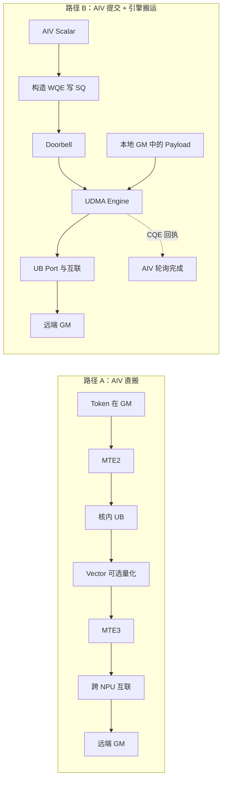

# 昇腾 EP 通信的两条硬件路径：AIV 直搬与 Jetty + UDMA

> **为什么写这篇**：MoE 的 Dispatch / Combine 里，AIV 有时自己搬数据，有时只提交任务、由通信引擎搬。两种实现常常出现在同一个仓库、同一份 profiling 里，混着看很容易把「控制面下发开销」当成「数据面带宽」，或者反过来把网络带宽当成瓶颈。这篇先把两条路径的边界划清，再逐条拆开。
>
> **平台边界**：A2/A3 与 950（A5）的通信抽象不同。公开资料里，A3 超节点展示了 AIV 通过映射后的远端地址做内存语义访问；950 上除了 UB Memory 同步语义，还多了 URMA / Jetty 的异步网络语义路径。CANN 的 `MoeDistributeDispatch` 系列算子里，`commType` 当前只支持 URMA（`2`），可见这条路径已是 950 上 EP 通信的主干。具体能力以芯片与 CANN 版本为准，本文不做跨平台统一断言。

## 目录

- [一、三个不同的问题](#一三个不同的问题)
- [二、AIV 直搬路径](#二aiv-直搬路径)
  - [2.1 AIV 的硬件分工](#21-aiv-的硬件分工)
  - [2.2 AIV 如何访问远端内存](#22-aiv-如何访问远端内存)
  - [2.3 Dispatch 的完整数据流](#23-dispatch-的完整数据流)
  - [2.4 Combine 的完整数据流](#24-combine-的完整数据流)
  - [2.5 瓶颈在哪里](#25-瓶颈在哪里)
  - [2.6 流水重叠如何实现](#26-流水重叠如何实现)
  - [2.7 与引擎搬运路径的分界](#27-与引擎搬运路径的分界)
- [三、Jetty 与 UDMA 路径](#三jetty-与-udma-路径)
  - [3.1 几个通信概念的关系](#31-几个通信概念的关系)
  - [3.2 Jetty 与 RDMA QP](#32-jetty-与-rdma-qp)
  - [3.3 一次 Jetty 通信的硬件流程](#33-一次-jetty-通信的硬件流程)
  - [3.4 为什么代码里还有 UB 和 MTE3](#34-为什么代码里还有-ub-和-mte3)
  - [3.5 为什么要多个 Jetty](#35-为什么要多个-jetty)
  - [3.6 阶段化性能模型](#36-阶段化性能模型)
  - [3.7 三种通信方式对比](#37-三种通信方式对比)
- [四、怎么选路径](#四怎么选路径)
  - [4.1 什么时候哪条路径占优](#41-什么时候哪条路径占优)
  - [4.2 两条路径可以并存](#42-两条路径可以并存)
  - [4.3 六组容易混淆的概念](#43-六组容易混淆的概念)
  - [4.4 平台边界与常见误解](#44-平台边界与常见误解)
- [五、Profiling 判据与实验](#五profiling-判据与实验)
- [六、小结](#六小结)
- [参考资料](#参考资料)
- [证据等级](#证据等级)

## 一、三个不同的问题

先给结论：

- **路径 A（AIV 直搬）**：AIV 既安排搬运，也亲自搬。Payload 必然过核内 UB，走 MTE2 读入、MTE3 写出。
- **路径 B（AIV 提交 + 引擎搬运）**：AIV 只安排搬运。它构造 WQE、敲 Doorbell、收 CQE，Payload 由 UDMA 从 GM 直接搬到远端 GM。
- 两条路径共用同一个 AIV 编程模型和同一张互联网络，差别只在**谁搬 Payload**。这也直接决定了 profiling 时该盯 MTE，还是盯 WQE 下发速率。

把「AIV 做通信」当成一件事，是最常见的误解来源。它至少包含三层，每层的瓶颈、优化手段和观测指标都不一样：

| 层次 | 谁在动数据 | 典型硬件 | 对应章节 |
|---|---|---|---|
| 核内数据搬运 | AIV 与 GM 之间 | MTE2 / MTE3 / UB | [2.1](#21-aiv-的硬件分工) 至 [2.2](#22-aiv-如何访问远端内存) |
| 跨 NPU 数据传输 | 芯片与芯片之间 | HCCS / UB Bus / RoCE / UDMA | 第二、三节都涉及 |
| 数据计算与控制 | AIV 内部 | Scalar / Vector | [2.3](#23-dispatch-的完整数据流) 至 [2.4](#24-combine-的完整数据流)、[3.3](#33-一次-jetty-通信的硬件流程) |

分层之后，很多「矛盾」就消失了。例如：

- 路径 A 里，「网络带宽」和「MTE3 带宽」是两个独立上限，最小值决定实际吞吐。
- 路径 B 里，「AIV 写 WQE 的速度」和「UDMA 搬数据的速度」也是两个独立上限，前者常常先撞墙。

所以看到「链路利用率只有 7%，但 Dispatch 就是快不起来」，先别怀疑网卡，回去看下发侧。



路径 A 的三个特征：

1. Payload 必须经过发送端 AIV 的 UB，因此 UB 容量天然限制了单次搬运的粒度与并发度。
2. MTE2 和 MTE3 与 Vector 是彼此独立的流水，可以重叠，这是「搬运与计算流水化」的硬件基础。
3. AIV 的搬运算力与专家计算的算力是同一份资源，通信抢得越多，计算可用得越少。

路径 B 的三个特征：

1. Payload 不经过 AIV 的 UB，也不占用 MTE2 / MTE3，AIV 只承担描述符、提交和完成处理。
2. 下发能力成为新的独立瓶颈：WQE 构造（Scalar + UB）、搬运到队列（MTE3）、Doorbell、CQE 轮询，任何一环慢都会限制有效带宽。
3. 通信可以做成真正的异步流水：提交即返回，完成靠 CQE 或对端标志位回收。

| 维度 | 路径 A：AIV 直搬 | 路径 B：AIV 提交 + 引擎搬运 |
|---|---|---|
| 控制方 | AIV | AIV |
| Payload 搬运方 | MTE2 / MTE3 | UDMA（也可能是 RDMA、SDMA 引擎） |
| Payload 是否过 AIV UB | 是 | 否（但量化、打包、聚合等前后处理通常仍要过） |
| 通信队列 | MTE 指令流水 | Jetty 的 SQ / CQ |
| 队列推进方式 | 指令级同步 | WQE + Doorbell |
| 完成回收 | MTE 同步机制、标志位 | CQE 轮询、对端状态位 |
| AIV 主要开销 | 搬运完整数据 | 构造 WQE、提交、收完成 |
| 典型受限点 | UB 容量、MTE 带宽 | WQE 下发速率、SQ 深度、链路 |

## 二、AIV 直搬路径

这一节讨论「Payload 由 AIV 的 MTE 搬运」，典型平台是 A3 超节点（CloudMatrix384 一类支持远端内存映射的系统）。

一句话结论：AIV 不只是向量计算单元，它同时是一套可编程的细粒度搬运资源。理解 Dispatch / Combine 的性能，必须同时看 MTE2、MTE3、UB、Vector、Scalar 五条资源，而不是只看跨卡带宽。

### 2.1 AIV 的硬件分工

在昇腾上，AIV（AI Vector Core）是一类可编程计算核，内部由多个硬件模块组成。做通信时，这些模块各有分工：

| 硬件模块 | 含义 | 在 Dispatch / Combine 中的作用 |
|---|---|---|
| Scalar | 标量控制单元 | 计算地址、Token 路由、控制循环、下发指令 |
| Vector | 向量计算单元 | 量化、反量化、乘法、加权求和 |
| UB | Unified Buffer，核内 SRAM | 暂存 Token、路由信息、量化结果、聚合中间结果 |
| MTE2 | Memory Transfer Engine 2 | 把 GM 数据搬入 UB |
| MTE3 | Memory Transfer Engine 3 | 把 UB 数据搬出到 GM |
| GM | Global Memory | 全局内存地址空间，通常对应 HBM 中的张量与通信窗口 |
| AIC | AI Cube Core | 执行专家 FFN 的矩阵乘法 |
| HCCS / UB Bus | 跨芯片互联 | 承载跨 NPU 的数据传输 |

关键事实：**MTE2、MTE3 和 Vector 是相对独立的硬件流水线，可以异步并行执行**。这是昇腾实现「搬运与计算重叠」的硬件基础，也是后面流水化优化的前提。

**为什么通信也要过 UB。** 因为 AIV 的普通 Vector 计算主要操作核内数据，而不是直接对 HBM 中的 Tensor 做逐元素计算。对一个 Token 做量化，典型路径是：

```text
GM 中的 BF16 Token
  → MTE2 搬入 UB
  → Vector 量化
  → UB 中的 INT8 Token
  → MTE3 搬回 GM（或直接写远端）
```

即使完全不做计算，只想把「内存中的一个张量搬到另一个地方」，走 AIV MTE 路径时通常也要经过 UB 中转：MTE2 读入、MTE3 写出。原因不是物理上做不到 GM 到 GM，而是**这条编程模型里的搬运动词就是 GM 与 UB 之间**。真正能绕开 UB 的是另一类引擎（UDMA、SDMA 等），它们可以直接在 GM 之间搬运，这正好是两条路径的分野。

所以 UB 不只是计算缓存，它同时是 AIV 通信路径上的中转缓冲区。这一条决定了后面很多瓶颈的来源。

### 2.2 AIV 如何访问远端内存

对于 A3 CloudMatrix384 等支持全局共享内存、内存语义访问的系统，AIV 的 MTE 不仅能访问本地 GM，也能通过映射后的远端地址访问其他 NPU 的 GM。

于是 MTE2 和 MTE3 组合出四种基本搬运路径：

| 搬运指令 | 源地址 | 目的地址 |
|---|---|---|
| MTE2 本地读 | 本地 GM | 本地 AIV UB |
| MTE2 远端读 | 远端 GM | 本地 AIV UB |
| MTE3 本地写 | 本地 AIV UB | 本地 GM |
| MTE3 远端写 | 本地 AIV UB | 远端 GM |

远端访问依赖硬件互联能力、地址映射和访问权限，**并不是任意两张 NPU 卡都天然支持**。CloudMatrix384 的 AIV-Direct 就是利用这种能力降低通信启动时延。

**Push：主动向远端写入。** 假设 Rank 0 需要把一个 Token 发送到 Rank 1。Push 模式下，发送端的 AIV 主动用 MTE3 写入对端 GM：

```text
Rank 0 HBM
  → Rank 0 AIV MTE2
  → Rank 0 AIV UB
  → Rank 0 AIV MTE3
  → Rank 0 片上互联与 I/O
  → 跨 NPU 互联网络
  → Rank 1 片上互联与 I/O
  → Rank 1 HBM
```

几个必须记住的结论：

- Token 经过发送端 AIV 的 UB。
- Token 经过发送端 AIV 的 MTE2 和 MTE3。
- 远端写入本身**不需要**经过接收端 AIV 的 UB。
- 远端写入本身也**不需要**接收端 AIV 的 MTE2 / MTE3 参与。
- 接收端后续做重排或计算时，才需要自己的 AIV 去读接收缓冲区。

这就是单边通信（One-sided Communication）的典型场景：数据面只有一边在动，但建链阶段仍然是双方握手。

**Pull：主动从远端读取。** 另一种方式是接收端主动拉取：Rank 1 的 AIV 用 MTE2 读取 Rank 0 的 GM。

| 对比项 | Push | Pull |
|---|---|---|
| 主动发起方 | 发送端 | 接收端 |
| 跨卡搬运单元 | 发送端 MTE3 | 接收端 MTE2 |
| 使用谁的 UB | 发送端 | 接收端 |
| 谁承担主要搬运压力 | 发送端 AIV | 接收端 AIV |
| 典型通信语义 | Put / Write | Get / Read |

所以分析 EP 通信性能时，第一步要看实现采用 Push、Pull 还是两者混合。不同选择会让不同 Rank 的 MTE2 / MTE3 负载严重不均衡，而 EP 恰恰是「有的 rank 收得多、有的 rank 发得多」的典型场景。

### 2.3 Dispatch 的完整数据流

假设三个 NPU，每个部署不同的专家；Rank 0 的 Token X 被路由到 Rank 1 和 Rank 2。为便于说明，设 hidden size = 7168、输入 BF16、Dispatch 时做 INT8 量化。

```text
Rank 0 HBM（Token，BF16）
  → MTE2 读入 UB
  → Vector 量化（INT8），Scalar 同时算目标 Rank 与偏移
  → MTE3 写远端通信窗口
  → 片内互联 → UB Bus / HCCS → Rank 1 / Rank 2 HBM
  → 接收端 AIV 轮询状态标记，确认数据就绪
  → 接收端 MTE2 读入 → UB → MTE3 写出到专家输入缓冲
  → AIC 执行专家矩阵乘法
```

**每一步用到的硬件：**

| 阶段 | 操作 | 主要硬件 |
|---|---|---|
| 1 | 读取 Token、TopK IDs | MTE2、Scalar |
| 2 | 计算目标 Rank 和地址偏移 | Scalar / Vector |
| 3 | 将 Token 搬入 UB | MTE2 |
| 4 | Token 动态量化 | Vector |
| 5 | 写入远端通信窗口 | MTE3、跨卡互联 |
| 6 | 发布通信完成标记 | AIV、同步机制 |
| 7 | 等待接收数据就绪 | 接收端 AIV |
| 8 | 按 Expert 重排接收数据 | MTE2、UB、MTE3 |
| 9 | 执行专家矩阵乘法 | AIC，部分环节使用 AIV |

CloudMatrix-Infer 公开论文中的 FusedDispatch 采用了类似的数据发送、完成标记同步和接收数据组装流程，只是把三段做成了流水。

**发送端的伪代码。** 下面这段只用于说明硬件流程，同步函数和量化函数都是伪代码，不是某个仓库的真实 API：

```c
// 1. 读取本地 Token（GM -> UB）
DataCopy(tokenUB, localTokenGM, count);

// 2. 等待 MTE2 完成
SyncMTE2ToVector();

// 3. 可选：动态量化（BF16 -> INT8）
Quantize(quantUB, tokenUB);

// 4. Scalar 计算目标 Rank 的 GM 地址
remoteAddr = peerWindowBase[dstRank] + offset;

// 5. 等待 Vector 完成
SyncVectorToMTE3();

// 6. MTE3 直接写入远端 GM
DataCopy(remoteAddr, quantUB, quantCount);

// 7. 数据可见后，发布完成标记
PublishFlagAfterRemoteWrite();
```

注意第 4 步：远端地址来自初始化阶段交换的窗口信息，不是在每次通信里临时协商。

**SHMEM 通信为什么也涉及 UB。** 在 MoonEP 等 EP 实现里经常看到 SHMEM。要分清它解决什么问题：

- 如何分配可被其他 Rank 访问的通信窗口。
- 如何获得远端 Rank 的内存地址。
- 如何提供 Put、Get、同步等通信接口。

**SHMEM 本身不是一种独立的物理搬运引擎。** 它是一层抽象的对称内存与 RMA 接口，底下可以挂不同的数据通路：

```text
上层 Dispatch / Combine 算子
  → SHMEM API（分配窗口、取远端地址、Put / Get）
  → 具体搬运引擎（MTE、UDMA、RoCE、SDMA 之一）
  → 跨 NPU 互联
  → 远端 HBM
```

当 SHMEM 底层选择 MTE 路径时，实际搬运仍然经过 AIV 的 MTE 和 UB。当底层选择 UDMA 时，源码里会看到 `aclshmemx_udma_*` 一族的调用，Payload 就不必经过 UB。

这一区分很重要：**「用了 SHMEM」不能推断出「用了哪种搬运引擎」**，必须看它实际调用的接口和配置。

### 2.4 Combine 的完整数据流

Combine 与 Dispatch 最大的区别：

- Dispatch 是一个 Token 分发到多个专家。
- Combine 是多个专家的计算结果返回原始 Rank，并做加权求和。

假设 Rank 1 和 Rank 2 分别算出专家结果 Y1 和 Y2，路由权重为 0.3 和 0.7，最终结果为：

```text
Y = 0.3 * Y1 + 0.7 * Y2
```

接收端的典型执行过程：

```c
// 等待当前 Token 的所有专家结果就绪
WaitAllExpertResults();

// MTE2：读取专家结果（GM -> UB）
DataCopy(y1UB, recvExpert1GM, hiddenSize);
DataCopy(y2UB, recvExpert2GM, hiddenSize);

// Vector：加权求和
Muls(y1UB, y1UB, 0.3, hiddenSize);
Muls(y2UB, y2UB, 0.7, hiddenSize);
Add(resultUB, y1UB, y2UB, hiddenSize);

// MTE3：写回最终结果
DataCopy(outputGM, resultUB, hiddenSize);
```

这是简化示例，省略了流水同步、数据类型转换和跨专家分块。

因此 Combine 相比纯通信算子，往往额外背了两份压力：**Vector 的加权计算**和**UB 的访存占用**。当然，也有实现选择在发送端提前加权，或者做分层聚合，把压力前移或摊薄。

### 2.5 瓶颈在哪里

**有效带宽上限。** 假设所有 Token 都通过 AIV MTE 发送。对于不改变数据大小的单向搬运，忽略其他竞争时，有效带宽满足：

```text
B_effective <= min(B_HBM_read, B_MTE2, B_UB, B_MTE3, B_link, B_remote_write)
```

这里的 MTE 带宽指参与通信的多个 AIV 的**聚合有效带宽**。如果 MTE3 聚合后只能提供较低的发送带宽，即使超节点互联还有大量剩余带宽，通信也无法提速。

**一个 Token 实际产生了多少访存。** 以 hidden = 7168、TopK = 8 为例，假设八个专家都在远端、每个专家一份直接 Push、忽略去重与元数据：

| 观测点 | 数据量 | 说明 |
|---|---|---|
| 本地 HBM 读（MTE2） | 14 KiB | 7168 × 2 B，BF16，单次读入 |
| UB 中单份待发数据 | 7 KiB | INT8 量化后 |
| 远端写（MTE3，累计） | 56 KiB | TopK = 8，每个专家一份 |
| 网络有效载荷（Dispatch） | 56 KiB | 不含协议头、元数据 |
| Combine 返回载荷 | 112 KiB | 八个专家 × 14 KiB，BF16 |

一个 Token 在本地只读一次，却可能要写八次。所以这种实现下，发送侧是「读一次、写八次」，接收侧还要把 56 KiB 再读入并重排一遍，双向的 MTE 负载都不轻，且读写比例严重不对称。

这也是 Token 去重、按 Rank 聚合、UB 数据复用能优化通信性能的根本原因：它们减少的是**写放大**，不是网络带宽。

**UB 容量会限制通信流水。** UB 是每个 AIV 核内有限的 SRAM，需要同时容纳：

- 原始 Token。
- 量化后的 Token。
- Scale 与路由信息。
- 临时计算数据。
- Ping-Pong 双缓冲。
- 同步标记及其他临时数据（视实现而定）。

UB 不够时只有两条路：切得更细（更多搬运指令、更多同步），或者降低并发度（流水变浅）。两者都会压低有效带宽。所以「UB 容量」是 AIV 直搬路径上一个容易被忽略的硬约束，调 kernel 时值得单独核对占用。

### 2.6 流水重叠如何实现

如果完全串行执行，一个 AIV 必须等当前 Token 发送完成，才能处理下一个 Token。用 UB 双缓冲后，MTE2、Vector、MTE3 可以同时处理不同的 Token：

| 时间片 | 串行执行 | 双缓冲流水 |
|---|---|---|
| 1 | MTE2 搬 T0 | MTE2 搬 T0 |
| 2 | Vector 处理 T0 | MTE2 搬 T1 |
| 3 | MTE3 发 T0 | MTE2 搬 T2、Vector 处理 T0 |
| 4 | MTE2 搬 T1 | MTE2 搬 T3、Vector 处理 T1、MTE3 发 T0 |

假设三个阶段耗时相同，且缓冲区可以安全复用。理想稳定流水中，每个 Token 的处理间隔由最慢的阶段决定：

```text
T_interval ≈ max(T_MTE2, T_Vector, T_MTE3)
```

而不是三者之和。总时间近似为「流水填充时间 + Token 数 × T_interval」。

实际流水效率取决于数据依赖、UB 分配和硬件竞争。CloudMatrix-Infer 的 FusedDispatch 也采用了「Token 搬入、地址计算与量化、远端写入」的三级流水设计，思路与此一致。

### 2.7 与引擎搬运路径的分界

AIV 发起通信，不代表 Payload 一定由 AIV 的 MTE 搬运。这两件事必须分开看：

```text
方式一：AIV 既控制又搬运
  AIV Scalar 算地址 → MTE2 读 → UB → MTE3 写远端

方式二：AIV 只控制，引擎搬运
  AIV Scalar 构造 WQE → 提交 Jetty → UDMA 从 GM 直接写远端
```

在方式二里，AIV 主要负责准备通信描述符（WQE）、提交请求、处理完成状态；Payload 由独立通信硬件从 GM 直接搬到远端 GM，不经过 UB，也不占用 MTE。

| 对比项 | AIV MTE 直搬 | AIV 直驱 RDMA / UDMA | SDMA |
|---|---|---|---|
| 实际搬运硬件 | MTE2 / MTE3 | 通信引擎 | SDMA 引擎 |
| Payload 必经 AIV UB | 是，典型 MTE 路径 | 否 | 否 |
| AIV 负载 | 数据搬运及计算 | 提交、同步及可选的前后处理 | 视控制方式而定 |
| 小包通信 | 适合细粒度低时延场景 | 取决于请求提交效率 | 启动开销可能较明显 |
| UB 容量限制 | 明显 | 主要影响前后处理 | 不直接限制纯搬运 |
| 主要瓶颈 | MTE、UB、互联 | WQE 下发、SQ 深度、链路 | DMA、内存及链路 |

方式二的控制面细节，是下一节的主题。

## 三、Jetty 与 UDMA 路径

这一节讨论「AIV 只提交任务、由通信引擎搬 Payload」，典型平台是 Ascend 950PR / 950DT（A5）。

一句话结论：Jetty 是通信任务的提交端点，UDMA 是实际搬数据的硬件引擎，URMA 是统一的远端内存访问机制与接口，UB 是承载跨芯片传输的互联体系，AIV 是组织任务、提交请求、处理同步的可编程计算核。它们属于同一套通信体系的不同层次，不是互相并列的几种硬件。

### 3.1 几个通信概念的关系

先划清层次，这是理解后面所有内容的前提：

| 概念 | 物流类比 | 实际作用 |
|---|---|---|
| AIV | 发货人员 | 组织数据、填写通信任务 |
| WQE | 运输订单 | 描述源地址、目的地址、数据长度等 |
| Jetty | 物流业务端点 | 管理通信任务及其队列 |
| SQ | 待发货订单队列 | 保存待执行的 WQE |
| Doorbell | 通知发货 | 通知硬件有新任务 |
| UDMA | 运输车辆 | 实际搬运数据 |
| UB Bus | 高速公路 | 承载跨芯片传输 |
| CQE | 运输完成回执 | 表示对应任务已完成 |

所以「Jetty 通信」本质上就是：**AIV 通过 Doorbell 向 URMA 的 Jetty 队列提交任务，由 UDMA 硬件执行跨 NPU 的内存搬运**。

再加两个容易漏掉的：

- **URMA（Unified Remote Memory Access）** 是这套远端内存访问的机制与编程接口，Jetty、WQE、CQE 都是它的概念。
- **UB（Unified Bus）** 是 950 的互连底座。注意它和 AIV 核内的 **UB（Unified Buffer）** 没有关系，只是缩写撞车。

950 白皮书对 URMA 的描述是：异步模式使用 Jetty 的 SQE / CQE，支持 Write / Read / Send / Atomic；RTP 模式 4 个端口可靠传输，CTP 模式 9 个端口。这也解释了为什么 Jetty 会成为 950 通信栈的核心对象。

### 3.2 Jetty 与 RDMA QP

Jetty 可以类比传统 RDMA 的 QP（Queue Pair），但两者并不完全等价。把两套栈的对应层并排放：

```text
RDMA / RoCE           URMA / UB
RDMA Verbs            URMA API
QP                    Jetty
RDMA Engine           UDMA Engine
RoCE / InfiniBand     Unified Bus
```

逐项对照：

| 对比项 | RDMA / RoCE | URMA / UB |
|---|---|---|
| 通信引擎 | RDMA Engine | UDMA Engine |
| 通信端点 | QP | Jetty |
| 发送队列 | SQ | SQ / JFS |
| 接收队列 | RQ | RQ / JFR |
| 完成队列 | CQ | CQ / JFC |
| 通信任务 | WQE | WQE |
| 硬件通知 | Doorbell | Doorbell |
| 完成事件 | CQE | CQE |
| 内存管理 | MR | Segment |
| 内存访问凭证 | lkey / rkey | Token 等 |
| 网络端点标识 | GID 等 | EID |
| 通信网络 | RoCE / IB | Unified Bus |

角色是一一对应的，这也是「Jetty 像 QP」这个说法成立的原因。但有三点不能直接套用：

1. **抽象层次不同。** URMA 把通信端点、内存访问对象（Segment）和底层传输通道拆成三套独立概念，Jetty 不等于「连接」。而 QP 在 RDMA 里同时绑定了连接与队列语义。
2. **传输模式不止一种。** 公开材料提到 URMA 支持多种传输模式（RC、RM、UM 一类），具体定义与可用组合以 UB / URMA 规范为准，本文未逐一核对。因此不要照搬「QP 一定是 RC」这类 RDMA 经验。
3. **上层对象不同。** HCCL 侧看到的是 Channel（= 两端 Endpoint + 协议 + N 个 Notify），Jetty 是 Channel 在 UB 协议下的底层载体，默认 1:1，但多通道、共享 Jetty 等模式会打破这个比例。详见 [UB/Jetty.md](../../../UB/Jetty.md)。

### 3.3 一次 Jetty 通信的硬件流程

假设 Rank 0 的 AIV 要通过 Jetty 把一个 Token 写入 Rank 1 的 HBM。

**初始化：建立通信资源。** 这部分通常在 Host 侧完成，且只做一次：

```text
创建通信上下文
  → 注册本地通信内存 Segment
  → 创建 Jetty / SQ / CQ
  → 交换远端 EID、Jetty、Segment 信息
  → 建立或配置传输通道
  → 将通信上下文提供给 AIV
```

这些操作不会在每次 Dispatch 时重做，而是初始化阶段建好、后续复用。这也是为什么通信启动开销在 warmup 之后通常可以忽略，而「每轮重新建链」的实现性能会很差。

Jetty 可以按实现分配给不同 AIV 使用，也可以在满足并发访问约束的条件下共享。

**运行期：AIV 提交 WQE。** WQE 是通信任务描述符。下面是原理示意，不是真实的硬件结构体：

```c
// 原理示意，并非实际硬件结构体
struct WQE {
    uint64_t src_addr;
    uint64_t dst_addr;
    uint32_t length;
    uint32_t opcode;       // WRITE / READ / AMO
    uint32_t dst_jetty;
    uint32_t dst_eid;
    uint32_t token;
};
```

要点：**WQE 里放的是地址、长度、操作类型这类描述信息，不是 Token 数据本身**。Token 还在本地 HBM 里，等着 UDMA 去取。

**控制流与数据流。** 一次 Jetty 通信有两条完全不同的数据流。

控制流（走 AIV 的 Scalar 和片上总线）：

```text
AIV Scalar
  → 构造 WQE
  → 写入 Jetty 的 SQ（可能在 GM，也可能先经 UB staging）
  → 推进 PI
  → 敲 JFS Doorbell
  → UDMA Engine 取走并解析任务
```

实际 Token 数据流：

```text
本地 HBM
  → 片上访存互联
  → UDMA Engine
  → UB Port
  → 跨芯片互联（Unified Bus）
  → 远端访存系统
  → 远端 HBM
```

关键结论：**实际 Token 数据不经过 AIV 的 UB、MTE2 和 MTE3**。AIV 只碰控制信息，Payload 由 UDMA 从 GM 直接搬到远端 GM。

这正是 Jetty + UDMA 相对于 AIV MTE 直接搬运的核心区别：控制面与数据面解耦。

### 3.4 为什么代码里还有 UB 和 MTE3

这是最容易产生「既然 UDMA 搬数据，为什么 kernel 里还有 MTE3」疑问的地方。

因为 UDMA 只负责搬 Payload，**准备通信任务本身也需要内存搬运**。CANN SHMEM 的 UDMA 实现里就有这样的做法：用 UB 拼装 WQE，再通过 MTE3 把 WQE 搬到 GM 中的发送队列，并为此提供 UB staging 配置。

于是 MTE 在两种通信方式里的职责完全不同：

| 对比项 | 方式 A：AIV MTE 通信 | 方式 B：Jetty + UDMA 通信 |
|---|---|---|
| MTE3 搬什么 | 完整 Token Payload | WQE 等控制信息 |
| 单次搬运量（示意） | 14,336 B | 64 B |
| Payload 是否过 UB | 是 | 否 |
| MTE 是否是主要瓶颈 | 通常是 | 通常不是，但可能限制下发速率 |

假设一个 Token 是 BF16、hidden size = 7168，则 7168 × 2 B = 14,336 B。WQE 按 64 B 估计（仅用于举例）：

```text
14,336 B / 64 B = 224 倍
```

即两种方式下 MTE3 的搬运字节量相差两个数量级。但要注意三个限定：

- 这是**搬运字节量**的比值，不是实际通信性能提升倍数。
- 64 B 是 SQ 的最小槽位粒度（WQEBB），真实 SQE 可能更大，例如 HCCL MoE 算子里的 Write-with-Notify SQE 是 96 B、占两个槽位。实际比值要按任务格式修正。
- 没有计入量化、打包、Doorbell、CQE 轮询等额外开销。

即便如此，「MTE3 从搬 14 KB 变成搬 64 B」这个量级变化，足以改变 kernel 的瓶颈位置：从 MTE 带宽受限，变成下发速率受限。

### 3.5 为什么要多个 Jetty

可以把 Jetty 理解成独立的通信任务上下文。多个 Jetty 的主要价值：

- 减少多个 AIV 竞争同一个 SQ 的开销。
- 提高通信任务的并行下发能力。
- 增加可同时在途的通信请求数量。
- 减少不同目标 Rank 之间的队列阻塞。
- 在硬件资源允许时，提高通信引擎和物理链路的利用率。

但必须把几个「数量」分清楚：

| 概念 | 实际含义 |
|---|---|
| Jetty 数量 | 逻辑通信端点资源数量 |
| SQ Depth | 队列能够容纳的任务数量 |
| UDMA Engine 数量 | 物理通信执行资源数量 |
| Port 数量 | 物理互联端口数量 |
| Transport Channel 数量 | 底层传输通道资源数量 |

增加 Jetty 数量，并不等于增加物理 UDMA 引擎数量，也不等于增加物理通信端口数量。多个 Jetty 可以共享底层通信硬件，具体调度和映射取决于芯片架构与通信库配置。

几条已公开的硬约束（细节见 [UB/Jetty.md](../../../UB/Jetty.md)）：

- Ascend 950 的 STARS2.0 调度器提供 **64 个 UB jetty**，Jetty 是有限资源，建多了会挤压其他通信域。
- 单 Jetty 的 SQ 深度可配，会向上取整到 2 的幂，并有设备上限。
- HCCL 的多通道算法（MeshMultiJetty / NHRMultiJetty）通过 `HCCL_UB_MULTI_CHANNEL_NUM` 控制，只有单 Jetty 是带宽瓶颈时才有收益。
- 省资源的反向做法是共享 Jetty（`IS_SHARED_QUEUE` + 相同 `SHARED_QUEUE_TAG`），代价是共享同一个 Jetty 的通道不支持并发使用。

### 3.6 阶段化性能模型

分析 DeepEP-Ascend 这类 EP 通信实现时，建议把一次通信拆成六个阶段，各自盯不同的指标：

| 阶段 | 性能指标 | 主要硬件瓶颈 |
|---|---|---|
| Issue | WQE/s、Issue latency | AIV Scalar、UB、MTE3、Doorbell |
| Queue | SQ occupancy、队列等待 | Jetty、SQ Depth、调度 |
| Transfer | URMA latency、Payload GB/s | UDMA、HBM、UB Bus |
| Completion | CQE polling latency | CQ、AIV、完成处理 |
| Drain | 最后一次提交至全部完成的时间 | 在途请求、链路、慢 Rank |
| Epilogue | 数据重排及聚合耗时 | AIV、MTE2、Vector、MTE3 |

这样拆的好处是：当你看到「Dispatch 带宽只有几十 GB/s」时，能快速判断是 Issue 卡住、Queue 满了，还是 Transfer 真的慢。把六个阶段混成一个数，就只能猜。

DeepEP-Ascend 公开仓库明确采用 HCCL/HCOMM、UBMEM 与 URMA 通信栈，因此它的 Jetty 用法值得单独核对。但具体创建多少 Jetty、AIV 如何分配到 Jetty，需要看它的 kernel 与通信初始化代码，**不能仅从 URMA 通用架构推断**。

**小 Token 通信可能受 Issue 能力限制。** 假设每个 WQE 对应一个 Token，则 UDMA 的有效带宽上限近似为：

```text
B_issue = R_WQE * S_payload
```

其中 `R_WQE` 是每秒能提交的 WQE 数量，`S_payload` 是每个 WQE 对应的有效数据大小。

取 `R_WQE = 10 M WQE/s`，并假设物理有效带宽上限为 1000 GB/s：

| 单个 WQE 的有效 Payload | Issue 对应带宽 | 占 1000 GB/s 链路的比例 |
|---|---|---|
| 1 KiB | 10.24 GB/s | 1.0% |
| 7 KiB | 71.68 GB/s | 7.2% |
| 14 KiB | 143.36 GB/s | 14.3% |
| 56 KiB | 573.44 GB/s | 57.3% |

这解释了一个常见现象：明明 UDMA 和物理链路的理论带宽很高，实际 Dispatch 带宽却很低。**瓶颈可能不是硬件搬不动，而是 AIV 来不及向 Jetty 提交足够多的任务。**

注意这只是量级估算：没考虑 HBM、协议头、队列等待与同步开销，`R_WQE` 本身也随实现和硬件变化。

对应的优化方向：

- WQE 批量提交，减少 Doorbell 次数。
- Doorbell 合并，一次通知对应多个任务。
- 多 Jetty 并行，摊开队列竞争。
- Token 聚合，把小包攒成大包。
- Scatter-Gather，一个 WQE 描述多段数据。
- 减少重复发送（去重、按 Rank 聚合）。

### 3.7 三种通信方式对比

CANN 的 `MoeDistributeDispatch` / `MoeDistributeCombine` 系列算子接口里，`commType` 直接把「用哪个通信方案」暴露成了参数：`0` 表示 AICPU-SDMA，`1` 表示 CCU，`2` 表示 URMA；当前版本仅支持 `2`，且 Ascend 950DT 系列产品仅支持 URMA 通信。这说明在这个算子里，URMA 是当前唯一可选的通信方案，SDMA 与 CCU 只保留了枚举位。

把三种方式放在一起看：

| 对比项 | AIV MTE 直搬 | AIV 直驱 RDMA | AIV 直驱 URMA |
|---|---|---|---|
| 控制方 | AIV | AIV | AIV |
| Payload 搬运方 | MTE | RDMA Engine | UDMA Engine |
| Payload 经过 AIV UB | 是 | 通常不需要 | 通常不需要 |
| WQE 可能经过 UB | 不涉及此类 WQE | 是 | 是 |
| 通信队列 | MTE 指令流水 | QP | Jetty |
| Doorbell | 不涉及此类 Doorbell | 是 | 是 |
| 异步完成管理 | MTE 同步机制 | CQE | CQE |
| 主要优化方向 | UB 复用、MTE 流水 | WQE、QP、网络 | WQE、Jetty、传输通道 |
| AIV 资源消耗 | 搬运完整数据 | 主要为通信控制 | 主要为通信控制 |

三种方式的共同点是 AIV 都是控制方；差别只在 Payload 由谁搬、经过哪条队列、完成怎么回收。

## 四、怎么选路径

### 4.1 什么时候哪条路径占优

| 场景特征 | 更可能的赢家 | 原因 |
|---|---|---|
| 单包极小、时延敏感（逐 token 的 decode） | 路径 A | 省掉 WQE 往返与队列调度，AIV 直接写远端内存 |
| 单包中等、消息量大 | 路径 B | Payload 不过 UB，AIV 的搬运算力被释放出来 |
| 单包大（几十 KiB 以上） | 路径 B | 引擎搬运带宽高，且不占 AIV 流水 |
| AIV 算力紧张（量化、激活、聚合都重） | 路径 B | Vector 与 MTE 留给计算 |
| 需要跨超节点、跨机 | 路径 B（URMA / RoCE） | 内存语义的远端映射有范围限制 |
| 需要与 GEMM 深度重叠 | 两者都可，看流水设计 | 路径 B 的完成回收更容易异步化 |

### 4.2 两条路径可以并存

这不是二选一。同一个算子可以两条路径并存：

- MegaMoE 的属性 `topoType` 明确区分 `0 = MTE 拓扑` 与 `1 = URMA 跨超拓扑`，约束也随之不同（例如 `hidden` 在 MTE 拓扑下要求 64 的倍数，URMA 跨超拓扑下要求 1024 的倍数）。
- DeepEP-Ascend 社区 PR #12 提议在 EP128、每 rank batch ≤ 32 时改走 MTE 直写，说明小包场景下 MTE 路径仍有竞争力。
- MoonEP 的 NPU 后端数据面同时支持 MTE 与 URMA/UDMA，按场景选路。

结论是：**先量清瓶颈在哪一层，再选路径**，而不是先认定某条路径更先进。

### 4.3 六组容易混淆的概念

| 概念对 | 区别 | 一句话记法 |
|---|---|---|
| UB（Unified Buffer）与 UB（Unified Bus） | 前者是 AIV 核内 SRAM，后者是芯片间互联体系，两者没有关系 | 小 UB 在核里，大 UB 在机柜里 |
| Jetty 与 QP | 都是通信端点，但 Jetty 属于 URMA，QP 属于 RDMA / RoCE | 角色相同，协议不同 |
| URMA 与 UDMA | URMA 是统一远端内存访问的机制与接口，UDMA 是执行搬运的硬件引擎 | 一个说「怎么访问」，一个负责「搬」 |
| Segment 与 MR | 都是注册给通信域、允许对端访问的内存段，字段和凭证不同 | 名字不同，作用类似 |
| MTE 直搬与「AIV 直驱」 | 前者由 MTE 搬 Payload，后者由 AIV 提交任务、引擎搬 Payload | 司机与调度员的区别 |
| Jetty 数量与引擎数量 | 前者是逻辑端点数，后者是物理执行资源数 | 多开窗口不等于多买货车 |

其中「AIV 直驱」这个词在官方文档里是明确术语：`HcclChannelAcquire` 的约束里就写着「AIV 直驱 URMA 场景下，本端与远端参与交换的内存数量必须一致」。所以「AIV 直驱」= AIV 作为发起引擎，不等于 AIV 自己搬数据。

### 4.4 平台边界与常见误解

**1. 「950 上是 Jetty，A2/A3 上也是 Jetty。」**
不是。Jetty 是 UB 时代的对象。Atlas A2/A3 上对应的是 SDMA（片内）和 RoCE QP（跨机），没有 Jetty 这一层。在 A2/A3 上找 Jetty，是找错层了。

**2. 「URMA 就是 UDMA。」**
不是。URMA 是机制与接口，UDMA 是执行引擎。公开材料里这两个词经常混用，读文档时要按上下文区分「协议 / 引擎 / 库 / 具体 DMA 操作」。

**3. 「Jetty 越多，带宽越高。」**
只有单 Jetty 是瓶颈时才有收益。单 Jetty 已经打满链路，加 Jetty 只是浪费有限的硬件资源（950 上总共 64 个）。

**4. 「上了 Jetty + UDMA，AIV 就完全退出通信了。」**
没有。AIV 仍然要构造 WQE、提交、轮询 CQE，量化、打包、聚合这些前后处理也还在 AIV 上。MTE3 也仍可能因为搬 WQE 而成为下发瓶颈。

**5. 「224 倍说明通信快了 224 倍。」**
不是。那是 MTE3 搬运字节量的比值，不是端到端性能比值。端到端还受链路、UDMA、同步、Drain 等限制。

**6. 「小包走 UDMA 一定比 MTE 快。」**
不一定。小包时约束往往在 Issue：每个 Token 一个 WQE，`R_WQE` 上不去，带宽就上不去。这也是为什么小包场景下仍有人选择 MTE 直写。

## 五、Profiling 判据与实验

结合 EP 算子在 64 / 128 Rank 下的常见测试，建议按硬件维度拆开看：

| 硬件维度 | 关注指标 | 判断目的 |
|---|---|---|
| AIV | 核数、执行周期、核间负载差异 | 通信核分配是否合理 |
| MTE2 | Active Cycles、读带宽 | Token 搬入是否受限 |
| MTE3 | Active Cycles、写带宽 | 远端写入是否受限 |
| Vector | Active Cycles、计算流水占比 | 量化或 Combine 聚合是否瓶颈 |
| UB | 空间占用、分块大小、双缓冲配置 | 流水能力是否受限 |
| Scalar | 执行周期、地址计算与提交开销 | 小包控制开销是否过大 |
| HBM | 读写带宽 | 通信与 GEMM 是否争抢内存 |
| HCCS / UB Bus | 实际吞吐、链路利用率 | 物理互联是否瓶颈 |
| RDMA / UDMA | Issue、Completion、Drain 延迟 | 独立通信引擎是否瓶颈 |
| 同步 | Flag polling、Barrier 等待 | 慢 Rank 与负载不均衡 |

具体计数器名称与可采集性以对应芯片和 msprof 版本为准。

**一个简单有效的实验：改 AIV 数量，看带宽是否继续增长。**

- 如果增加 AIV 明显提升带宽：当前受 AIV、MTE 或请求下发能力限制。
- 如果增加 AIV 后带宽不再增长：已经撞到互联、HBM、共享访存通路或通信引擎的上限。

但要同时看副作用：增加通信 AIV 数量可能提升独立 Dispatch 性能，却挤占了专家计算要用的 Vector 核，整体 MoE 通算重叠效率反而下降。这正是官方文档对 AIV 引擎的描述——「通信占用 Vector 计算核，需要多个 Vector 计算核才能打满通信带宽；通信算子与计算算子竞争计算核资源，可能互相影响」。

## 六、小结

| 操作 | 典型硬件路径（AIV MTE Push 实现） |
|---|---|
| Dispatch 发送 | HBM → MTE2 → UB → 可选量化 → MTE3 → 远端 HBM |
| Dispatch 接收重排 | HBM → MTE2 → UB → MTE3 → 专家输入 HBM |
| 专家计算 | HBM → AIC 内部 Buffer → Cube → 输出 HBM |
| Combine 发送 | HBM → MTE2 → UB → MTE3 → 源 Rank HBM |
| Combine 聚合 | HBM → MTE2 → UB → Vector 加权求和 → MTE3 → HBM |

这条路径的核心理解是：

- UB 是数据搬运和计算的中转站。
- MTE2 是读入通路，MTE3 是写出通路。
- Vector 是数据处理单元，Scalar 是控制单元。
- HCCS / UB Bus 是跨芯片传输通路。

而换到 Jetty + UDMA 路径后，唯一改变的其实是「谁搬 Payload」：

- Payload 不再过 UB，改由 UDMA 从 GM 直达远端 GM。
- AIV 的开销从搬运变成构造 WQE、提交、收完成。
- 瓶颈从 MTE 带宽，转为 WQE 下发速率、SQ 深度与链路。

因此优化昇腾上的 Dispatch 和 Combine，不能只盯跨卡网络带宽，还要同时优化：AIV 核间负载均衡、UB 数据复用、MTE 搬运效率、同步开销，以及通算流水重叠——如果走引擎路径，则要把 WQE 下发、Doorbell 合并、多 Jetty 与传输通道一起算进去。

## 参考资料

- [Ascend C：AI Core 硬件架构及数据搬运路径](https://asc.gitcode.com/api/SIMD-API/c_api/data_move_guide/overview/data_path.html)
- [Serving Large Language Models on Huawei CloudMatrix384](https://arxiv.org/html/2506.12708v3)，§4.2.1，重点看 Figure 11、12
- [Huawei Cloud Model-as-a-Service on the CloudMatrix384 SuperPod](https://arxiv.org/html/2508.02520v6)，§3 通信库设计
- [CANN：MoE Dispatch & Combine 通算融合算子](https://www.hiascend.com/developer/techArticles/20250726-1)
- [Ascend 950 NPU 架构白皮书](https://public-download.obs.cn-east-2.myhuaweicloud.com/ascend/%E6%98%87%E8%85%BE950%20NPU%E6%9E%B6%E6%9E%84%E7%99%BD%E7%9A%AE%E4%B9%A6.pdf)，URMA 与 STARS2.0 调度器章节
- [昇腾开源 SHMEM 通信库](https://github.com/hicann/shmem)
- [DeepEP-Ascend](https://github.com/deepseek-ai/DeepEP-Ascend)

本机 CANN 知识库中的对应材料：

- 950 调度器与互连（64 UB jetty、URMA 的 Jetty SQE/CQE、RTP 4 端口 / CTP 9 端口）—— `knowledge/common/platforms/concepts/ascend950_scheduler_interconnect.md`
- 通信引擎对比（AIV 低时延、占 Vector 核、需多核打满带宽）—— `cann-docs-raw/hcomm/docs/zh/comm_op_dev_guide/prog_models_concepts/comm_engine.md`
- AIV 直驱 URMA 的建链约束 —— `cann-docs-raw/hcomm/docs/zh/api_ref/comm_opdev/control_plane_api/comms_domain_resource_mgmt/HcclChannelAcquire.md`
- AIV 引擎支持的通信场景（URMA 与 UB Memory）—— `cann-docs-raw/hcomm/docs/zh/api_ref/comm_mgr_c/HcclCommSymWinRegister.md`
- `commType` 的三种方案取值 —— `cann-docs-raw/ops-transformer/mc2/moe_distribute_dispatch_setup/docs/aclnnMoeDistributeDispatchSetup.md`
- AIV 作为发起引擎、基于 hcomm + UDMA 的通信接口 —— `cann-docs-raw/ops-transformer/mc2/common/op_kernel/apace/README.md`
- MegaMoE 的 `topoType`（0 为 MTE 拓扑、1 为 URMA 跨超拓扑）—— `cann-docs-raw/ops-transformer/mc2/mega_moe/README.md`
- SHMEM 的地址与引擎边界（MTE / SDMA / UDMA / RDMA 不可互换）—— `knowledge/ops/ascendc/guides/shmem/symmetric_memory_and_completion.md`

## 证据等级

- **官方文档明确记载**：AIV 作为通信引擎的定位与约束、AIV 直驱 URMA、AIV 引擎仅支持 URMA 与 UB Memory 场景、`commType` 的三种取值、`topoType` 的两种通信拓扑、950 的 64 个 UB jetty 与 URMA 的 Jetty SQE/CQE 语义、RTP / CTP 端口数、多通道与共享 Jetty 的生效条件。均可在本机 CANN 知识库归档文档中查到。
- **论文与源码观察**：CloudMatrix384 的 AIV-Direct 与 FusedDispatch 流程、SQE 实际尺寸（96 B 占两个 64 B 槽位）、SHMEM UDMA 的 UB staging 做法、MoE 状态标志位。属于实现细节，不保证跨版本稳定。
- **工程推断**：物流类比、14 KiB / 7 KiB / 56 KiB / 112 KiB 的访存量估算、224 倍搬运量比值、Issue 受限的带宽表、六阶段拆解与路径选择建议。这些是分析框架与量级估算，没有对应的实测数据，不能当性能承诺。

---

*配套阅读：[UB/Jetty.md](../../../UB/Jetty.md) 讲 Jetty 的对象模型、SQE / CQE、超时与排错；[UB/HCCL_HCOMM.md](../../../UB/HCCL_HCOMM.md) 讲 HCCL 与 HCOMM 的分工；[EP 算子索引](../../ep.md) 汇总硬件定位、前反向支持与仓库地址。*
