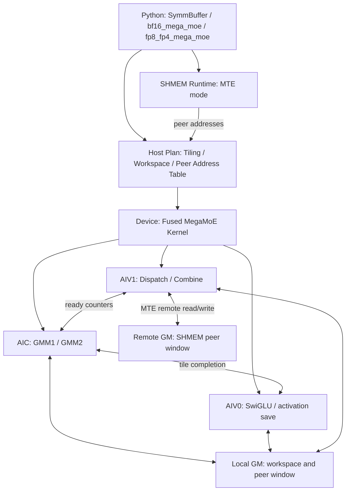
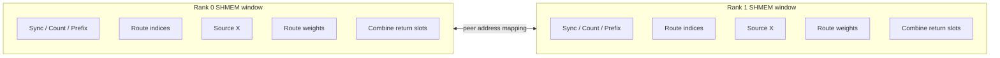
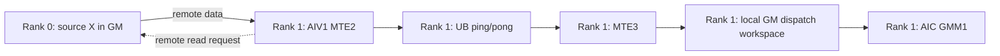
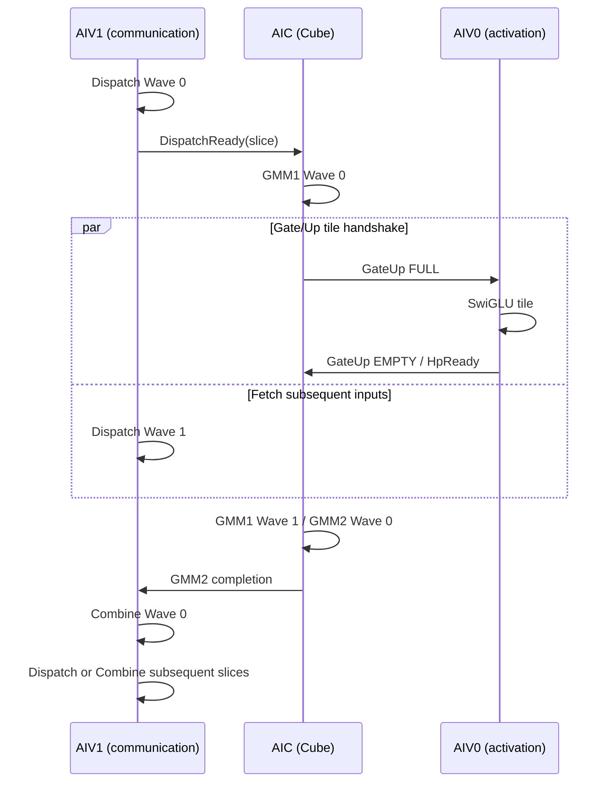
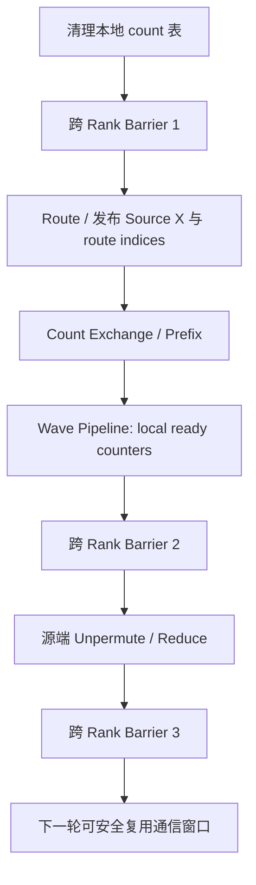
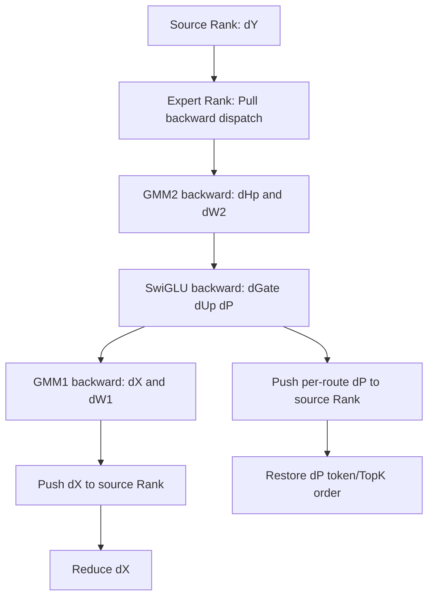
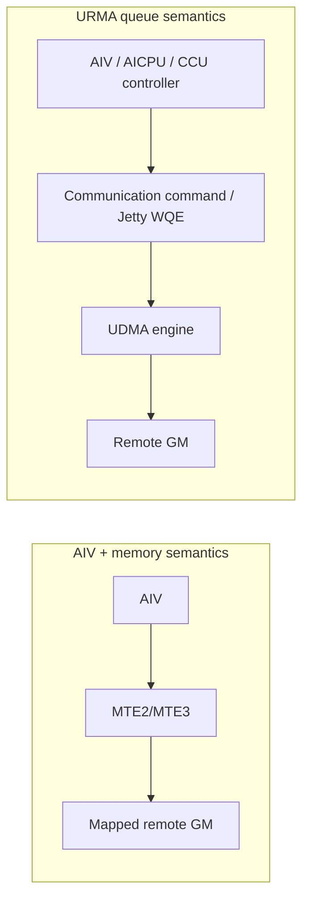

# Ascend 950 MegaMoE 通信原理与架构分析

> 技术调研文档｜源码基线：`lueelu/DeepEP` PR #10，Head `ab2cea96587054ef9ea8fb7cfa71729e2d16e732`（2026-11-24 更新的版本）
>
> 分析范围：BF16 推理与训练前向、反向为主，补充 W4A8/W8A8 推理通信路径。文档中的架构图为逻辑示意，不是硬件实测时序。性能数据来自 PR 作者，未独立复测。

## 1. 核心结论

MegaMoE 是 Ascend 950 上将 EP 通信与专家 FFN 计算融合的 MoE 算子。它将 Dispatch、GMM1、SwiGLU、GMM2、Combine 组织在同一个设备 Kernel 内，通过 AIC/AIV 分工、Wave 调度和细粒度就绪协议隐藏通信开销。

**当前公开 API 的通信主路径采用 AIV + MTE + SHMEM 的远端内存访问模型，而不是显式提交 URMA/UDMA Jetty 的队列通信模型。** 从 HCOMM 的分类角度看，其访问语义对应 AIV UB Memory（UBMem），但 MegaMoE 并没有直接使用 `AivUbMemChannel` 类。

| 维度 | 当前 MegaMoE 实现 |
|---|---|
| 通信控制方 | AIV（BF16 前向稳态主要是 AIV1） |
| 数据搬运 | MTE2：GM → UB；MTE3：UB → GM |
| 通信语义 | 通过映射的远端 GM 地址读写，即内存语义通信 |
| 通信窗口 | SHMEM 对称内存、peer 地址映射 |
| Dispatch | 目的端（专家 Rank）主动 Pull |
| Combine | 专家 Rank 主动 Push 到源 Rank |
| 计算 | AIC 执行 GMM1/GMM2，AIV0 执行 SwiGLU |
| URMA/UDMA | 主路径不显式使用 Jetty/WQE；存在未被当前公开路径选中的相关代码 |
| 大 CCU / AICPU | 不负责当前 Kernel 的主要 token payload 搬运 |

术语区分：**UB Memory 的 UB 是 Unified Bus（统一总线），AIV UB Buffer 的 UB 是 Unified Buffer（片上缓冲）。** 二者不是同一模块。源码能证实的是 MTE Runtime、远端地址和 AIV DataCopy；确切物理互联协议、片内路由及端口使用需结合 SHMEM SDK、拓扑及硬件资料另行核实。

## 2. 软件与硬件整体架构



### 2.1 关键软件模块

| 模块 | 代码位置 | 作用 |
|---|---|---|
| Python API | `experiments/megamoe/python/deep_ep_experimental/megamoe/api.py` | 对称缓冲区生命周期、选择 BF16/量化 Runtime |
| Runtime | `deep_ep/_runtime.py`、`csrc/runtime/session.cpp` | 初始化 SHMEM、分配对称通信窗口 |
| Host Plan | `plan_bf16.cpp`、`plan_quantized.cpp` | 生成 Tiling、布局与 peer 地址表 |
| BF16 前向 | `mega_moe_wave_bf16.hpp` | Dispatch/GMM/SwiGLU/Combine 融合调度 |
| Wave 规划 | `common/mega_moe_bf16_wave_plan.hpp` | Wave、Slice、Tile、临时 Workspace 布局 |
| Peer 规划 | `csrc/kernels/common/mega_moe_peer_rows.hpp` | 多源 Rank 均衡取数与区间映射 |
| GMM | `catlass_gmm/mega_moe_bf16_catlass_impl.hpp` | CATLASS 矩阵乘、核间就绪机制 |
| BF16 反向 | `mega_moe_bf16_backward.hpp` | 梯度通信、计算与归并 |

### 2.2 AIC/AIV 硬件分工

BF16 前向稳态中，每个 AIC 配对两个 AIV：AIC 执行 Gate/Up 和 Down GEMM；AIV0 读取 Gate/Up Tile 计算 SwiGLU；AIV1 负责 Dispatch 与 Combine，并消费 GMM2 完成通知。

| 资源 | 功能 | 典型数据路径 |
|---|---|---|
| AIC / Cube | 矩阵乘法 | GM → L1/L0A/L0B → Cube → L0C → GM |
| AIV0 / Vector | SwiGLU、激活保存 | GM → UB → Vector → GM |
| AIV1 / Vector | 远端内存读写、通信调度 | Remote GM → UB → Local GM，或逆向 |
| MTE2/MTE3 | AIV 搬运流水线 | GM → UB / UB → GM |
| GM/HBM | 权重、通信窗口和 Workspace | 各核间交换中间结果 |

上述分工描述稳态前向；路由初始化和收尾阶段可能动用更多 AIV。融合不意味着所有中间结果均不经过 GM，例如 BF16 Gate/Up Tile 仍通过 GM 双槽在 AIC 和 AIV0 间交接。

## 3. 如何从源码确认通信模型

### 3.1 Runtime 层：强制 MTE

`deep_ep/_runtime.py` 对 MegaMoE 的量化及 BF16 路径均禁止 `udma=True`：

```python
if self._megamoe and (group is None or udma):
    raise ValueError("MegaMoE requires a ProcessGroup or StoreGroup and the MTE runtime")
if self._megamoe_train and (udma or bootstrap != "default"):
    raise ValueError("MegaMoE training requires the MTE/default runtime")
```

`csrc/runtime/session.cpp` 初始化通信引擎：

```cpp
attr.option_attr.data_op_engine_type =
    udma ? static_cast<data_op_engine_type_t>(
               ACLSHMEM_DATA_OP_MTE | ACLSHMEM_DATA_OP_UDMA)
         : ACLSHMEM_DATA_OP_MTE;
```

因此 MegaMoE 选择 `ACLSHMEM_DATA_OP_MTE`，不是 UDMA Runtime。BF16 推理同样使用 `_megamoe_train` 对应的 BF16 Runtime 类型；是否训练由其他参数控制。

### 3.2 Host 层：建立远端内存地址

`plan_quantized.cpp` 中，量化路径显式指定：

```cpp
t.topoType = MegaMoeImpl::TOPO_TYPE_MTE;
```

获取远端窗口地址的核心逻辑：

```cpp
void* address = aclshmem_ptr(window, static_cast<int32_t>(peer));
TORCH_CHECK(address != nullptr, "MegaMoE cannot resolve SHMEM peer ", peer);
addresses[peer] = reinterpret_cast<uint64_t>(address);
```

远端地址无法解析时，这一代码路径报错，不会在此处自动回退至 URMA。

### 3.3 Device 层：AIV 通过 DataCopy 直接访问远端 GM

BF16 的 `CopyWavePayload()`、`CombineSlice()` 通过 `GetRankWinAddrWithOffset()` 取得远端地址，再使用 Ascend C `DataCopy`，由 MTE 搬运数据。

这一链路与显式构造 Jetty/WQE、提交 UDMA Read/Write 的实现不同。综合 Runtime、Host 和 Device 三层证据，可判断当前公开路径属于 AIV 驱动的远端内存语义访问。

### 3.4 为什么还有 URMA 代码？

`mega_moe_peermem.hpp` 保留 `TOPO_TYPE_MTE` 和 `TOPO_TYPE_URMA`；部分通用 Combine 代码存在 `GetUrmaCommHandle()`、`hcomm->WriteNbi()`。这些代码的存在不代表当前 MegaMoE 公开 API 实际使用它们。应以 Runtime 选择、Tiling 参数以及 Kernel 调用链为准。

## 4. SHMEM 通信窗口及路由元数据

每个 Rank 持有本地对称通信窗口，其他 Rank 可以通过 peer address table 访问对应区域；各 Rank 并非共享同一块物理 HBM。



上图是逻辑区域，实际偏移、对齐和条件分配由 Host/Device 共用布局代码决定。

### 4.1 Route：把 token 的 TopK 选择变成专家队列

设每卡 M 个 token、TopK=K、全局专家数 E、EP 并行度 P、每卡专家数 L=E/P。一个 token 的每个 TopK slot 对应一条 route。

例如 Rank 0 的 4 个 token、K=2：

| Token | Slot 0 | Slot 1 |
|---|---|---|
| T0 | E1 | E3 |
| T1 | E0 | E2 |
| T2 | E1 | E2 |
| T3 | E0 | E3 |

展开得到 `topk_idx=[1,3,0,2,1,2,0,3]`，按专家重排 route id：`[2,6,0,4,3,5,1,7]`。

- `route_id = token_id × K + slot`
- `token_id = route_id / K`（整数除法）
- `slot = route_id % K`

`InitBf16Routes()` 两次扫描：第一次统计专家 count，第二次生成连续的专家 route list；`InvertRows()` 建立反向索引。源 X 在 SHMEM 中按原 token 存一份，专家端根据 route index 拉取。这样减少源端的重复存储，但并不等于跨卡 payload 量自动减少 K 倍。

### 4.2 Count Exchange 与 Prefix

各 Rank 交换每个专家的路由行数，专家端计算接收总量及各源段的前缀。以 EP4、每卡一专家为例：

| 源 Rank | E0 | E1 | E2 | E3 |
|---|---:|---:|---:|---:|
| R0 | 2 | 2 | 2 | 2 |
| R1 | 1 | 3 | 3 | 1 |
| R2 | 3 | 1 | 2 | 2 |
| R3 | 2 | 3 | 1 | 2 |
| 专家接收总量 | 8 | 9 | 8 | 7 |

Rank 1 的 Expert 1 得到 9 行，其来源数量为 `[2,3,1,3]`，专家内 exclusive prefix 为 `[0,2,5,6]`。这些计数用于确定 GMM M 维、来源索引和规范行序。

实现包含两条路径：普通路径向 peers 交换完整源计数表；Compact 路径按目标 Rank 打包本地专家 count 与源端 prefix，减少冗余元数据。Compact 是否启用取决于配置、核数和 UB 容量。计数交换本身也是远端内存读写，使用 arrival tag 标记有效到达，避免将旧数据或初始零值误认为本轮结果。

## 5. Dispatch：专家端 Pull 数据

假设 Rank 0 的 token 路由到 Rank 1 的本地专家。Rank 1 从 count/prefix 和 route indices 获知需要读取哪些源 token。



设备端简化代码（省略索引批处理、保存状态等分支）：

```cpp
sourceX.SetGlobalBuffer(/* peer base + payloadOffset */);
DataCopy(buffer, sourceX[token * k_], k_);  // remote GM -> UB (MTE2)
// 等待前一次读完成
DataCopy(targetX[pendingRow * k_], previousBuffer, k_); // UB -> local GM (MTE3)
```

Ping/Pong 两个 UB 缓冲使下一次远端读与上一次本地写能够交叠。`MTE2_MTE3` 表示读完成后可以写，`MTE3_MTE2` 表示写完成后才能重用对应 UB 槽。

Pull 的优势是专家 Rank 可以按照本地计算调度自主取数，不必等待源 Rank 将整个批次全部推送完成。缺点是大量小块远端读、热点 peer 和共享 AIV/MTE 资源可能成为瓶颈。

## 6. Wave 与 Peer-balanced 规划

### 6.1 Wave / Slice / Tile

- Wave：具有一定 GMM 任务预算的调度批次，可能包含多个专家的 Slice。
- Slice：单专家在一个 Wave 内的路由行区间。
- Tile：单个 AIC 承担的矩阵乘子任务。

BF16 前向以 256 行为 Group，GMM1 每个配对任务包括 128 列 Gate + 128 列 Up，GMM2 以 256 列划分。

令 AIC 核数为 C，隐藏维 H，FFN 中间维 F：

```text
g1 = ceil(F / 128)
g2 = ceil(H / 256)
groups = max(ceil(2*C/g1), ceil(C/g2))
wave_rows = groups * 256
```

示例 C=36、H=7168、F=3072，则 g1=24、g2=28、groups=3、满 Wave 行预算=768，GMM1/GMM2 分别有 72/84 个列块任务（满行组）。专家尾块仍消耗一个 Group 预算，因此实际行数可能小于 768。

### 6.2 Peer-balanced Dispatch

如果一个专家从四个 peer 分别接收 600 行，第一波 768 行的规划如下：

| 方式 | R0 | R1 | R2 | R3 | 合计 |
|---|---:|---:|---:|---:|---:|
| Source-major | 600 | 168 | 0 | 0 | 768 |
| Peer-balanced | 192 | 192 | 192 | 192 | 768 |

MegaMoE 按各 peer 的可用行数计算每个 Slice 的配额，已耗尽的 peer 被跳过。`GetPeerRowCut()`、`TakePeerRowPrefix()` 和 `PeerTransferCursor` 通过区间公式、商余数或二分实现，不需要逐 token 规划表。

需要区分“逻辑轮流取数”和“物理布局”：配额可按 round-robin 理解，但同一 Slice 中一个 peer 的实际数据段可以连续落位。不同 Rank 的 peer 起始顺序可旋转，减少对同一源端的集中访问。量化路径的部分实现还可使用 ranks-per-node 的跨机交错策略；不能直接推断 BF16 使用相同 rail 规划。

**Peer-balanced 不改变专家归属，不复制专家，不解决专家总体负载倾斜。** 它优化的是既定路由下的读取顺序及波次内 peer 配额。

### 6.3 规范行序与通信行序

BF16 训练保存状态按 `[local expert][source rank][source token/TopK route]` 的规范行序排列；前向通信/计算 Workspace 可以使用 peer-balanced 行序。

`PeerRowLayout::SourceRow()` 定位源端 route 队列；`SavedRow()` 计算训练保存的规范地址。Dispatch 和 Combine 复用同一映射，实现结果正确返回，同时使反向保存与调度顺序解耦。

## 7. 通算融合与核间同步

### 7.1 AIC、AIV0、AIV1 流水线



此图展示依赖关系，而非固定硬件时序。AIC 的 GMM1/GMM2 共用 Cube 资源，AIV1 的 Dispatch/Combine 共用通信搬运资源。

默认 BF16 前向模式 0 交错执行 GMM1/GMM2；当每卡源 token 数 >=512 时，`UseGmm2Lag()` 启用一波延迟，让 AIC 先执行下一波 GMM1，给前一波 SwiGLU 更多执行时间。训练构建还可选择模式 1（分阶段执行 GMM1/GMM2，完整 Hp Workspace）。

### 7.2 就绪协议

| 生产者 → 消费者 | 同步机制 | 正确性保证 |
|---|---|---|
| Dispatch → GMM1 | `waveDispatchReady_`，MTE3 完成后 AtomicAdd | Slice 所需数据写完，AIC 才读 |
| GMM1 → SwiGLU | `GateUpCompletion` 双槽 FULL/EMPTY | Gate/Up 写完才读；消费完成才复用槽 |
| SwiGLU → GMM2 | Hp ready counter | GMM2 所需激活已就绪 |
| GMM2 → Combine | `Gmm2AivCompletion`、`PollDownCompletion()` | 等待真实 FIX 写出完成，不仅是任务已提交 |
| Combine → 后续 Wave | `waveReleased_`、`OutputSlotAvailable()` | 在途发送完成后才能复用环形槽 |

同步分四层：单核流水线 `SetFlag/WaitFlag`；配对 AIC/AIV 的 intra-core-group 硬件事件；单卡 GM 原子计数和 `SyncAll`；跨卡 SHMEM generation counter/同步标记。

特别是 GMM2 的 `Submit()` 只说明通知已入队，实际结果是否写完由完成协议确认。把“任务提交”误认为“数据可读”会引入异步竞争。

### 7.3 跨 Rank 同步边界



| 阶段 | 目的 |
|---|---|
| Barrier 1 | 保证上一轮/本轮初始化的计数清理完成，避免覆盖新数据 |
| Count Exchange | 确认路由元数据到达，建立接收计划 |
| Wave Pipeline | 不需要逐 Wave 全 EP Barrier，按局部就绪推进 |
| Barrier 2 | 确认各 Rank 的 Combine 发送完成，源端开始归并 |
| Barrier 3 | 确认旧窗口数据读取完成，允许下一次调用安全复用 |

上述三个显式跨 Rank Barrier 对应所分析的 BF16 前向；量化、小 BS 和反向路径存在各自的协议，不能照搬该数量。

## 8. Combine：专家端 Push 与源端归并


`CombineSlice()` 根据与 Dispatch 相同的 peer row mapping 获取源 Rank 和远端 route 槽：

```cpp
const uint64_t remoteRow = layout.SourceRow(slice, t);
DataCopy(buffers[ping], input[row * k_], k_); // local GM -> UB
DataCopy(output[row * k_], buffers[ping], k_); // UB -> remote GM
```

（摘录省略同步和地址设置，完整代码不能省略事件依赖。）

回传槽按源端重排的 route 队列定位，并非简单直接写最终 token 输出位置。源端通过 inverse route index 恢复 token/TopK slot 顺序，再执行归并。

BF16 推理：源 Rank 在 FP32 中对专家输出乘路由权重并累加，再转 BF16。BF16 训练：路由权重在 SwiGLU 后、GMM2 前施加，源端直接归并已乘权输出。两者在实数数学中等价，但 BF16 舍入位置不同，不能要求逐 bit 一致。

## 9. Workspace 与流控

BF16 前向接收容量超过 8 个 Wave 时使用 8 槽循环 Workspace；小于该容量时保留密集布局。槽映射为 `wave % 8`，在默认交错调度下，Dispatch X 与 GMM2 输出复用行空间，Combine 完成后才允许覆盖。

```text
Wave 0 → slot 0       Wave 8  → slot 0（等待释放）
Wave 1 → slot 1       Wave 9  → slot 1（等待释放）
...
Wave 7 → slot 7       Wave 15 → slot 7（等待释放）
```

以 EP8、M=4096、K=6、H=7168、均衡路由、Wave=768 行为例：

| 对应临时 X 行容量 | 行数 | BF16 字节容量 |
|---|---:|---:|
| 完整接收 | 24576 | 336 MiB |
| 8 个 Wave | 6144 | 84 MiB |

此例仅比较 X 对应的理论临时行容量，减少 75%；不代表整个算子节省 75%。SHMEM 窗口、路由元数据、完整训练保存状态、Hp、Gate/Up 等仍需分别计算。模式 1 中 Hp 按完整接收容量分配，释放条件不同。

接收容量需要考虑热点 Rank，而不是只取平均值 M×K。若每个 token 的 TopK 专家不重复，单 Rank 的理论最坏接收行数为 `M_max × EP × min(K, L)`。已知实际峰值时可以配置更紧的 `max_recv_tokens`，同时必须确保不会出现容量不足。

## 10. BF16 训练反向通信



反向沿前向保存的 route index 和规范行序访问梯度。源 Rank 在通信窗口发布 dY，专家 Rank 按路由拉取；dX 返回后按 token 累加，dP 保留每条 TopK route 对应的梯度。专家权重梯度 dW1/dW2 在专家本地计算，沿完整专家行归约；不要将单个 Wave 的权重梯度视为最终梯度。

- `gmm1_save_type=bf16`：直接保存和读取 Gate/Up。
- `gmm1_save_type=mxfp8`：量化保存 Gate/Up，反向解码；符合形状条件时同样支持 128 行 Wave。
- `gmm1_save_type=none`：按专家重算 GMM1，采用整专家调度。
- `save_dispatched_x=False`：可由训练框架使用 `dispatch_rebuilder` 重建本 microbatch 的专家 X 和路由权重，节省保存内存；需满足布局、流同步和生命周期约束。

在保存模式的反向 Wave 中，AIV 按 128 行发布 dO ready，AIC 计算 dHp，SwiGLUGrad 消费对应列。等待 dO 时可穿插执行已满足依赖的前序专家 dW2 Tile。反向回传仍采用 MTE 远端访问模型。

## 11. 量化推理路径

| 维度 | BF16 | W4A8 | W8A8 |
|---|---|---|---|
| Runtime | MTE | MTE | MTE |
| 前向 | 支持 | 支持 | 支持 |
| 训练反向 | 支持 | 不支持 | 不支持 |
| 共享专家融合 | 不支持 | 支持 | 不支持 |
| 输入 payload | BF16 X | FP8 X + Scale | FP8 X + Scale |
| Wave 规划 | BF16 专用 Tile | 量化 Tile | 量化 Tile |

W4A8 在小 BS（B<=256）时使用较小 Wave、符合拓扑条件时启用 rail 路由中转、六槽 Combine 行缓冲及 epoch/count 协议；大 BS 使用 Prefill Wave、两槽 Combine 和输入/输出握手。W4A8 共享专家可以与 routed expert 通信并行计算。W8A8 不支持该共享专家路径。

这些是量化路径的专用策略；并不意味着通信底层切换成 URMA。

## 12. 与其他通信模型及 EP 算子的区别

### 12.1 AIV UB Memory 与 URMA



URMA 图是抽象模型，不代表所有 AICPU/CCU 实现都以完全相同的软件形式直接提交 WQE。

| 维度 | MegaMoE MTE 路径 | URMA/UDMA 路径 |
|---|---|---|
| 控制方 | AIV | AIV、AICPU/TS 或 CCU 等，视实现而定 |
| payload 访问 | MTE 远端内存读写 | UDMA 等通信引擎执行任务 |
| 显式 Jetty/WQE | 主路径无 | 队列语义相关 |
| AIV UB Buffer | 主 token 搬运使用 | 是否经过 UB 取决于实现，可由引擎直接搬运 GM |
| 通算同步 | GM counter + 核间事件 | 需要将通信完成状态与计算依赖对接 |

如果将 MegaMoE 改成 CCU/URMA 路径，潜在收益是释放 AIV/MTE 资源，但需要重设计 Wave 粒度通信任务下发、完成可见性、依赖与缓冲区生命周期。是否更快必须测量，不能仅凭控制硬件类型判断。

### 12.2 DeepEP-Ascend / MoonEP / MegaMoE

| 对比 | DeepEP-Ascend | MoonEP（专家复制/规划方向） | MegaMoE |
|---|---|---|---|
| 核心优化 | Dispatch/Combine 通信原语 | 专家负载与路由规划 | 完整 MoE 层通算融合 |
| 通信控制和引擎 | 需区分具体 Runtime，存在 UDMA 等路径 | 需按分支核实 | 当前公开路径 AIV+MTE |
| 专家复制 | 非通信原语本身的必需功能 | 可通过规划使用复制专家 | 当前 BF16 路径不复制专家 |
| 调度 | 通信接口与上层组织 | 规划后通信 | Wave/Slice/Tile 核内流水线 |
| 性能重点 | 延迟、带宽、通信吞吐 | 负载均衡与通信瓶颈 | MoE E2E、MFU、重叠率 |

这里的 DeepEP/MoonEP 对比是架构定位，不是对其所有分支和所有硬件路径的完整代码审计。理论上可将专家负载均衡规划与 MegaMoE 结合，但需明确权重映射、路由协议及训练梯度归并，当前 PR 未直接实现。

## 13. 性能与 EP64/128 测试建议

### 13.1 PR 公布的 BF16 训练测试

环境：Ascend 950、CANN 9.2、SHMEM `7af7bf4`、CATLASS `2b4bd7c`、TopK=6、均衡路由、BF16 保存 Gate/Up、关闭 Timer。每轮取最慢 Rank，再对各轮取 P50。

| EP | 每卡 M / H / F | 每卡专家数 | 前向 P50（ms） | 前向 MFU | 反向 P50（ms） | 反向 MFU |
|---:|---|---:|---:|---:|---:|---:|
| 8 | 4096 / 7168 / 3072 | 4 | 8.190 | 91.8% | 16.854 | 89.2% |
| 16 | 8192 / 5120 / 2304 | 3 | 9.012 | 89.4% | 18.814 | 85.6% |
| 32 | 4096 / 7168 / 3072 | 4 | 8.488 | 88.6% | 17.042 | 88.2% |

按 PR 口径，均衡路由下有效矩阵乘 FLOPs：前向 `6 × M × K × H × F`，BF16 保存模式反向 `12 × M × K × H × F`，峰值为每卡 432 TFLOP/s。MFU=有效 FLOPs/（实测时间×峰值）。MFU 不等于通算重叠率或链路带宽利用率；EP16 形状不同也不能直接作为固定工作量扩展曲线。

### 13.2 测试矩阵和指标

| 层次 | 指标 | 目的 |
|---|---|---|
| 通信 | Dispatch / Combine remote payload GB/s，读写延迟 | 评估 MTE 远端访问能力 |
| 元数据 | Route、Count Exchange 耗时 | 评估大 EP 的启动开销 |
| 计算 | GMM1/GMM2 active time、等待时间、MFU | 判断 Cube 是否被通信阻塞 |
| Vector/MTE | SwiGLU、Dispatch、Combine 耗时及等待 | 判断 AIV/MTE 资源竞争 |
| 同步 | 核间等待、跨 Rank Barrier P50/P95 | 定位慢 Rank 与尾部开销 |
| 端到端 | 最大 Rank MoE 延迟、Token/s、MFU | 衡量业务真实收益 |
| 内存 | SHMEM、临时 Workspace、训练保存状态 | 衡量大 EP 容量与流控限制 |

建议使用 EP8/16/32/64/128，在固定每卡工作量的 weak scaling 和固定全局工作量的 strong scaling 下分别测试；增加均衡路由、热点专家、热点 Rank、小 BS、长 Prefill 等场景。应注明本地/远端 route 比例，带宽计算采用真实跨卡 payload，不把本地拷贝和逻辑重复字节直接当成互联流量。BF16 前向与量化路径的统计口径需分开。

通算融合收益可用 `T_serial - T_fused` 评估；精确的通信隐藏率应根据 Profiling 时间轴计算通信与计算区间交集，如 `duration(comm ∩ compute)/duration(comm)`（明确计算区间并集与分母）。不能直接把不同核的耗时相加，更不能用 MFU 替代重叠率。

### 13.3 核内 Timer

开启 `DEEPEP_BUILD_MEGAMOE=ON`、`DEEPEP_MEGAMOE_TIMER=ON` 后可使用相应诊断流程，关注 `AIV_INIT_ROUTING`、`AIV_COUNT_EXCHANGE`、`AIV_DISPATCH`、`AIC_GMM1_WAIT`、`AIC_GMM1`、`AIV_SWIGLU_WAIT`、`AIV_SWIGLU`、`AIV_COMBINE_WAIT`、`AIV_COMBINE`、`AIV_SYNC_WAIT` 等事件。正式性能与 Timer 诊断建议分别执行，以避免打点影响结果。

EP64/128 的关键风险：peer 数增加导致单 peer 小块化、Count Exchange 扩展成本、跨卡同步尾延迟、热点专家、AIV1 Dispatch/Combine 竞争、环形槽背压与 MTE 带宽瓶颈。PR 给出的 BF16 实测规模为 EP8/16/32；接口支持更大规模并不能证明 EP64/128 仍有同样 MFU。

## 14. 源码阅读索引

以下永久链接均固定到本次分析的 PR Head，避免分支更新导致行号变化。

| 代码位置 | 建议阅读内容 |
|---|---|
| [PR #10](https://github.com/lueelu/DeepEP/pull/10) | 合入范围、测试与性能数据 |
| [MegaMoE README](https://github.com/xixing-321/DeepEP/blob/ab2cea96587054ef9ea8fb7cfa71729e2d16e732/experiments/megamoe/README.md) | 公开接口、模式及调度说明 |
| [Runtime 限制](https://github.com/xixing-321/DeepEP/blob/ab2cea96587054ef9ea8fb7cfa71729e2d16e732/deep_ep/_runtime.py#L123-L128) | MegaMoE 禁止 UDMA |
| [Session 初始化](https://github.com/xixing-321/DeepEP/blob/ab2cea96587054ef9ea8fb7cfa71729e2d16e732/csrc/runtime/session.cpp#L40-L95) | MTE 引擎配置 |
| [量化 Tiling](https://github.com/xixing-321/DeepEP/blob/ab2cea96587054ef9ea8fb7cfa71729e2d16e732/experiments/megamoe/csrc/plan_quantized.cpp#L215-L235) | 固定 TOPO_TYPE_MTE |
| [FillPeerAddresses](https://github.com/xixing-321/DeepEP/blob/ab2cea96587054ef9ea8fb7cfa71729e2d16e732/experiments/megamoe/csrc/plan_quantized.cpp#L272-L279) | aclshmem_ptr 远端映射 |
| [InitBf16Routes](https://github.com/xixing-321/DeepEP/blob/ab2cea96587054ef9ea8fb7cfa71729e2d16e732/experiments/megamoe/csrc/kernels/mega_moe/stage/mega_moe_route_bf16.hpp#L88-L135) | 两次扫描、索引与 Source X 发布 |
| [Count Exchange](https://github.com/xixing-321/DeepEP/blob/ab2cea96587054ef9ea8fb7cfa71729e2d16e732/experiments/megamoe/csrc/kernels/mega_moe/mega_moe_wave_bf16.hpp#L451-L625) | 普通/Compact 计数交换 |
| [CopyWavePayload](https://github.com/xixing-321/DeepEP/blob/ab2cea96587054ef9ea8fb7cfa71729e2d16e732/experiments/megamoe/csrc/kernels/mega_moe/mega_moe_wave_bf16.hpp#L823-L911) | MTE Pull + Ping/Pong |
| [DispatchWave](https://github.com/xixing-321/DeepEP/blob/ab2cea96587054ef9ea8fb7cfa71729e2d16e732/experiments/megamoe/csrc/kernels/mega_moe/mega_moe_wave_bf16.hpp#L914-L951) | AIV1 分工、Ready 发布 |
| [Wave Plan](https://github.com/xixing-321/DeepEP/blob/ab2cea96587054ef9ea8fb7cfa71729e2d16e732/experiments/megamoe/csrc/kernels/mega_moe/common/mega_moe_bf16_wave_plan.hpp) | Wave 大小、Slice 与环形布局 |
| [Wave Math](https://github.com/xixing-321/DeepEP/blob/ab2cea96587054ef9ea8fb7cfa71729e2d16e732/csrc/kernels/common/mega_moe_wave_math.hpp) | 任务预算、8 槽与任务分配 |
| [Peer Row Planner](https://github.com/xixing-321/DeepEP/blob/ab2cea96587054ef9ea8fb7cfa71729e2d16e732/csrc/kernels/common/mega_moe_peer_rows.hpp) | peer-balanced 配额 |
| [Peer Row Layout](https://github.com/xixing-321/DeepEP/blob/ab2cea96587054ef9ea8fb7cfa71729e2d16e732/experiments/megamoe/csrc/kernels/mega_moe/common/mega_moe_bf16_peer_row_layout.hpp) | 通信行序与保存行序转换 |
| [CATLASS GMM](https://github.com/xixing-321/DeepEP/blob/ab2cea96587054ef9ea8fb7cfa71729e2d16e732/experiments/megamoe/csrc/kernels/mega_moe/catlass_gmm/mega_moe_bf16_catlass_impl.hpp) | Gate/Up 配对及就绪检查 |
| [GateUpCompletion](https://github.com/xixing-321/DeepEP/blob/ab2cea96587054ef9ea8fb7cfa71729e2d16e732/experiments/megamoe/csrc/kernels/mega_moe/common/mega_moe_bf16_wave_completion.hpp) | FULL/EMPTY 双槽协议 |
| [PollDownCompletion / CombineSlice](https://github.com/xixing-321/DeepEP/blob/ab2cea96587054ef9ea8fb7cfa71729e2d16e732/experiments/megamoe/csrc/kernels/mega_moe/mega_moe_wave_bf16.hpp#L1053-L1124) | GMM2 完成确认与 MTE Push |
| [ProcessWave](https://github.com/xixing-321/DeepEP/blob/ab2cea96587054ef9ea8fb7cfa71729e2d16e732/experiments/megamoe/csrc/kernels/mega_moe/mega_moe_wave_bf16.hpp#L1128-L1328) | AIC/AIV0/AIV1 主循环、流控 |
| [Forward entry](https://github.com/xixing-321/DeepEP/blob/ab2cea96587054ef9ea8fb7cfa71729e2d16e732/experiments/megamoe/csrc/kernels/mega_moe/mega_moe_wave_bf16.hpp#L762-L812) | 输入 Barrier、路由发布 |
| [FinishForward](https://github.com/xixing-321/DeepEP/blob/ab2cea96587054ef9ea8fb7cfa71729e2d16e732/experiments/megamoe/csrc/kernels/mega_moe/mega_moe_wave_bf16.hpp#L1371-L1389) | 输出 Barrier、归并和安全复用 |
| [BF16 Backward](https://github.com/xixing-321/DeepEP/blob/ab2cea96587054ef9ea8fb7cfa71729e2d16e732/experiments/megamoe/csrc/kernels/mega_moe/mega_moe_bf16_backward.hpp) | 反向通信与梯度融合 |
| [Peer memory layout](https://github.com/xixing-321/DeepEP/blob/ab2cea96587054ef9ea8fb7cfa71729e2d16e732/experiments/megamoe/csrc/kernels/mega_moe/common/mega_moe_peermem.hpp) | MTE/URMA 布局定义 |
| [通用 Combine](https://github.com/xixing-321/DeepEP/blob/ab2cea96587054ef9ea8fb7cfa71729e2d16e732/experiments/megamoe/csrc/kernels/mega_moe/stage/mega_moe_gmm2_combine.hpp) | 保留的 URMA 分支及量化回传 |

## 15. 总结与待验证问题

MegaMoE 的关键并非将单独 EP 通信带宽推到最高，而是在 AIV 驱动的 MTE 远端内存访问基础上，将 Pull Dispatch、Push Combine 与 AIC 的计算进度直接耦合，通过多 peer Wave 规划、就绪计数、双缓冲及环形 Workspace 实现通算重叠。

已由源码确认：Runtime 选 MTE、AIV DataCopy 访问远端地址、BF16 前向 AIC/AIV 分工、Wave/Peer 规划、核间同步与三处显式跨 Rank Barrier。尚未独立验证：SHMEM SDK 内部的物理协议及端口选择、跨超节点互联能力、EP64/128 真机性能、MTE 与 UDMA/CCU 替代方案的实际收益。后续需要结合锁定版本 SHMEM 源码与真机 Profiling 进行验证。
