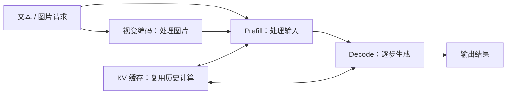
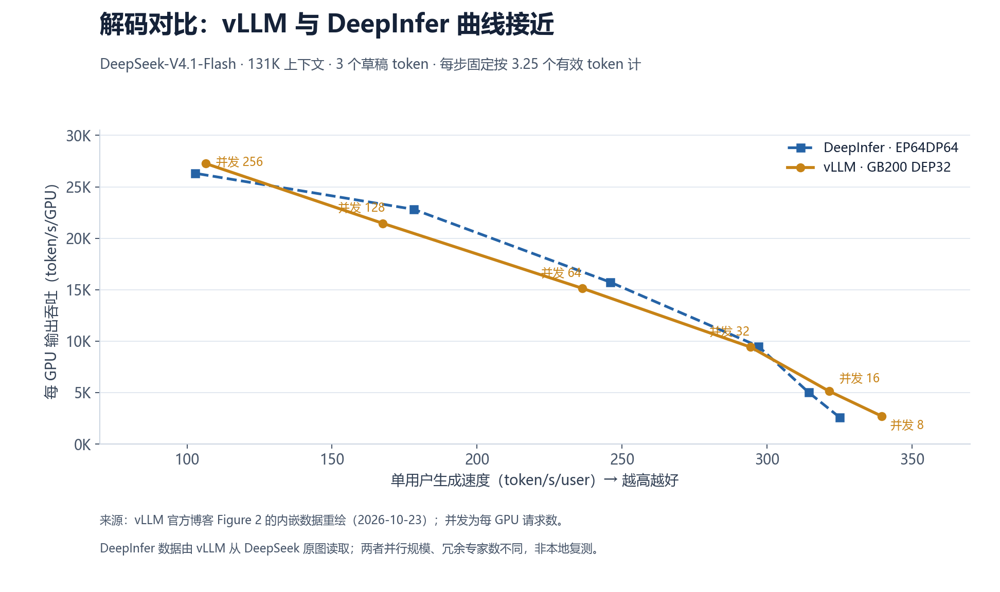
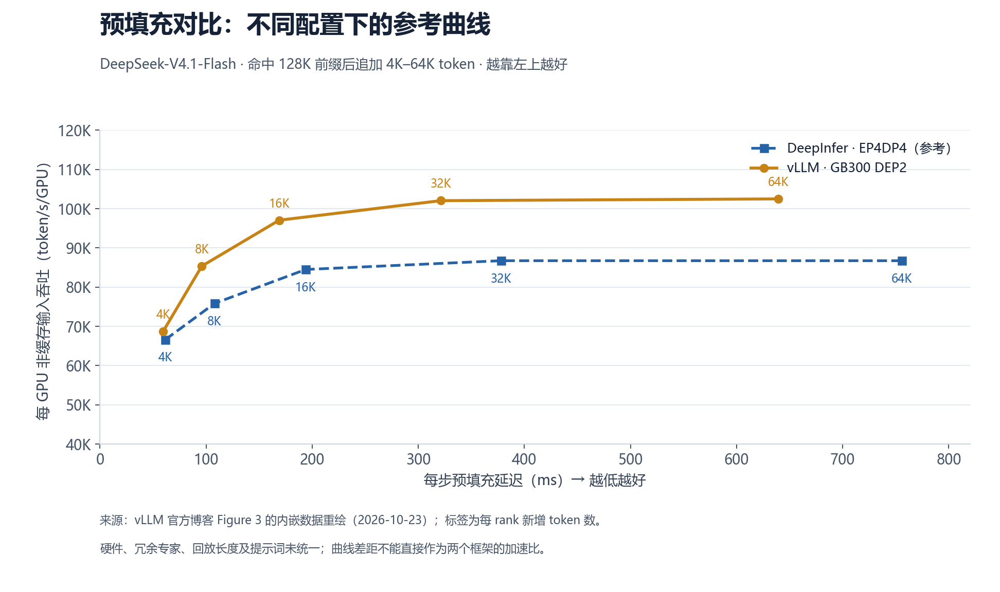

# DeepInfer 技术简报

> 更新日期：2026-11-09。基于 DeepInfer 官方仓库及 vLLM 官方博客整理；性能数据来自官方发布，未做本地复测。DeepInfer 代码基线：`a679bb86`。

## 1. 整体架构

DeepInfer 是 DeepSeek 面向自有模型优化的推理引擎。它主要把**模型计算、并行通信、请求调度和缓存管理**组合起来，提高吞吐、降低延迟。

这是官方完整服务的简化架构。**本次开源主要提供推理核心和离线调用入口，完整缓存服务、分离部署编排和跨实例负载均衡仍需补齐。**[1][2]

引擎内部可分为三层：

| 层次 | 主要作用 |
| --- | --- |
| 调度层 | 组织请求与批次，将 CPU 准备工作和设备计算重叠 |
| 模型执行层 | 执行注意力、MoE 专家计算、草稿生成与采样 |
| 算子与通信层 | 使用 FlashMLA、DeepGEMM、DeepEP、DeepSelect 等加速库，并适配 GPU/NPU |

并行策略上，注意力使用数据并行（DP），MoE 使用专家并行（EP）。官方生产配置倾向于 **Prefill 使用较小 EP 组，Decode 使用较大 EP 组**；专家负载均衡（EPLB）负责减少热门专家导致的设备忙闲不均。[2]

## 2. 支持的特性和模型范围

| 项目 | 当前公开支持范围 |
| --- | --- |
| 模型 | **DeepSeek-V4.1-Flash**；示例默认权重为 `DeepSeek-V4.1-Flash-1017` |
| 硬件 | **NVIDIA SM100 GPU、华为 Ascend 950 NPU** |
| 运行方式 | 离线推理，支持文本和图片输入 |
| 并行 | Attention DP、balanced CP（上下文并行）、MoE EP 与 EPLB |
| 加速算子 | 优化的注意力、矩阵计算、MoE、TopK 和采样算子 |
| 投机解码 | DSpark 先生成草稿，再由主模型验证；支持按置信度动态选择验证长度 |
| SWA 有界回放 | 只重算输入尾部的有限片段，减少滑动窗口状态恢复和部分 Prefill 工作 |
| 异步调度 | CPU 准备下一批次时，设备继续执行当前批次，减少等待 |
| 结构化输出 | 支持正则表达式、JSON Schema、EBNF 语法约束 |
| 结果一致性 | 批次不变性、确定性采样当前仅在 NVIDIA 上提供相应支持 |

来源：[官方功能列表][1]。SWA 有界回放涉及近似状态重建，不能当作与完整历史计算严格等价的优化。[2]

## 3. 明确未支持的特性

这里区分“本次未交付完整组件”和“已明确的平台能力限制”。

| 类别 | 当前缺项或限制 |
| --- | --- |
| 完整在线服务 | 本次发布没有完整提供集群 KV 缓存系统、视觉编码/Prefill/Decode 分离部署编排，以及跨 DP 副本的请求负载均衡 |
| 昇腾 Engram 主机卸载 | 尚不支持把 Engram 记忆表放在 CPU 内存，当前保留在 NPU 内存 |
| 昇腾批次不变性 | 对应选项在 NPU 配置中被禁用，不能承诺与 NVIDIA 相同的端到端确定性能力 |
| 昇腾部分融合路径 | attention 周边整段融合、MegaGate、Mega mHC 等路径尚未与 GPU 对齐 |
| 昇腾采样 TopK | 采样场景存在回退到 `torch.topk` 的路径 |

来源：[发布边界][1]、[Engram 限制][2]、[NPU 配置][3]、[融合路径][4]、[5]、[6]、[TopK 回退][7]。

**其他模型与硬件没有列入当前支持清单。** 例如不能据此认定 DeepSeek V3/R1、Ascend 910B/910C 或 H100/H200 已获当前版本支持。另需注意：引擎内已有 KV 管理和 EPLB，缺少的是完整集群服务组件。[1][2]

## 4. 基础的性能数据

| 项目 | 官方发布数据 | 测试条件与含义 |
| --- | --- | --- |
| DeepInfer Prefill 基准 | 发布吞吐—延迟曲线 | 4 张 SM100，位于同一高速互联域 |
| DeepInfer Decode 基准 | 发布吞吐—单用户速度曲线 | 64 张 SM100，位于同一高速互联域；对比数值见第 5 节 |
| 动态验证相对固定验证 | 估算有效吞吐提升 **5.4%** | EP64/DP64、每 rank 并发 60、Open-PerfectBlend；不是所有负载的固定收益 |
| 昇腾稀疏注意力算子 | Prefill 最高约 **410 TFLOPS**，Decode 最高约 **360 TFLOPS** | Ascend 950 的 FlashMLA 单算子结果，不是整个框架的吞吐 |

来源：[DeepInfer README][1]、[部署 Q&A][2]、[FlashMLA][8]。

读数据时注意两点：**单算子峰值不等于整机服务性能；投机解码的吞吐要核对实际接受 token 数。** DeepInfer 基准脚本存在“草稿全部接受”的计数口径，不能直接作为用户实际得到的输出速度。[9]

## 5. vLLM 博客发布的性能数据和 DeepInfer 对比图

采用 vLLM 官方于 **2026-10-23** 发布的 [《Serving DeepSeek-V4.1-Flash at Scale》][10]。

### 5.1 解码对比

条件：131K 上下文、3 个草稿 token，每步固定按 3.25 个有效 token 计。vLLM 使用 **GB200 DEP32**，DeepInfer 参考为 **EP64DP64**。两者结果接近，vLLM 博客给出的差距为 **6% 以内**。[10][11]

| 每 GPU 并发请求数 | vLLM 输出吞吐 | DeepInfer 输出吞吐 |
| ---: | ---: | ---: |
| 8 | 2,716 | 2,600 |
| 16 | 5,142 | 5,029 |
| 32 | 9,419 | 9,504 |
| 64 | 15,129 | 15,738 |
| 128 | 21,447 | 22,810 |
| 256 | 27,261 | 26,317 |

单位：token/s/GPU，按官方图数据计算后取整。DeepInfer 数值由 vLLM 从 DeepSeek 原图读取，存在读图误差；两者并行规模和冗余专家数不同。[原始交互图][11]

### 5.2 Prefill 对比

vLLM 使用 **GB300 DEP2、无冗余专家、128-token 回放**；DeepInfer 参考使用 **EP4DP4、32 个冗余专家、140-token 回放**。由于硬件和输入配置未统一，曲线用于参考，**不能把差距直接当作框架加速比**。[10][12]

两图按 vLLM 官方交互图的内嵌数据重绘，未新增测试。横纵轴和计数方法保持一致：[解码原图][11]、[Prefill 原图][12]。vLLM 博客称 Prefill 参考原图未注明具体硬件；当前 DeepInfer README 则注明为 4 张 SM100。[1][10]

### 5.3 vLLM 在线服务数据

| 指标 | 博客发布结果 |
| --- | --- |
| GB300 NVL72、P/D 分离与 Wide-EP | AgentX 综合吞吐 **954K token/s/GPU**，P90 单用户速度 **196 token/s** |
| 四张 B300、单用户专用低延迟路径 | P90 单用户速度 **826 token/s** |

**954K 包含缓存输入、非缓存输入和输出，不能解释为纯输出速度。** 博客中的 7.9 倍提升是相对 vLLM 自己此前的单节点结果，不是相对 DeepInfer。[10]

这些对比均为 NVIDIA 结果，尚不能用于判断昇腾上的框架性能差距。

**主要来源**：DeepInfer 官方仓库、部署 Q&A、FlashMLA，以及 vLLM 官方博客和配套交互图；各项链接见正文。

[1]: https://github.com/deepseek-ai/DeepInfer/blob/a679bb86ce36e883a98a97733492b686e5b9a08e/README.md
[2]: https://github.com/deepseek-ai/DeepInfer/blob/a679bb86ce36e883a98a97733492b686e5b9a08e/doc/inference_deployment_qa.md
[3]: https://github.com/deepseek-ai/DeepInfer/blob/a679bb86ce36e883a98a97733492b686e5b9a08e/deepinfer/worker/runtime_config.py
[4]: https://github.com/deepseek-ai/DeepInfer/blob/a679bb86ce36e883a98a97733492b686e5b9a08e/deepinfer/model_executor/models/v4_modules/attn.py
[5]: https://github.com/deepseek-ai/DeepInfer/blob/a679bb86ce36e883a98a97733492b686e5b9a08e/deepinfer/model_executor/models/v4_modules/mlp.py
[6]: https://github.com/deepseek-ai/DeepInfer/blob/a679bb86ce36e883a98a97733492b686e5b9a08e/deepinfer/model_executor/models/v4_modules/hc.py
[7]: https://github.com/deepseek-ai/DeepInfer/blob/a679bb86ce36e883a98a97733492b686e5b9a08e/deepinfer/npu_ops/deep_select.py
[8]: https://github.com/deepseek-ai/FlashMLA/blob/2e5429fc5653bab6e081f09477126f731882a6a9/README.md
[9]: https://github.com/deepseek-ai/DeepInfer/blob/a679bb86ce36e883a98a97733492b686e5b9a08e/examples/README.md
[10]: https://vllm.ai/blog/2026-10-23-deepseek-v41-flash-pd-wide-ep
[11]: https://vllm.ai/blog-assets/interactive_pages/dsv41-pd-decode-vs-deepinfer.html
[12]: https://vllm.ai/blog-assets/interactive_pages/dsv41-pd-prefill-vs-deepinfer.html
