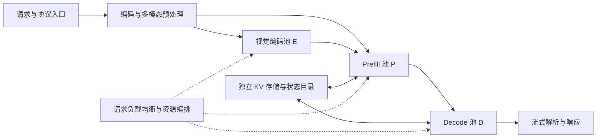

# DeepInfer 技术报告：架构、关键优化、当前限制与对昇腾的参考

> 调研日期：2026-11-09（Asia/Singapore）。  
> 研究对象：官方仓库 [deepseek-ai/DeepInfer](https://github.com/deepseek-ai/DeepInfer)。  
> 代码基线：[`a679bb86ce36e883a98a97733492b686e5b9a08e`](https://github.com/deepseek-ai/DeepInfer/commit/a679bb86ce36e883a98a97733492b686e5b9a08e)，提交时间 2026-11-03，提交说明为更新 V4.1 Flash 部署 Q&A 至 v0.2。主包版本标记为 `0.1.0`。  
> 方法：核查官方 README、部署 Q&A、核心代码、基准说明及主仓库锁定的算子子模块版本；本文未实际部署模型，也未在 GPU/NPU 上复测性能。文中“官方测量”不代表本地验证。

## 目录

1. [核心结论与项目定位](#一核心结论与项目定位)
2. [整体架构与开源边界](#二整体架构与开源边界)
3. [并行策略与负载均衡](#三并行策略与负载均衡)
4. [模型执行、稀疏注意力与低精度计算](#四模型执行稀疏注意力与低精度计算)
5. [DSpark 与置信度调度验证](#五dspark-与置信度调度验证)
6. [异步调度与执行图](#六异步调度与执行图)
7. [KV 缓存、YOCO 与 SWA 有界回放](#七kv-缓存yoco-与-swa-有界回放)
8. [结构化输出、多模态与结果一致性](#八结构化输出多模态与结果一致性)
9. [性能数据及其解释边界](#九性能数据及其解释边界)
10. [当前限制与工程风险](#十当前限制与工程风险)
11. [对昇腾平台的参考与落地建议](#十一对昇腾平台的参考与落地建议)
12. [复现与评估方案](#十二复现与评估方案)
13. [源码阅读索引与参考资料](#十三源码阅读索引与参考资料)

## 一、核心结论与项目定位

DeepInfer 是 DeepSeek 面向自有模型的大规模推理框架，最有价值的技术特征是把模型结构、低精度算子、MoE 通信、投机验证、主机调度和缓存复用作为一个整体优化。当前公开支持的模型是 **DeepSeek-V4.1-Flash**，默认示例权重为 `deepseek-ai/DeepSeek-V4.1-Flash-1017`；支持 **NVIDIA SM100 GPU 与华为 Ascend 950 NPU**。[项目说明][s1]

评估它时，应先把握以下四点：

- **开源的是高性能推理核心及离线入口。** 官方生产系统还依赖独立 KV 存储、视觉编码/Prefill/Decode 分离部署，以及跨实例负载均衡；这些组件没有随本次发布完整提供。[开源边界][s1]
- **不同阶段采用不同的优化目标。** Prefill 倾向于在容量允许时使用较小 DP/EP 组；Decode 倾向于在高速互联域内使用 Wide-EP，同时依赖专家和请求两级均衡。[部署策略][s2]
- **减少“无效工作”与提升算力利用率同样重要。** 置信度调度减少低收益的草稿验证，SWA 有界回放减少状态恢复工作，异步调度隐藏 CPU 间隙，融合算子减少中间数据搬运。[特性说明][s1]、[部署 Q&A][s2]
- **对昇腾而言，已有直接可研究的实现。** 重点应放在 Ascend 950 上的算子、布局、流水和通信协同，以及尚未完成的能力；不能据此推定 Ascend 910B/910C 等其他代际已被支持。[平台范围][s1]、[DeepEP-Ascend 环境范围][s18]

本文将证据分成三类：**仓库实现**表示能在锁定代码中找到对应路径；**官方系统设计**表示 Q&A 描述的生产系统，未必完整开源；**分析建议**表示基于前两类证据提出的昇腾落地判断。后文所有资源规划和优化优先级均属于建议，不能当作官方配置承诺。

常用术语：DP 为数据并行，EP 为专家并行，CP 为上下文并行，TP 为张量并行，ENP 为 Engram 并行，EPLB 为专家并行负载均衡。TTFT 指首 token 延迟，TBT/TPOT 衡量生成阶段 token 间隔，SLO 指服务目标，HBM 为设备高带宽内存，SWA 为滑动窗口注意力。文中的 rank 指并行组中的一个执行参与者，通常对应一个设备进程。

## 二、整体架构与开源边界

### 2.1 从端到端系统看 DeepInfer

官方生产架构采用视觉编码器 E、Prefill P、Decode D 分离，加上独立存储节点。其目的是分别控制首 token 延迟和生成阶段时延，并允许各阶段独立配置资源。[系统架构][s2]



图中是官方完整系统的概念关系，不能理解为这些服务都已包含在 DeepInfer 仓库中。生产请求入口还使用单独发布的 **DeepSeek Recipe** 处理 API 协议、模型模板、token 编解码与流式解析。[组件边界][s2]

### 2.2 引擎内部的分层

| 层次 | 主要职责 | 代表代码 |
| --- | --- | --- |
| 离线入口与配置 | 提交请求、配置模型和并行规模、管理输出 | `deepinfer/entrypoints/llm.py`、`deepinfer/config.py` |
| 引擎与调度器 | 请求状态、批次选择、预填充与解码推进、输出处理 | `deepinfer/engine/llm_engine.py`、`csrc/engine/scheduler.hpp` |
| Worker 与模型执行 | 构造输入、执行主模型和草稿模型、采样、图捕获 | `deepinfer/worker/model_runner.py`、`cuda_graph_runner.py` |
| 模型运行时 | V4.1 注意力、MoE、跨层 KV 复用、Engram、mHC 等模块 | `deepinfer/model_executor/models/v4_modules/` |
| 设备算子与通信 | FlashMLA、DeepGEMM、DeepEP、DeepSelect、TileLang 算子 | `vendor/`、`deepinfer/model_executor/layers/tilelang_ops/` |
| 平台适配 | 设备、通信后端、数据类型、主机内存注册 | `deepinfer/platform.py`、`deep_cluster/hardware/` |

Python 承担模型和执行流程组织，C++ 承担调度、输入准备、采样准备等频繁运行的 CPU 逻辑。源码保留 vLLM 派生标记，官方也说明其最初主要基于 vLLM，并参考 SGLang 与 TensorRT-LLM；这不意味着它与这些框架的当前接口或调度语义兼容。[项目来源][s1]、[扩展构建][s23]

### 2.3 必须区分的两种“缓存”和两种“负载均衡”

**引擎内 KV 块管理已经存在，集群级持久化缓存系统没有完整开源。** 仓库包含 `block_manager.hpp`、`cache_engine.py` 和状态缓存处理逻辑；README 所列缺失项指完整服务依赖的 KV 系统，不能据此写成“DeepInfer 没有 KV cache”。[缓存实现][s12]、[发布范围][s1]

同理，**MoE 专家负载均衡 EPLB 已有公开实现，跨 Prefill/Decode/VE 实例的请求负载均衡没有完整提供**。二者优化对象分别是专家槽位分布和请求归属，需要协同工作。[EPLB 实现][s10]、[系统负载均衡][s2]

## 三、并行策略与负载均衡

### 3.1 Attention DP、MoE EP 与 balanced CP

Attention DP 让不同设备处理不同请求或 token 分片；MoE EP 让专家参数分布在设备之间，token 经 dispatch 发送到相应专家，计算后 combine 回原请求。两者相结合，使请求在注意力侧分散，而专家侧汇聚足够多 token，提高矩阵计算效率。[并行设计][s2]

仓库还支持 balanced CP，用于长上下文分担计算，并在模型注意力路径中通过 all-gather 等操作协同。配置并不是任意组合：代码要求 `(CP × DP)` 能被 EP 整除；默认 DP 会根据 EP 与 CP 推导，Engram 并行组另有约束。[配置校验][s3]

这里有一个易混点：**README 的“支持 CP”与 Q&A 的“当前生产不使用 CP”并不矛盾。** 前者描述引擎能力，后者描述特定生产负载下的部署选择。官方称其测量中 CP 端到端最多比 DP 慢约 5%，虽然能改善长请求尾部 TTFT，但会引入算子、通信、CPU 开销，并可能加重专家不均衡。[能力清单][s1]、[生产选择][s2]

### 3.2 为什么 Prefill 小 EP，Decode 大 EP

| 阶段 | 官方生产策略 | 主要原因 | 不能忽略的代价 |
| --- | --- | --- | --- |
| Prefill | EP2–8 / DP2–8，容量允许时尽量小 | 单个专家已有较大 token 批量；减少跨卡流量和均衡难度 | 组过小可能放不下参数或工作区 |
| Decode | EP64–128 / DP64–128，Wide-EP | 汇聚更多请求的专家工作，分摊专家权重读取，提高算术强度 | 通信、同步、专家偏斜和整组故障影响扩大 |
| VE | 一般每实例单设备，可采用较便宜设备 | 视觉编码负载与语言生成解耦 | 图片 patch 数和 CPU 预处理仍需均衡 |

以上是官方系统经验，数字主要围绕其 GPU/超节点部署给出，不构成所有昇腾拓扑的推荐值。[配置依据][s2]

从工程角度看，扩大 EP 的收益来自“每个本地专家处理更多 token、单卡持有更少专家权重”等因素；当瓶颈转移到通信或同步后，继续扩大规模可能失去收益。官方也明确讨论了 Decode 中 EP 超过一定规模后收益放缓，以及共享超节点互联产生干扰的问题。[Wide-EP 边界][s2]

### 3.3 EPLB：逻辑专家与物理副本分离

公开 EPLB 的核心是维护两层身份：模型 gate 选择**逻辑专家**，运行时再映射到包含冗余副本的**物理专家槽位**。引擎累计各专家 token 数，在统计窗口上重新估计热度，周期性调整放置并搬运权重。[EPLB 状态与重排][s10]

其技术意义是避免模型路由热点被固定设备绑定。冗余副本增加 HBM 开销，但能把热门专家的工作分摊出去；重排间隔过短则会增加权重迁移和同步开销。因此应同时观察热度变化速度、最慢 rank 与平均 rank 的负载比，以及每次重排的停顿。

官方生产参数可作为调参起点，而非默认值说明：[生产 EPLB 参数][s2]

| 项目 | Prefill | Decode |
| --- | --- | --- |
| 初始冗余副本 | 每设备约 4 个，最终需满足 EP 整除 | 每设备约 1 个，最终需满足 EP 整除 |
| 热度统计窗口 | 100 steps | 1,000 steps |
| 重排间隔 | 1,000 steps | 10,000 steps |
| 官方 `moe_lb` 示例 | EP4DP4 为 1.074；EP2DP2 为 1.045 | 约 1.090 |

`moe_lb` 为最慢 rank 负载相对平均值的指标，越接近 1 越均衡。示例程序和测试使用的窗口、冗余专家数量、重排间隔与生产建议不同，不能把示例参数直接视为生产最优值。[示例配置][s24]

昇腾也有公开 EPLB 路径：代码在 NPU 上关闭基于 PyTorch `symm_mem` 的域内直接访问分支，采用通用点对点权重搬运。**DeepEP-Ascend 某些 `lb_*` 通信接口未实现，并不等于 DeepInfer 的 EPLB 整体不可用**，两者属于不同层次。[EPLB 平台分支][s10]、[DeepEP-Ascend 未完成项][s18]

### 3.4 请求均衡：生产系统采用不同的成本指标

官方完整系统按阶段设计请求路由：[请求均衡设计][s2]

- **Prefill：按预测计算时间分配。** 请求按上下文长度分档；引擎依据剩余计算配额拉取任务。单步 chunk 长度由 `cost(q,c)` 的拟合模型与时间预算求解，而不是仅按固定 token 数切块；组内预算通过 MIN 归约协调。
- **Decode：同时平衡并发数和累计 KV 长度。** 前者影响每步批量，后者影响注意力代价。仅按请求数均分，仍可能把长上下文集中在少数设备上。
- **VE：按待处理图片 patch 数分配。** 图片张数相同不代表计算量相同。

这些策略描述的是官方生产控制面。公开引擎已具备调度和分离运行的基础，不能因此推定完整分档路由器、全局状态采集和伸缩系统已在仓库中交付。

## 四、模型执行、稀疏注意力与低精度计算

### 4.1 模型与系统协同，而非通用 Transformer 执行器

V4.1 执行路径包含压缩 KV、稀疏索引、滑动窗口注意力、跨层 KV 复用、Engram、mHC 和草稿模型等专门逻辑。DeepInfer 为这些结构组织缓存、元数据和融合边界，其性能依赖模型结构本身，不能简单替换任意模型权重后期待相同收益。[模型构建][s4]、[注意力实现][s5]

稀疏注意力可概括为：先为 query 选择重要 KV 索引，再只对选中的 KV 计算注意力，并与滑动窗口等路径组合。这样降低主体注意力计算量，但索引打分、TopK、离散 KV 读取、反量化和布局转换可能成为新的瓶颈。[FlashMLA 算法与接口][s19]

### 4.2 算子库如何分工

| 组件 | 在 DeepInfer 中的作用 | 昇腾实现与注意点 |
| --- | --- | --- |
| FlashMLA | 稀疏注意力 Prefill/Decode，分页低精度 KV 访问 | 已有 Ascend 950 内核；整段 norm/RoPE/attention/cast 融合路径尚未支持昇腾 |
| DeepGEMM | 线性投影、分组 GEMM、索引打分、MegaMoE 等 | `DeepGEMM-Ascend` 采用同名 Python 包 `deep_gemm` |
| DeepEP | 专家 token 分发与合并，部分其他通信原语 | `DeepEP-Ascend` 采用同名包 `deep_ep`，依赖昇腾通信栈 |
| DeepSelect | 稀疏注意力索引 TopK、部分采样 TopK | 昇腾版的 dtype、索引类型等能力受限，采样场景存在回退 |
| TileKernels / TileLang | 归一化、量化、KV 操作、采样及元数据等 | 统一接口按 `cuda` / `asc` 目录选择设备实现 |

构建脚本会根据 `DEEPINFER_ACCELERATOR` 选择对应算子包。**接口复用与实现分离**让上层模型逻辑可以共享，同时让设备侧保留各自的数据布局和流水设计。[依赖构建][s16]、[算子分发][s15]

### 4.3 MegaMoE：融合通信与专家计算

传统 MoE 过程通常包含 gate、dispatch、专家第一层 GEMM、SwiGLU、第二层 GEMM、combine 等多个阶段。MegaMoE 将 dispatch、两次专家 GEMM、SwiGLU 与 combine 融合，减少阶段边界、临时张量和调度开销；gate 是否进一步融合取决于具体平台与路径。[MoE 实现][s6]、[昇腾 MegaMoE][s17]

公开代码中，MegaMoE 的使用受到精度和互联域条件约束。当前 NPU 路径限定于 `fp8xfp4`；NVIDIA 可选择的组合更多。NPU 的 MegaGate 分支没有启用，不能把整条 GPU gate+MoE 融合能力直接归给昇腾。[实际选择条件][s6]

值得注意的是，`parallel_state.py` 中域内判断在 NPU 上直接返回 `True`。这是当前后端的实现假设，不能当作任意跨机互联拓扑都满足高性能要求的证明。[域判断实现][s14]

对昇腾的直接启发是：融合的目标应是减少端到端关键路径上的搬运和等待，不能只统计 kernel 数量。若融合后资源竞争、通信排队或向量核负载变差，kernel 更少也可能更慢。

### 4.4 低精度不仅是 dtype，还包括 scale 和物理布局

官方 Q&A 与 FlashMLA 格式说明给出了以下关键路径：[低精度部署][s2]、[KV 字节格式][s19]

| 对象 | 代表格式 | 工程含义 |
| --- | --- | --- |
| SWA / V4.1 基础 KV | 512 个 E4M3 值，加每 32 个元素一个 UE8M0 scale；合计 528 B/token | RoPE 维度也量化；data 与 scale 相邻 |
| V4.1 FP4 压缩 KV | 512 个 E2M1 值，占 256 B；每 16 个元素一个 E4M3 scale，共 32 B；合计 288 B/token | FlashMLA 文档限定其作为 `extra_k_cache`，与 FP8 基础 KV 配合 |
| Indexer KV | MXFP4，per-32 UE8M0 scale | 降低索引缓存容量和读取量 |
| MoE routed expert 权重 | MXFP4，per-32 UE8M0 scale | 降低专家参数容量与带宽压力，可搭配 FP8 activation |

因此，看到接口中的 `is_fp8_kvcache` 或 `fp8` 命名，不能推断实际所有 KV 都使用同一种 FP8 布局。也不能把某个 token 的 288 B 当成整个模型每 token 的总缓存占用：还要计算层数、共享关系、压缩比例、SWA 状态和其他元数据。

DeepGEMM-Ascend 的 scale 布局与 NVIDIA 不同：沿 K 维两个 UE8M0 scale 打包成 `int16`，并采用适合设备的存储顺序；主框架也把平台 scale 类型区分为 NPU `int16` 与 GPU `int32`。[scale 布局][s17]、[平台类型][s13]

此外，MoE 参数处理代码会检查 FP4-QAT 权重条件。部署时必须联合确认 checkpoint、量化粒度、scale 编码、分组对齐和算子版本；不能把 FP4 当作任意 FP8 权重的无条件运行时替换。[权重处理][s6]

### 4.5 Engram：按 n-gram 哈希查询的分片记忆表

Engram 运行时将输入 token 映射到压缩词表，按 n-gram 计算查询哈希，从分片 embedding 表取得条目，经融合 KV 投影与 gate 注入 hidden states。它引入的是模型参数表的稀疏查询，和请求历史的 KV cache 属于不同对象。[Engram 运行时][s35]

其 ENP 并行组沿词表维度分片。官方 GPU 部署把表放在主机内存，通过单边 RDMA 异步获取所需条目，以隐藏访存并减少 HBM 常驻量；NPU 目前将数据保留在设备内存。Engram 的容量、查询通信和与各层计算的重叠，应作为独立模块评估。[部署方式][s2]

### 4.6 mHC：多路残差状态与跨子层融合

mHC（Manifold-Constrained Hyper-Connections）把残差主干扩展为 `hc_mult` 路，在 attention/FFN 前混合得到单路输入，子层执行后再将结果写回多路主干。运行时还包含混合系数计算、Sinkhorn 归一化、RMSNorm 和低精度转换等操作。[mHC 运行时][s36]

DeepInfer 用延迟 post 数据把前一个子层的写回与下一个子层的 pre 操作衔接；满足条件时，可通过 `mega_mhc` 融合 post、pre、归一化及转换。锁定代码的这条大融合路径仅在 GPU 上启用，NPU 有独立的小算子和 prenorm 实现。因此，mHC 既是激活容量和搬运成本来源，也是昇腾向量计算与融合优化的重要候选；应先测实际关键路径占比。[平台选择条件][s36]

## 五、DSpark 与置信度调度验证

### 5.1 从固定草稿长度到收益驱动的验证预算

投机解码先由较便宜的草稿模型产生若干候选，再由主模型验证，希望一次主模型执行输出多个有效 token。若所有请求始终验证相同长度，低接受率请求会消耗无效验证计算。

DeepInfer 的 DSpark 使用 Confidence Head 预测草稿 token 的接受概率，并结合测得的硬件耗时曲线，决定本轮值得验证多少 token，以及分给哪些请求。公开配置通过 `DEEPINFER_ENABLE_MTP_VARLEN=1` 启用动态验证；`DEEPINFER_USE_NEXTN_DECODE` 控制最大草稿长度，默认 5，设为 0 可关闭投机解码。[功能与配置][s1]、[调度机制][s2]

### 5.2 调度器实际优化什么

结合 `MTPVarlen::schedule()`，可用下式解释其目标：

\[
\max_K\quad
\frac{B+\sum_{j=1}^{K}\hat p_j}
{T_{\mathrm{profile}}(\operatorname{bucket}(B+K))
+\Delta T_{\mathrm{runtime}}+T_{\mathrm{sampler}}}
\]

其中 B 是请求数；每请求至少安排一个主模型位置；K 是额外验证预算；\(\hat p_j\) 是排序后的预计边际有效产出；`bucket` 表示向实际捕获的执行图尺寸对齐。公式是对代码的解释性归纳，并非对外 API 契约。[预算搜索源码][s7]

几个实现细节比“按置信度排序”更关键：

1. **按真实图档位估计耗时。** 增加一个验证 token 可能使整个批次跳到更大的执行图，成本不是严格线性的。
2. **用运行时反馈修正启动曲线。** 代码维护 forward 耗时残差与 sampler 时间的估计，减少启动 profile 与真实负载的偏差。
3. **区分总预算与请求内长度分配。** 总预算使用较早一轮置信度，以维护代码要求的依赖关系；每请求长度使用较新信息。
4. **异步场景在设备侧修正。** CPU 提前调度时本轮 confidence 尚未返回，先确定总预算，再通过设备算子利用最新 confidence 分配请求长度。

这些行为在 C++ 调度器、ZOS 和设备侧元数据处理之间配合完成。[MTPVarlen][s7]、[异步验证说明][s2]

### 5.3 收益依赖并发与工作负载

官方在 Open-PerfectBlend、EP64/DP64 条件下给出的数据是**由基准推算的有效吞吐**：每 rank 并发 60 时，平均验证长度从 5 降至 3.58，平均接受长度从 3.30 变为 3.21，估算吞吐从 13,730 增至 14,466 tok/s/rank，即约 +5.4%。同表中并发 16 时为 −1.5%，并发 96 时为 +11.0%。[完整测量条件与数据][s2]

因此，动态验证不是固定倍数的加速开关。其收益取决于草稿质量、confidence 校准、上下文、图档位、采样成本和设备性能曲线。对昇腾必须重测这些关系，不能照搬 SM100 上的最优预算。

## 六、异步调度与执行图

### 6.1 “零开销”指隐藏关键路径间隙

同步执行链可以写成：

```text
CPU schedule(N) → device forward(N) → sample(N)
→ device/CPU sync → CPU post-process(N) → schedule(N+1)
```

设备等待结果处理和下轮调度时会空闲。DeepInfer 将 CPU 调度与设备计算重叠：设备执行第 N 轮 forward/sample 时，CPU 提前准备第 N+1 轮，处理更早一轮结果，再推进后续采样。[官方流水说明][s2]

“zero-overhead batch scheduler”应理解为尽量把调度耗时移出设备关键路径，CPU 本身仍在消耗时间。若 CPU 工作超过设备计算，或者存在额外同步点，仍会暴露开销。

### 6.2 为什么需要设备侧元数据和延迟回收

提前一轮调度时，上一轮到底接受几个 token、请求是否结束等信息可能尚未回到 CPU。执行器必须维护在途状态，修正位置与有效 token、处理回退、避免提前复用缓存和请求资源。仓库以 `zos.cpp`、输入准备逻辑、Worker 状态和延迟释放路径实现这类协同。[ZOS 实现][s8]、[引擎推进][s9]

这也是异步调度迁移的主要难点：它改变了请求状态的可见时间和内存生命周期，不能只把 `schedule()` 放进线程。针对 EOS、取消、抢占、草稿拒绝和结构化输出，应验证跨轮状态是否一致。

### 6.3 执行图与动态长度并不冲突

Decode 预先捕获多个批量档位，运行时选择能覆盖实际 `total_q` 的最小档位并填充。动态验证先确定 token 预算，再匹配图档位；它并不要求每轮构造一个全新的动态形状图。[图选择与重放][s11]

主模型与 DFlash 草稿模型各有图运行路径；捕获、预热和缓存会增加启动时间与内存开销。较密档位减少 padding，较疏档位减少图数量，需按真实请求分布选择。[模型运行器][s22]

NPU 上源码通过 `torch_npu` 的兼容机制复用许多 `torch.cuda` 风格接口，图捕获也有 NPU 分支，因此文件名包含 `cuda` 不能作为“只支持 GPU”的依据。但 NPU 不支持相同的 `keep_graph` 行为，通信库也有自己的图支持边界，仍需逐路径验证。[NPU 图分支][s11]、[平台兼容层][s13]

## 七、KV 缓存、YOCO 与 SWA 有界回放

### 7.1 不同类型的缓存采用不同生命周期

官方系统将分页块缓存、滑动窗口状态和在途设备缓存分开管理：[缓存体系][s2]

| 类型 | 官方系统存储位置 | 复用或恢复方式 |
| --- | --- | --- |
| 正在运行的 block KV 和 state KV | 推理设备内存 | 引擎直接访问 |
| main KV 与 indexer K 的分页块 | 独立 3FS 存储集群 | 根据前缀元数据匹配，异步读取与换入 |
| 需要跨请求保存的 SWA 状态 | 生产机器的主机内存 | 目录定位本机或远端单副本 |
| YOCO consumer SWA 等可重建状态 | 运行时状态槽；不按同样方式长期保存 | 通过有限尾段回放重建 |

3FS 存储和 SWA 目录是完整系统设计，不能等同于公开 `CacheEngine` 已实现完整跨机缓存服务。

### 7.2 长期缓存的目的：消除重复 Prefill

官方将 Agent 流量 KV 保留约 3 天、聊天流量约 7 天，利用 SSD 容量覆盖更长的复用间隔。其架构允许任意 Prefill 引擎读取任意前缀，从而减少“前缀亲和路由”与“负载均衡”之间的冲突。[长期缓存与路由][s2]

读取分为三个阶段：入口先做哈希链元数据匹配；独立进程把 KV 读到主机共享内存；引擎再按层换入设备内存，尽量与 forward 重叠。入口匹配在路由前发生，无法完全隐藏。Q&A 中使用 NIC/GDR 隐藏细粒度换入开销的描述属于 GPU 生产路径，不能直接认定 NPU 已有相同实现。[缓存数据路径][s2]

一个可用于昇腾规划的分析判据是：

\[
T_{\mathrm{match}}+T_{\mathrm{fetch,exposed}}+T_{\mathrm{swap,exposed}}
< T_{\mathrm{prefill,saved}}
\]

这里比较的是未被排队或计算隐藏的读取时间，而非整段存储 I/O 总时间。缓存是否划算还应加入存储容量、SSD 写入寿命和网络成本。

### 7.3 YOCO 为何能减少 Decoder Prefill

在 V4.1 的相关结构中，部分 decoder 层的 block KV 可以由 encoder 输出投影获得，consumer 层不必像普通模型那样完整重算所有历史 query；但滑动窗口状态仍需要恢复。[架构与回放说明][s2]

DeepInfer 提供三种截断模式：[环境变量语义][s25]

- `off`：关闭该截断路径。
- `mask`：保留 query 行，仅收窄 SWA 可见范围，作为语义对照路径。
- `compact`：实际移除被截断区域的 consumer query，减少后续计算。

`compact` 不能随意丢弃全长 KV 投影。源码保留 full hidden 与 full metadata，先生成和写入覆盖完整上下文的 main/index KV，再对精简 query 运行 consumer 路径。[完整 KV 与精简 query 协同][s5]

### 7.4 SWA 有界回放是一种受控近似

官方描述的 bounded replay 仅重算最近窗口的一段 token，并把其注意力可见范围限制在回放片段内。因此恢复得到的 SWA 状态是**近似状态**，并非完整历史前向的严格等价结果。[近似性质][s2]

应区分两件事：

1. **mask 与 compact 在同一截断语义下是否等价。** 公开工具提供单设备元数据检查和多设备 teacher-forcing logprob / TopK 比较。
2. **截断回放相对完整历史计算是否影响模型效果。** 这需要任务级精度评估，前述等价检查不能代替它。[等价检查范围][s21]

当前 README 给出的 decoder 设置为：

```bash
export DEEPINFER_YOCO_PREFILL_TRUNCATION_MODE=compact
export DEEPINFER_YOCO_PREFILL_KEEP_TOKENS=140
```

保留长度必须满足：

\[
\mathrm{KEEP\_TOKENS}\geq \mathrm{SWA\_window}+\mathrm{max\_backtracking\_tokens}
\]

`max_backtracking_tokens` 至少覆盖最大草稿长度加一，并可被配置放大，所以 140 是当前默认 V4.1 设置的建议值，不能在修改窗口或草稿长度后机械沿用。[配置要求][s1]、[回退长度定义][s25]

Q&A 同时描述 encoder SWA 缺失时回退一个块、重算窗口以恢复的策略。本文将该描述视为完整系统设计，不据此宣称公开离线入口已交付全部外部前缀存储命中流程。

## 八、结构化输出、多模态与结果一致性

### 8.1 结构化输出

公开接口支持 regex、JSON Schema 和 EBNF 等约束，通过 `SamplingParams.so_args` 提供。格式约束先编译为语法自动机，生成时逐步推进 matcher、生成合法 token mask，并作用于采样；仓库依赖 XGrammar。[功能接口][s1]、[编译与运行流程][s2]

完整系统将编译与推理解耦，以免复杂 schema 编译阻塞设备。离线示例包含结构化输出回归检查，但这不能替代复杂 schema、长工具参数、流式中断等真实场景的验证。[示例验证范围][s20]

### 8.2 多模态

仓库包含图像预处理、ViT、对齐模块与图片 token 输入，离线样例覆盖纯文本、单图和多图。生产采用独立 VE 池，公开 benchmark 的 image 模式则可在同一引擎内运行视觉编码器和语言模型。[多模态样例与计时边界][s20]

对 NPU，视觉 attention 还有专门导入替换路径。评估时应分别测 CPU 图片处理、图像 H2D、VE 设备计算和后续 Prefill；仅看 VE kernel 时间会漏掉请求首 token 延迟中的其他部分。[NPU 替换入口][s26]

### 8.3 批次不变性与确定性采样是两个能力

**批次不变性**要求请求与不同同批请求组合时，模型结果仍保持一致；**确定性采样**还要求在固定输入、采样参数和 `seq_seed` 下输出相同。固定随机种子并不能自动消除计算归约顺序或批量形状变化带来的数值差异。

当前 README 仅在 NVIDIA 上提供这两项承诺：批次不变性使用 `DEEPINFER_BATCH_INVARIANT=1`；确定性采样还要求关闭动态 MTP 验证，并给出固定 `seq_seed`。NPU 的配置代码直接断言不得开启该批次不变性选项。[一致性支持范围][s1]、[NPU 配置限制][s27]

即便 NPU 底层 GEMM 开启某些 deterministic 算法，也不能据此宣称端到端 batch-invariant 或跨设备逐位一致。

## 九、性能数据及其解释边界

### 9.1 三种测量层次不能混用

| 层次 | 官方证据 | 可以说明什么 | 不能说明什么 |
| --- | --- | --- | --- |
| 单算子 | FlashMLA、DeepGEMM-Ascend、DeepEP-Ascend 的性能数据 | 特定形状、精度、拓扑下的内核能力 | 完整服务或所有模型的加速倍数 |
| 离线引擎 | DeepInfer Prefill/Decode 扫点与 Pareto 曲线 | 指定上下文、批量、EP 下的执行效率 | 带排队、存储、路由和故障影响的在线 SLO |
| 在线生产 | Q&A 描述的集群和负载均衡经验 | 架构设计动机与实际部署经验 | 第三方能直接复现的公开服务基准 |

README 展示的 Prefill 曲线测于 **4 张 SM100**，Decode 曲线测于 **64 张 SM100**，各自在一个 scale-up 域内。它们不是昇腾端到端结果，也不是同等资源下 Prefill 与 Decode 的直接比较。[主仓库基准条件][s1]

### 9.2 解码吞吐必须检查接受率口径

公开基准的 `decode_tokens_per_s_per_gpu` 按满接受口径计算：[基准说明][s20]、[计数实现][s28]

\[
\mathrm{throughput}_{\mathrm{full}}
=\mathrm{SPS}\times B\times(1+N)/CP
\]

SPS 是每秒 decode steps，B 是基准配置的 decode 请求数，N 是最大草稿长度。默认 B=64、N=5 时，每步按 384 个 token 计数，不能将它直接解释为真实用户获得的 token 数。

绘图脚本在固定验证长度模式下以 `τ = 1 + N × a` 做给定平均草稿接受比例的缩放。它还明确拒绝对 `mtp_varlen=1` 的数据套用同一绘图口径，因为动态验证下每步工作量本身已受接受情况影响。[绘图脚本][s29]

因此，可靠的有效吞吐应直接累计实际输出 token 并除以墙钟时间，另外记录草稿生成数、验证数、接受数、每轮实际产出和回退次数。不能将固定长度的接受率缩放公式无条件用于动态验证。

### 9.3 官方内核数据的代表性结果

以下数据均来自主仓库锁定版本的官方子模块文档，未在本地复测：

| 组件 | 官方条件与结果 | 解释边界 |
| --- | --- | --- |
| FlashMLA Ascend 稀疏注意力 | Ascend 950：Prefill 最高约 410 TFLOPS，Decode 最高约 360 TFLOPS | 特定算子与工况；不等于框架整体接近同样利用率 |
| DeepGEMM-Ascend dense GEMM | Ascend 950DT、CANN 9.20，BF16 形状 M=4096、N=7168、K=16384：约 431 TFLOPS，文档标示硬件利用率 99.8% | 大矩阵峰值；小批量、索引和通信可能受其他单元限制 |
| DeepEP-Ascend EP64 | Ascend 950DT、CANN 9.2.0，FP8 dispatch 323–327 GB/s，BF16 combine 294–298 GB/s | 使用手工配置的 PoC HDK、指定网络与负载；计时不包含最终 epilogue |

数据出处：[FlashMLA][s19]、[DeepGEMM-Ascend][s17]、[DeepEP-Ascend][s18]。

DeepEP-Ascend 文档中的商业 HDK 发布日期是当时的供应商计划，报告不据此确认截至调研日已正式可下载；已公布性能使用的 PoC 配置也不是可直接取得的公共发行版配置。[固件条件说明][s18]

### 9.4 Profiling 不能替代无扰动性能测量

基准说明指出 profiler 会扰动执行，trace 中的 step 时间用于分析 kernel 构成，不应直接用于计算 SPS。脚本也会避开部分负载统计 flush 区间，并把日志区间与静默计时区间分开。[测量窗口说明][s20]

这意味着报告在线性能时还需补测日志、统计归约、EPLB 重排、缓存访问和路由全部启用的长期窗口；经筛选的稳态内核窗口不能代表在线长尾。

## 十、当前限制与工程风险

### 10.1 模型、硬件和产品形态限制

| 限制 | 已核实事实 | 对使用者的影响 |
| --- | --- | --- |
| 模型覆盖窄 | README 当前仅列 DeepSeek-V4.1-Flash | 不能视作与通用多模型服务框架等价的替代品 |
| 硬件代际限定 | 当前声明 SM100 与 Ascend 950 | 不应推定 H100/H200、910B/910C 可用或具有相同性能 |
| 交付形态为离线核心 | 缺完整 KV 系统、E/P/D 编排及跨副本负载均衡 | 在线产品化仍需相当规模系统集成 |
| 环境要求严格 | Linux、GCC≥13、Python 3.12；GPU CUDA 13，NPU CANN 9.2 | 本文所在 Windows 工作区无法据此完成设备复测 |
| 依赖与 ABI 绑定 | NPU requirements 锁定 torch 2.13.0+cpu、torch-npu 2.13.0rc1；C++20 且要求 CXX11 ABI | 环境升级需要成套验证，不能任意替换单个依赖 |

依据：[项目支持与依赖][s1]、[NPU requirements][s30]、[扩展构建][s23]。

### 10.2 昇腾后端尚未完全对齐的能力

| 项目 | 当前状态 | 应如何理解 |
| --- | --- | --- |
| Batch-invariant / 确定性采样 | README 仅承诺 NVIDIA；NPU 禁用对应选项 | 这是明确功能差异，不能只靠随机种子补齐 |
| Engram CPU offload | NPU 尚不支持，数据保留在 NPU 内存 | 挤占 HBM，需要与专家副本、KV 和图工作区共同预算 |
| 整段 attention 融合 | norm/RoPE/attention/RoPE/cast 融合路径为 GPU 限定 | 昇腾已支持主体 attention，但融合粒度仍有优化空间 |
| Mega mHC | 当前 `mega_mhc` 大融合为 GPU 限定 | 昇腾已有 mHC 执行路径，但跨子层融合粒度不同 |
| MegaMoE / gate | NPU 当前选择 `fp8xfp4` MegaMoE；MegaGate 为 GPU 路径 | 不同精度和 gate 路径不能套用同一性能结论 |
| Sampler TopK | NPU patch 对返回 value 的采样场景回退到 `torch.topk` | Decode 小批量时可能暴露额外时延 |
| DeepSelect 输入与索引 | 锁定版 Ascend 仅 BF16 输入、int32 输出索引，TopK≤4096 | 上层 dtype、布局和回退必须纳入评估 |
| EPLB 权重重排 | NPU 未使用 GPU 的 PyTorch `symm_mem` 直接访问优化 | EPLB 可运行，但迁移成本需单独测量 |
| DeepEP-Ascend 部分原语 | Bucket reduce-scatter/all-reduce、`lb_*` 内核未完成；PP/Engram 等仍实验性 | 是该通信库的边界，不能扩大为 HCCL 或整个 DeepInfer 都无相应能力 |
| DeepEP-Ascend 图与拓扑 | 该库尚不支持 graph capture、hybrid communication、CPU-backed Engram；要求特定连接条件和多 rank 偶数约束 | 应与主框架图执行及 MegaMoE 路径分别核实 |
| 设备算子测试 | 测试钩子会跳过当前非 CUDA 后端尚缺失的 kernel | “测试通过”必须同时查看 skip 项及实际覆盖路径 |

依据：[平台与运行配置][s13]、[s27]；[MoE][s6]；[attention][s5]；[mHC][s36]；[NPU TopK 回退][s26]；[DeepSelect][s31]；[EPLB][s10]；[DeepEP-Ascend][s18]；[测试跳过机制][s32]。

`transfer_to_npu`、导入替换和临时 capability 设置等兼容措施也表明后端仍含适配层。它们方便共享上层逻辑，但升级 torch-npu、TileLang 或 CANN 时应重点验证接口和初始化行为，而非假设所有 CUDA 风格调用都天然等价。[平台适配实现][s13]

### 10.3 性能和稳定性上的结构性约束

**Wide-EP 把性能与高速域、均衡和容错绑定。** 官方指出单设备故障可能使整个 EP 实例不可用；生产靠冗余容量、请求重路由和重新选择健康设备集合恢复。第三方若只部署大 EP 组而没有这些机制，会扩大故障影响面。[故障与伸缩设计][s2]

**长期缓存必须解决版本兼容。** 官方用部署配置、模型权重和用户组标识兼容范围；tokenizer、块布局、权重或影响 KV 数值的框架变化都会使旧缓存不可复用。跨 GPU/NPU 使用缓存也必须先证明字节布局和数值语义兼容，不能因为模型相同就直接互读。[缓存兼容策略][s2]

**有界回放与投机调度必须分别验证正确性。** mask/compact 等价不证明与完整历史等价；采样确定性不证明与无投机模式逐位相同；PPL 基线通过也不证明所有任务质量保持不变。

**局部峰值不构成在线性价比结论。** 官方内核峰值、离线满接受吞吐和生产收入等指标口径不同。没有统一的输入输出长度、命中率、SLO、功耗与设备成本，无法推出“比某框架快多少”或“昇腾成本降低多少”。

## 十一、对昇腾平台的参考与落地建议

### 11.1 总体建议：先研究现成实现，再补关键差距

对 Ascend 950，DeepInfer 提供了从通信库、GEMM 和 attention 到模型执行器的完整研究链条；可以直接验证其原生后端，也可以把特定模块引入现有推理栈。对其他昇腾代际，更适合作为设计参考，首先建立硬件与软件能力矩阵，再决定移植范围。

以下均为分析建议，不表示相关工作已由本报告实现或验证。

### 11.2 第一优先级：建立面向真实负载的成本模型

昇腾优化应分别记录 Prefill 的 chunk/上下文/命中长度，以及 Decode 的并发、KV 长度、草稿长度与实际接受情况，并测出各图档位时间。该数据同时服务于 CP/EP 选择、投机验证预算、请求路由和资源伸缩。

尤其应观察：

- Prefill 是 Cube、向量计算、稀疏 gather、反量化、布局转换还是通信受限。
- Decode 是专家权重读取、attention KV 读取、采样、CPU 间隙还是跨 rank 等待受限。
- 启用统计、重排、共享专家和图重放后，瓶颈是否发生转移。

不能把设备峰值 FLOPS 直接代入所有模块的延迟估计。DeepGEMM-Ascend 文档中部分 MQA logits 场景被 FIX pipe 限制，就是矩阵相关操作不一定受矩阵算力限制的例子。[昇腾算子瓶颈][s17]

### 11.3 第二优先级：复用 FlashMLA 的昇腾流水设计

FlashMLA 已公开针对 Ascend 950 的详细分析，适合直接作为稀疏 attention 优化参考。[官方昇腾技术说明][s33]

| 设计点 | 官方实现思路 | 对昇腾工程的参考 |
| --- | --- | --- |
| 每 AI Core 的 head 数 | 代表设计选择 64 heads，平衡计算、L2 带宽与片上容量 | 按算存比与 SRAM 预算选择 tile，避免只追求更大矩阵 |
| Cube / Vector 协作 | 使用 1C2V，分摊 gather 发射、反量化、softmax 和 FixPipe 工作 | 向量核应按完整流水预算，不能当作无成本辅助资源 |
| Output 累加 | 在 UB 维护需 rescale 的 accumulator | 根据片上存储可执行的操作安排数据驻留 |
| KV layout 转换 | 先将稀疏 KV 搬到 UB，再以 SIMD 完成 ND→NZ，之后送入 L1 | 稀疏访存和矩阵布局转换应联合设计 |
| gather2 | 一个 MTE2 请求获取两个 token，减少有限队列深度的压力 | 在带宽未满时，也要检查访存请求发射能力 |
| data / scale 相邻 | 低精度 KV 每 token 的数据与 scale 放在一起 | 减少离散加载次数，缓存格式应与目标设备协同设计 |
| skip-scale | 在数值范围允许时跳过部分 online-softmax rescale | 优化向量与搬运开销，但必须验证数值误差 |
| bank / icache | 平衡 L1 bank、处理 UB bank conflict，控制内联和展开体积 | 指令缓存与 bank 冲突也属于性能设计约束 |

这些数值和方案针对 Ascend 950 的具体结构；迁移到其他芯片时，应重新验证片上容量、拷贝队列、向量吞吐和同步机制。

### 11.4 第三优先级：把 MoE 通信、计算与 EPLB 一起优化

建议同时测两条路径：独立 dispatch→grouped GEMM→combine，以及 MegaMoE 融合路径。对每条路径记录 gate、通信、专家计算、shared expert、padding 和尾部同步的时间，并检查它们对 HBM 和 Vector 的竞争。

可形成以下闭环：先用实际热度和 shape 找到最慢 rank，再决定增加热点副本还是调整 EP；随后测量权重迁移成本，选择重排周期，最后验证优化后的长期吞吐与 P99 是否改善。重排收益应覆盖搬运代价，而不是仅让 `moe_lb` 数值更好看。

DeepEP-Ascend 的底层基于 HCCL/HCOMM、UBMEM 与 URMA。它提供高性能原语，但具体收益受 scale-up 域、网络层级、HDK/固件与带宽竞争影响。应从已验证的域内规模起步逐级扩展，保留公共可获得环境下的复现记录。[通信实现与条件][s18]

### 11.5 第四优先级：优先消除已暴露的 NPU 回退和融合缺口

最明确的候选是采样 TopK 回退、非 MegaGate 路径，以及未在 NPU 启用的 attention 周边和 mHC 大融合。建议先用 trace 证明这些部分在目标批量下占关键路径，再选择优化；不要因其尚未对齐就假设它们一定是最大瓶颈。

跨平台接口应显式约定输入 dtype、stride、对齐、scale 形式、输出索引类型、异步完成语义与 graph 支持。DeepSelect 和 DeepGEMM 的差异说明，“函数同名”不足以保证所有能力和性能一致。[算子差异][s17]、[s31]

### 11.6 第五优先级：保留异步调度和设备侧状态的协同

若目标是降低 Decode 尾延迟，应先测 CPU gap，再考虑引入 ZOS。实施时把请求生命周期、投机回退、KV 槽位、结构化输出状态和流事件作为一个整体迁移。需要特别关注共享内存 pin/register 失败后的慢路径，以及多线程设备上下文绑定。[主机内存注册实现][s13]

引入动态验证时，使用昇腾实际测得的图尺寸耗时曲线，并在不同并发和上下文下校准 confidence。先验证有效 token/s 和质量，再决定是否默认开启。

### 11.7 第六优先级：缓存与调度共同规划

昇腾 HBM 预算至少应覆盖：模型常驻权重、Engram、EPLB 副本、运行 KV、SWA/state slots、通信 buffer、执行图和临时工作区。Engram 暂不能 offload 时，缓存命中带来的计算收益不一定能转化为更高并发，因为容量瓶颈仍可能存在。

建议分两步建设：先证明单机/单域前缀复用与 NPU 换入路径有效，再建设独立存储和全局目录；随后按真实复用间隔确定 TTL。跨请求缓存应按权重、tokenizer、量化和布局版本隔离，并验证读入数据完整性。

### 11.8 与现有昇腾推理栈的结合方式

| 路径 | 适用情形 | 主要工作与代价 |
| --- | --- | --- |
| 直接评估 DeepInfer Ascend 后端 | Ascend 950，主要运行官方 V4.1 模型，追求专用路径效率 | 补服务入口、缓存、路由、观测和容错；严格匹配依赖 |
| 复用算子到现有服务框架 | 已有 vLLM-Ascend 等服务栈，希望保留多模型和运维能力 | 对接 KV 布局、权重格式、通信 buffer、图与异步语义 |
| 借鉴调度和缓存设计 | 其他昇腾代际、不同模型或不同超节点条件 | 重建成本模型与状态机，重新验证质量和收益 |

选择依据应是目标模型、交付时间、在线能力和维护成本，而非单个离线吞吐数字。把一个 kernel 接入已有框架通常比迁移整个执行器边界更小，但它也未必能保留全部协同优化收益。

## 十二、复现与评估方案

### 12.1 先固定环境，再建立可运行基线

建议记录 DeepInfer commit、所有子模块 commit、权重快照、CANN、驱动/固件、torch-npu、TileLang、CPU/NUMA、设备与网络拓扑。主仓库采用锁定子模块，应优先按该组合构建，避免直接替换为各依赖仓库最新版本。

Ascend 950 的官方流程示意如下，需在满足依赖的 Linux 昇腾环境执行；本报告没有执行这些部署命令：[构建与离线入口][s1]

```bash
git clone https://github.com/deepseek-ai/DeepInfer.git
cd DeepInfer
git checkout a679bb86ce36e883a98a97733492b686e5b9a08e

# 先创建并激活独立 Python 3.12 环境，加载匹配的 CANN 环境。
export DEEPINFER_ACCELERATOR=ascend
./build.sh

# 保持平台变量；设置为已准备的本地权重目录。
export DEEPINFER_HF_MODEL_DIR=/path/to/DeepSeek-V4.1-Flash-1017
python examples/offline_inference.py
```

实际 EP、DP、设备可见性和跨机启动参数应依可用设备配置。示例会在导入和设备初始化前设置可见设备；NPU 场景下 `CUDA_VISIBLE_DEVICES` 与 `ASCEND_RT_VISIBLE_DEVICES` 应一致。[初始化约束][s13]、[示例启动逻辑][s24]

### 12.2 质量验证要分层

| 层次 | 验证内容 | 仓库提供的起点 |
| --- | --- | --- |
| 算子 | dtype/layout/边界索引、量化误差、不同 batch 与长度 | 各算子库 tests、TileLang 内嵌测试 |
| 模型数值 | 短/长 PPL、teacher-forcing logprob / TopK、跨版本变化 | `tests/models/`、`examples/yoco/` |
| 生成语义 | EOS、长输出、草稿拒绝、结构约束、单图/多图 | offline 与 structured-output 示例 |
| 任务效果 | 推理与知识任务、长上下文任务、业务样本 | `eval/` 的 AIME 2026、GPQA Diamond、HLE 流程 |
| 服务状态 | 并发加入退出、取消、缓存失效、异常恢复、EP 故障 | 需要在线集成后补充 |

仓库 eval 将生成与评分分开，报告 Pass@1；数据集需自行取得并转换，不会自动下载。AIME、GPQA 的多采样平均准确率仍以 Pass@1 报告，不能误写为任一采样命中即成功的 Pass@K。[评估流程与口径][s34]

### 12.3 性能矩阵与消融顺序

以下为建议的评估维度，不是硬件保证支持的配置：

- 上下文：4K、32K、128K，以及业务实际长尾；分别测全 miss、部分命中和长前缀命中。
- 并发：从低并发逐步增加至满足 SLO 的上限，观察每设备和整组有效吞吐。
- 并行：固定总资源比较可行的 DP/EP/CP 组合，再逐级扩 EP，避免同时改变多个因素。
- 投机：关闭草稿、固定长度、动态验证；同时记录验证与接受数量。
- 回放：`off`、`mask`、`compact`；先确认比较条件及近似语义，再比较收益。
- 运行方式：同步/异步、eager/graph、独立 MoE/MegaMoE，以及 EPLB 重排开关。

建议按“可运行与质量基线→单算子→单域离线→跨机扩展→带真实缓存和路由的在线”推进。无扰动计时完成后再采 trace；不把 profiler 时间混入主吞吐结果。

### 12.4 最终应交付的指标

| 方面 | 必须记录的指标 |
| --- | --- |
| 在线体验 | TTFT 与 TBT/TPOT 的 P50/P95/P99、满足 SLO 的请求比例 |
| 有效吞吐 | 实际输入非命中 token/s、实际输出 token/s、每设备与整集群值 |
| 投机效率 | 草稿/验证/接受 token 数、每轮有效产出、confidence 误差与回退 |
| 设备效率 | Cube/Vector、HBM/互联、关键路径 CPU gap 与 padding 浪费 |
| 均衡与稳定性 | 最慢 rank/均值、EPLB 迁移耗时、故障恢复时间与受影响请求 |
| 缓存 | 命中率、节省 Prefill 时间、实际暴露 I/O、容量和 SSD 写入量 |
| 资源成本 | 峰值 HBM、主机内存、通信与图工作区、功耗及单位有效 token 成本 |
| 正确性 | PPL/任务效果、结构约束失败率、skip 测试清单及平台差异 |

只有在同一模型权重、输入输出分布、实际输出计数与 SLO 下比较，才能对 DeepInfer 与现有昇腾栈形成可用于决策的结论。

## 十三、源码阅读索引与参考资料

### 13.1 建议阅读顺序

| 顺序 | 路径 | 重点问题 |
| --- | --- | --- |
| 1 | `README.md`、`doc/inference_deployment_qa.md` | 当前发布与完整系统的边界 |
| 2 | `deepinfer/config.py`、`platform.py`、`examples/_config.py` | 并行约束、平台初始化、实际默认参数 |
| 3 | `csrc/engine/scheduler.hpp`、`mtp_varlen.hpp`、`zos.cpp` | 调度状态、验证预算、异步跨轮关系 |
| 4 | `deepinfer/worker/model_runner.py`、`cuda_graph_runner.py` | 输入准备、图档位、主模型与草稿执行 |
| 5 | `deepinfer/model_executor/models/v4_modules/attn.py`、`mlp.py` | 注意力 KV、YOCO、MoE 融合与平台选择 |
| 6 | `deepinfer/model_executor/eplb/`、`parallel_utils/` | 专家映射、权重迁移与通信域 |
| 7 | `deepinfer/worker/cache_engine.py`、`tilelang_ops/asc/` | 状态布局、缓存操作和 NPU 小算子 |
| 8 | 锁定版 FlashMLA、DeepGEMM-Ascend、DeepEP-Ascend | 设备内核、布局、流水与互联限制 |
| 9 | `examples/README.md`、`benchmark.py`、`sweep/plot_pareto.py` | 接受率、窗口、profile 和有效吞吐口径 |

### 13.2 来源说明

下列 DeepInfer 链接均固定到本文代码基线。算子库链接固定到该基线 `.gitmodules` 对应的实际 gitlink 提交，而非浮动 `main`；这样可避免后续依赖更新改变本文事实。正文的“当前”均指该调研快照。

| 编号 | 官方来源 | 用途 |
| --- | --- | --- |
| S1 | [DeepInfer README][s1] | 模型、硬件、功能、构建、开源边界、主基准条件 |
| S2 | [V4.1 Flash 部署 Q&A][s2] | 完整生产架构、并行、缓存、投机、伸缩和限制 |
| S3 | [配置与并行校验][s3] | DP/CP/EP/ENP 与运行长度约束 |
| S4 | [V4 模型构建器][s4] | 模型专用模块组织 |
| S5 | [V4 attention 运行时][s5] | NPU 融合开关、完整 KV 与 compact query |
| S6 | [V4 MoE 运行时][s6] | 精度组合、MegaMoE、gate、权重处理 |
| S7 | [MTPVarlen][s7] | 置信度预算、图档位与时间反馈 |
| S8 | [ZOS 核心][s8] | 异步状态协同 |
| S9 | [LLM engine][s9] | 引擎推进与输出处理 |
| S10 | [EPLB 运行时][s10] | 专家映射、统计和 NPU 重排路径 |
| S11 | [图运行器][s11] | 捕获、档位、NPU 图分支 |
| S12 | [Cache engine][s12] | 引擎内缓存和状态管理 |
| S13 | [平台适配][s13] | HCCL、torch-npu、内存注册与设备初始化 |
| S14 | [并行状态与域判断][s14] | NPU 域内假设 |
| S15 | [TileLang 算子分发][s15] | cuda/asc 后端切换 |
| S16 | [Vendor 构建][s16] | 不同平台选择不同算子包 |
| S17 | [DeepGEMM-Ascend README][s17] | 布局、MegaMoE、算子峰值与要求 |
| S18 | [DeepEP-Ascend README][s18] | 通信、拓扑、HDK 条件和未完成项 |
| S19 | [FlashMLA README][s19] | 注意力支持、KV 格式及平台限制 |
| S20 | [DeepInfer examples README][s20] | 基准口径、profile 扰动、离线验证 |
| S21 | [YOCO 等价验证][s21] | mask/compact 的验证范围 |
| S22 | [模型运行器][s22] | 图、草稿执行与启动性能曲线 |
| S23 | [扩展构建配置][s23] | C++20、ABI 与 GPU/NPU 源文件选择 |
| S24 | [示例公共配置][s24] | 权重、设备初始化及示例 EPLB 参数 |
| S25 | [环境变量定义][s25] | 草稿长度、回退、截断等参数语义 |
| S26 | [NPU TopK 适配][s26]、[NPU 导入替换][s26b] | 采样回退与视觉替换 |
| S27 | [Worker 运行配置][s27] | NPU 一致性限制、JIT 缓存 |
| S28 | [benchmark.py][s28] | 满接受吞吐计数 |
| S29 | [Pareto 绘图][s29] | 固定接受比例换算与 VARLEN 限制 |
| S30 | [Ascend requirements][s30] | PyTorch / torch-npu 版本 |
| S31 | [DeepSelect README][s31] | TopK 类型、索引与范围限制 |
| S32 | [设备算子测试钩子][s32] | 缺失 kernel 的跳过机制 |
| S33 | [FlashMLA 昇腾稀疏 Attention 技术说明][s33] | 1C2V、gather2、ND2NZ、bank、流水优化 |
| S34 | [评估流程 README][s34] | AIME、GPQA、HLE 与 Pass@1 口径 |
| S35 | [Engram 运行时][s35] | n-gram 表查询、投影和门控注入 |
| S36 | [mHC 运行时][s36] | 多路残差、延迟 post 和 GPU 大融合条件 |

[s1]: https://github.com/deepseek-ai/DeepInfer/blob/a679bb86ce36e883a98a97733492b686e5b9a08e/README.md
[s2]: https://github.com/deepseek-ai/DeepInfer/blob/a679bb86ce36e883a98a97733492b686e5b9a08e/doc/inference_deployment_qa.md
[s3]: https://github.com/deepseek-ai/DeepInfer/blob/a679bb86ce36e883a98a97733492b686e5b9a08e/deepinfer/config.py
[s4]: https://github.com/deepseek-ai/DeepInfer/blob/a679bb86ce36e883a98a97733492b686e5b9a08e/deepinfer/model_executor/models/v4_modules/builder.py
[s5]: https://github.com/deepseek-ai/DeepInfer/blob/a679bb86ce36e883a98a97733492b686e5b9a08e/deepinfer/model_executor/models/v4_modules/attn.py
[s6]: https://github.com/deepseek-ai/DeepInfer/blob/a679bb86ce36e883a98a97733492b686e5b9a08e/deepinfer/model_executor/models/v4_modules/mlp.py
[s7]: https://github.com/deepseek-ai/DeepInfer/blob/a679bb86ce36e883a98a97733492b686e5b9a08e/csrc/engine/mtp_varlen.hpp
[s8]: https://github.com/deepseek-ai/DeepInfer/blob/a679bb86ce36e883a98a97733492b686e5b9a08e/csrc/engine/zos.cpp
[s9]: https://github.com/deepseek-ai/DeepInfer/blob/a679bb86ce36e883a98a97733492b686e5b9a08e/deepinfer/engine/llm_engine.py
[s10]: https://github.com/deepseek-ai/DeepInfer/blob/a679bb86ce36e883a98a97733492b686e5b9a08e/deepinfer/model_executor/eplb/__init__.py
[s11]: https://github.com/deepseek-ai/DeepInfer/blob/a679bb86ce36e883a98a97733492b686e5b9a08e/deepinfer/worker/cuda_graph_runner.py
[s12]: https://github.com/deepseek-ai/DeepInfer/blob/a679bb86ce36e883a98a97733492b686e5b9a08e/deepinfer/worker/cache_engine.py
[s13]: https://github.com/deepseek-ai/DeepInfer/blob/a679bb86ce36e883a98a97733492b686e5b9a08e/deepinfer/platform.py
[s14]: https://github.com/deepseek-ai/DeepInfer/blob/a679bb86ce36e883a98a97733492b686e5b9a08e/deepinfer/model_executor/parallel_utils/parallel_state.py
[s15]: https://github.com/deepseek-ai/DeepInfer/blob/a679bb86ce36e883a98a97733492b686e5b9a08e/deepinfer/model_executor/layers/tilelang_ops/ops.py
[s16]: https://github.com/deepseek-ai/DeepInfer/blob/a679bb86ce36e883a98a97733492b686e5b9a08e/scripts/build_vendor.sh
[s17]: https://github.com/deepseek-ai/DeepGEMM-Ascend/blob/3a35326271b069b8b5bf1a754435acd6cc91575b/README.md
[s18]: https://github.com/deepseek-ai/DeepEP-Ascend/blob/3b25377d04b24fc6154698ded78a2bcb2c59afff/README.md
[s19]: https://github.com/deepseek-ai/FlashMLA/blob/2e5429fc5653bab6e081f09477126f731882a6a9/README.md
[s20]: https://github.com/deepseek-ai/DeepInfer/blob/a679bb86ce36e883a98a97733492b686e5b9a08e/examples/README.md
[s21]: https://github.com/deepseek-ai/DeepInfer/blob/a679bb86ce36e883a98a97733492b686e5b9a08e/examples/yoco/README.md
[s22]: https://github.com/deepseek-ai/DeepInfer/blob/a679bb86ce36e883a98a97733492b686e5b9a08e/deepinfer/worker/model_runner.py
[s23]: https://github.com/deepseek-ai/DeepInfer/blob/a679bb86ce36e883a98a97733492b686e5b9a08e/setup.py
[s24]: https://github.com/deepseek-ai/DeepInfer/blob/a679bb86ce36e883a98a97733492b686e5b9a08e/examples/_config.py
[s25]: https://github.com/deepseek-ai/DeepInfer/blob/a679bb86ce36e883a98a97733492b686e5b9a08e/deepinfer/environ.py
[s26]: https://github.com/deepseek-ai/DeepInfer/blob/a679bb86ce36e883a98a97733492b686e5b9a08e/deepinfer/npu_ops/deep_select.py
[s26b]: https://github.com/deepseek-ai/DeepInfer/blob/a679bb86ce36e883a98a97733492b686e5b9a08e/deepinfer/npu_ops/__init__.py
[s27]: https://github.com/deepseek-ai/DeepInfer/blob/a679bb86ce36e883a98a97733492b686e5b9a08e/deepinfer/worker/runtime_config.py
[s28]: https://github.com/deepseek-ai/DeepInfer/blob/a679bb86ce36e883a98a97733492b686e5b9a08e/examples/benchmark.py
[s29]: https://github.com/deepseek-ai/DeepInfer/blob/a679bb86ce36e883a98a97733492b686e5b9a08e/examples/sweep/plot_pareto.py
[s30]: https://github.com/deepseek-ai/DeepInfer/blob/a679bb86ce36e883a98a97733492b686e5b9a08e/requirements-ascend.txt
[s31]: https://github.com/deepseek-ai/DeepSelect/blob/bfa4507d935f17ebfc3d0f00ff7d3c9a4d0e5c18/README.md
[s32]: https://github.com/deepseek-ai/DeepInfer/blob/a679bb86ce36e883a98a97733492b686e5b9a08e/deepinfer/model_executor/layers/tilelang_ops/conftest.py
[s33]: https://github.com/deepseek-ai/FlashMLA/blob/2e5429fc5653bab6e081f09477126f731882a6a9/docs/20260930-ascend-prefill-deep-dive-zh.md
[s34]: https://github.com/deepseek-ai/DeepInfer/blob/a679bb86ce36e883a98a97733492b686e5b9a08e/eval/README.md
[s35]: https://github.com/deepseek-ai/DeepInfer/blob/a679bb86ce36e883a98a97733492b686e5b9a08e/deepinfer/model_executor/models/v4_modules/engram.py
[s36]: https://github.com/deepseek-ai/DeepInfer/blob/a679bb86ce36e883a98a97733492b686e5b9a08e/deepinfer/model_executor/models/v4_modules/hc.py
