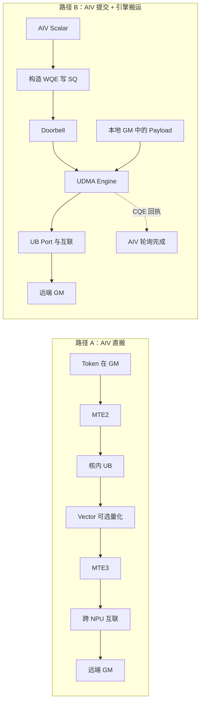

# 昇腾 EP 通信的两条硬件路径：AIV 直搬与 Jetty + UDMA

> **为什么写这篇**：MoE 的 Dispatch / Combine 里，AIV 有时自己搬数据，有时只提交任务、由通信引擎搬。两种实现常常出现在同一个仓库、同一份 profiling 里，混着看很容易把「控制面下发开销」当成「数据面带宽」，或者反过来把网络带宽当成瓶颈。这篇先把两条路径的边界划清，再分别深入。
>
> **平台边界**：A2/A3 与 950（A5）的通信抽象不同。公开资料里，A3 超节点展示了 AIV 通过映射后的远端地址做内存语义访问；950 上除了 UB Memory 同步语义，还多了 URMA / Jetty 的异步网络语义路径。CANN 的 `MoeDistributeDispatch` 系列算子里，`commType` 当前只支持 URMA（`2`），可见这条路径已是 950 上 EP 通信的主干。具体能力以芯片与 CANN 版本为准，本文不做跨平台统一断言。

## 目录

- [一句话版本](#一句话版本)
- [先分层：三个不同的问题](#先分层三个不同的问题)
- [两条路径的形状](#两条路径的形状)
- [最容易混淆的六组概念](#最容易混淆的六组概念)
- [什么时候哪条路径占优](#什么时候哪条路径占优)
- [文档地图](#文档地图)
- [证据等级](#证据等级)

## 一句话版本

- **路径 A（AIV 直搬）**：AIV 既安排搬运，也亲自搬。Payload 必然过核内 UB，走 MTE2 读入、MTE3 写出。
- **路径 B（AIV 提交 + 引擎搬运）**：AIV 只安排搬运。它构造 WQE、敲 Doorbell、收 CQE，Payload 由 UDMA 从 GM 直接搬到远端 GM。
- 两条路径共用同一个 AIV 编程模型和同一张互联网络，差别只在**谁搬 Payload**。这也直接决定了 profiling 时该盯 MTE，还是盯 WQE 下发速率。

## 先分层：三个不同的问题

把「AIV 做通信」当成一件事，是最常见的误解来源。它至少包含三层，每层的瓶颈、优化手段和观测指标都不一样：

| 层次 | 谁在动数据 | 典型硬件 | 对应文档 |
|---|---|---|---|
| 核内数据搬运 | AIV 与 GM 之间 | MTE2 / MTE3 / UB | [aiv_mte.md](aiv_mte.md) 第 1～2 节 |
| 跨 NPU 数据传输 | 芯片与芯片之间 | HCCS / UB Bus / RoCE / UDMA | 两篇都涉及 |
| 数据计算与控制 | AIV 内部 | Scalar / Vector | [aiv_mte.md](aiv_mte.md) 第 3～4 节、[jetty_udma.md](jetty_udma.md) 第 3 节 |

分层之后，很多「矛盾」就消失了。例如：

- 路径 A 里，「网络带宽」和「MTE3 带宽」是两个独立上限，最小值决定实际吞吐。
- 路径 B 里，「AIV 写 WQE 的速度」和「UDMA 搬数据的速度」也是两个独立上限，前者常常先撞墙。

所以看到「链路利用率只有 7%，但 Dispatch 就是快不起来」，先别怀疑网卡，回去看下发侧。

## 两条路径的形状

路径 A 的三个特征：

1. Payload 必须经过发送端 AIV 的 UB，因此 UB 容量天然限制了单次搬运的粒度与并发度。
2. MTE2 和 MTE3 与 Vector 是彼此独立的流水，可以重叠，这是「搬运与计算流水化」的硬件基础。
3. AIV 的搬运算力与专家计算的算力是同一份资源，通信抢得越多，计算可用得越少。

路径 B 的三个特征：

1. Payload 不经过 AIV 的 UB，也不占用 MTE2 / MTE3，AIV 只承担描述符、提交和完成处理。
2. 下发能力成为新的独立瓶颈：WQE 构造（Scalar + UB）、搬运到队列（MTE3）、Doorbell、CQE 轮询，任何一环慢都会限制有效带宽。
3. 通信可以做成真正的异步流水：提交即返回，完成靠 CQE 或对端标志位回收。

| 维度 | 路径 A：AIV 直搬 | 路径 B：AIV 提交 + 引擎搬运 |
|---|---|---|
| 控制方 | AIV | AIV |
| Payload 搬运方 | MTE2 / MTE3 | UDMA（也可能是 RDMA、SDMA 引擎） |
| Payload 是否过 AIV UB | 是 | 否（但量化、打包、聚合等前后处理通常仍要过） |
| 通信队列 | MTE 指令流水 | Jetty 的 SQ / CQ |
| 队列推进方式 | 指令级同步 | WQE + Doorbell |
| 完成回收 | MTE 同步机制、标志位 | CQE 轮询、对端状态位 |
| AIV 主要开销 | 搬运完整数据 | 构造 WQE、提交、收完成 |
| 典型受限点 | UB 容量、MTE 带宽 | WQE 下发速率、SQ 深度、链路 |

## 最容易混淆的六组概念

| 概念对 | 区别 | 一句话记法 |
|---|---|---|
| UB（Unified Buffer）与 UB（Unified Bus） | 前者是 AIV 核内 SRAM，后者是芯片间互联体系，两者没有关系 | 小 UB 在核里，大 UB 在机柜里 |
| Jetty 与 QP | 都是通信端点，但 Jetty 属于 URMA，QP 属于 RDMA / RoCE | 角色相同，协议不同 |
| URMA 与 UDMA | URMA 是统一远端内存访问的机制与接口，UDMA 是执行搬运的硬件引擎 | 一个说「怎么访问」，一个负责「搬」 |
| Segment 与 MR | 都是注册给通信域、允许对端访问的内存段，字段和凭证不同 | 名字不同，作用类似 |
| MTE 直搬与「AIV 直驱」 | 前者由 MTE 搬 Payload，后者由 AIV 提交任务、引擎搬 Payload | 司机与调度员的区别 |
| Jetty 数量与引擎数量 | 前者是逻辑端点数，后者是物理执行资源数 | 多开窗口不等于多买货车 |

其中「AIV 直驱」这个词在官方文档里是明确术语：`HcclChannelAcquire` 的约束里就写着「AIV 直驱 URMA 场景下，本端与远端参与交换的内存数量必须一致」。所以「AIV 直驱」= AIV 作为发起引擎，不等于 AIV 自己搬数据。

## 什么时候哪条路径占优

| 场景特征 | 更可能的赢家 | 原因 |
|---|---|---|
| 单包极小、时延敏感（逐 token 的 decode） | 路径 A | 省掉 WQE 往返与队列调度，AIV 直接写远端内存 |
| 单包中等、消息量大 | 路径 B | Payload 不过 UB，AIV 的搬运算力被释放出来 |
| 单包大（几十 KiB 以上） | 路径 B | 引擎搬运带宽高，且不占 AIV 流水 |
| AIV 算力紧张（量化、激活、聚合都重） | 路径 B | Vector 与 MTE 留给计算 |
| 需要跨超节点、跨机 | 路径 B（URMA / RoCE） | 内存语义的远端映射有范围限制 |
| 需要与 GEMM 深度重叠 | 两者都可，看流水设计 | 路径 B 的完成回收更容易异步化 |

但这不是二选一。同一个算子可以两条路径并存：

- MegaMoE 的属性 `topoType` 明确区分 `0 = MTE 拓扑` 与 `1 = URMA 跨超拓扑`，约束也随之不同（例如 `hidden` 在 MTE 拓扑下要求 64 的倍数，URMA 跨超拓扑下要求 1024 的倍数）。
- DeepEP-Ascend 社区 PR #12 提议在 EP128、每 rank batch ≤ 32 时改走 MTE 直写，说明小包场景下 MTE 路径仍有竞争力。
- MoonEP 的 NPU 后端数据面同时支持 MTE 与 URMA/UDMA，按场景选路。

结论是：**先量清瓶颈在哪一层，再选路径**，而不是先认定某条路径更先进。

## 文档地图

| 文档 | 内容 | 适合什么时候读 |
|---|---|---|
| [aiv_mte.md](aiv_mte.md) | AIV 硬件分工、远端访问的 Push / Pull、Dispatch 与 Combine 的完整数据流、UB 与 MTE 瓶颈、流水重叠、Profiling 判据 | 分析「AIV 自己搬」的实现，或怀疑 MTE / UB 受限 |
| [jetty_udma.md](jetty_udma.md) | Jetty 与 UDMA / URMA 的关系、与 RDMA QP 的对照、一次通信的控制流与数据流、多 Jetty、Issue 受限的带宽模型 | 分析「AIV 提交、引擎搬」的实现，或怀疑下发速率受限 |
| [../ep.md](../ep.md) | 昇腾 EP 通信库、算子与框架调度的仓库级调研 | 需要定位具体实现落在哪个仓库 |
| [../../UB/Jetty.md](../../UB/Jetty.md) | Jetty 的对象模型、SQE / CQE、超时与排错地图 | 需要 Jetty 的机制细节和排错步骤 |
| [../../UB/HCCL_HCOMM.md](../../UB/HCCL_HCOMM.md) | HCCL 与 HCOMM 在通信流程中的分工 | 想弄清「谁建 Jetty、谁写工单」 |

## 证据等级

本文区分三档证据，读的时候请留意：

- **官方文档明确记载**：AIV 作为通信引擎的低时延定位与「需要多个 Vector 核才能打满带宽」的约束、`commType` 的三种取值（AICPU-SDMA / CCU / URMA）、`topoType` 的 MTE / URMA 拓扑、AIV 直驱 URMA、950 的 64 个 UB jetty、URMA 的 Jetty SQE/CQE 语义。均可在本机 CANN 知识库的归档文档中查到。
- **论文与源码观察**：CloudMatrix384 的 AIV-Direct 与 FusedDispatch 三级流水、SQE 实际尺寸（96 B 占两个 64 B 槽位）、状态标志位模式等。属于实现细节，不保证跨版本稳定。
- **工程推断**：物流类比、224 倍的搬运量比值、Issue 受限的带宽估算、路径选择建议。这些是分析框架，不是规范条文，也没有对应的实测数据。

---

*两篇深入文档可以独立阅读；如果只想知道「为什么代码里既有 Jetty 又有 UB 和 MTE3」，直接看 [jetty_udma.md](jetty_udma.md) 第四节。*
